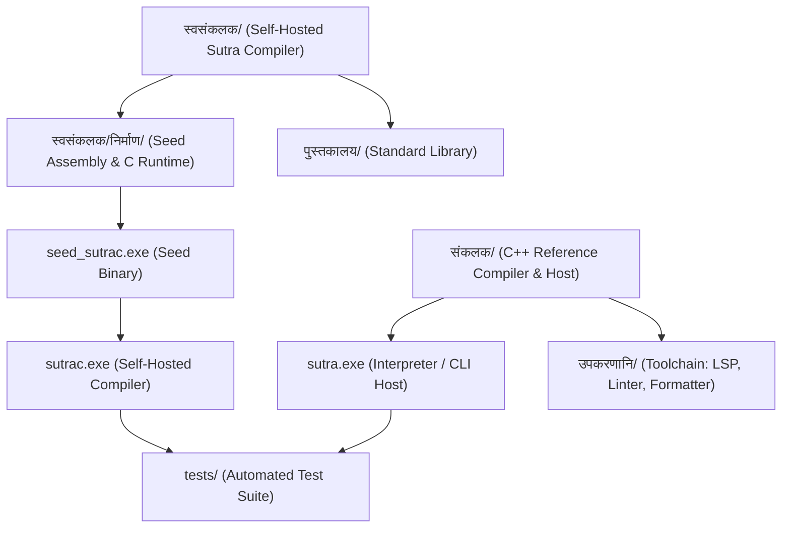

# सूत्र (Sutra) — Repository Inventory & Directory Classification

**Date**: 2026-09-01  
**Audit Baseline**: Commit `34e5557` + working tree audit

---

## 1. Top-Level Directory Inventory

| Directory | Purpose | Total Files | Total Size | Primary Content | Status & Classification |
| :--- | :--- | :--- | :--- | :--- | :--- |
| **`संकलक/`** | C++ Reference Compiler, Interpreter & CLI Driver | 59 | ~0.53 MB | C++17 source (`.cpp`) and headers (`.hpp`) | **Required (Core C++ Host)** |
| **`स्वसंकलक/`** | Self-Hosted Sutra Compiler (written in Sutra) | 57 | ~11.54 MB | Sutra source (`.सूत्र`), executables (`.exe`), assembly (`.s`) | **Required (Core Self-Host)** |
| **`स्वसंकलक/निर्माण/`** | Seed bootstrap artifacts & runtime modules | 8 | ~3.82 MB | Frozen seed assembly (`मूल_संकलन.s`), `sutra_runtime.c`, runtime `.s` | **Required (Seed Bootstrap)** |
| **`पुस्तकालय/`** | Standard Library (15 modules) | 16 | ~0.13 MB | Sutra standard library modules (`.सूत्र`) + README.md | **Required (Stdlib)** |
| **`उपकरणानि/`** | Developer Toolchain (LSP, Linter, Formatter, Debugger, etc.) | 14 | ~0.08 MB | C++ tool source files, headers, CLI wrappers | **Required (Toolchain)** |
| **`tests/`** | Primary test suite (18 feature categories) | 144 | ~0.17 MB | Sutra test programs (`.सूत्र`), negative tests, LSP test | **Required (Test Suite)** |
| **`परीक्षणानि/`** | C++ unit tests & native phase 5 tests | 8 | ~0.10 MB | `test_sutra.cpp`, `test_toolchain.cpp`, OOP class tests | **Required (C++ Unit Tests)** |
| **`docs/`** | Subsystem and architecture technical docs | 13 | ~0.09 MB | Subsystem markdown specifications | **Required (Documentation)** |
| **`document/`** | Language specification & master book chapters | 49 | ~0.42 MB | Comprehensive language reference, tutorials, and specs | **Required (Language Reference)** |
| **`दस्तावेजाः/`** | Sanskrit language specification draft | 1 | ~0.01 MB | `भाषा_विनिर्देषः.md` | **Required (Documentation)** |
| **`examples/`** | Example Sutra programs | 12 | ~0.01 MB | Sutra usage examples (`.सूत्र`) | **Required (Examples)** |
| **`उदाहरणानि/`** | Sanskrit/Hindi example programs | 6 | ~0.01 MB | Real-world example applications (`.सूत्र`) | **Required (Examples)** |
| **`external/`** | Third-party header-only dependencies | 1 | ~0.87 MB | `nlohmann/json.hpp` (JSON-RPC for LSP) | **Required (Dependency)** |
| **`build/`** | C++ build directory | 31 | ~17.18 MB | Object files (`.o`) and build targets | **Generated (Build Artifacts)** |
| **`.cache/`** | Clangd language server index cache | 758 | ~28.40 MB | Clangd C++ symbol index files (`.idx`) | **Generated (Tool Cache)** |
| **`.vscode/`** | VS Code workspace configuration | 2 | ~0.00 MB | `settings.json`, `tasks.json` | **Required (IDE Config)** |
| **`निरॠमाण/`** | Double-encoded Mojibake folder of `निर्माण` | 13 | ~3.25 MB | Stale bootstrap copies from Aug 27–30 | **Historical / Corrupted Duplicate** |
| **`निॠमाण/`** | Double-encoded Mojibake folder of `नि्माण` | 13 | ~3.25 MB | Identical file hashes to `निरॠमाण/` | **Historical / Corrupted Duplicate** |
| **`सॠवसंकलक/`** | Double-encoded Mojibake folder of `स्वसंकलक` | 26 | ~6.51 MB | Contains corrupted subdirectories | **Historical / Corrupted Duplicate** |
| **`नि्माण/`** (root) | Typo folder (missing 'r' repha in Devanagari) | 10 | ~3.11 MB | Stale duplicate of seed bootstrap files | **Historical / Typo Duplicate** |
| **`स्वसंकलक/नि्माण/`** | Typo folder inside `स्वसंकलक/` | 10 | ~3.11 MB | Stale duplicate of seed bootstrap files | **Historical / Typo Duplicate** |

---

## 2. Root Files Inventory & Classification

| Filename | Size (bytes) | Description | Classification |
| :--- | :--- | :--- | :--- |
| `README.md` | 11,110 | Repository README and project introduction | **Required (Documentation)** |
| `architecture.md` | 9,768 | Architecture overview and component model | **Required (Documentation)** |
| `design.md` | 4,300 | Design principles and language philosophy | **Required (Documentation)** |
| `memory.md` | 6,354 | Memory model and GC design document | **Required (Documentation)** |
| `phases.md` | 7,285 | Project milestone roadmap and phase tracker | **Required (Documentation)** |
| `prd.md` | 8,364 | Product requirements document | **Required (Documentation)** |
| `progress.txt` | 6,126 | Engineering milestone progress log | **Required (Historical Log)** |
| `rules.md` | 7,283 | Coding guidelines and invariant rules | **Required (Documentation)** |
| `bootstrap.ps1` | 4,608 | Self-hosted compiler bootstrap script (no C++ host) | **Required (Build Script)** |
| `build.ps1` | 7,292 | C++ host multi-target build script | **Required (Build Script)** |
| `build.bat` | 1,385 | Windows CMD legacy build script | **Required (Build Script)** |
| `run_tests.ps1` | 13,135 | Primary automated test runner and parity validator | **Required (Test Script)** |
| `verify_compiler.ps1` | 6,210 | Native compiler verification script | **Required (Test Script)** |
| `verify_compiler_self.ps1` | 6,564 | Self-hosted compiler verification script | **Required (Test Script)** |
| `verify_intrinsics.ps1` | 2,178 | Low-level OS/memory intrinsic verification | **Required (Test Script)** |
| `verify_ir.ps1` | 2,018 | Self-hosted IR pipeline test runner | **Required (Test Script)** |
| `verify_emit.sh` | 5,252 | Split-pipeline emitter end-to-end verification | **Required (Test Script)** |
| `verify_emit_full.sh` | 2,702 | Full emission end-to-end verification | **Required (Test Script)** |
| `verify_ir_selfhost.sh` | 3,481 | Self-hosted fixed-point verification script | **Required (Test Script)** |
| `.clangd` | 210 | Clangd compile flags and language server config | **Required (IDE Config)** |
| `.gitattributes` | 593 | Git line-ending (CRLF/LF) and UTF-8 attributes | **Required (Git Config)** |
| `.gitignore` | 1,944 | Git ignore rules | **Required (Git Config)** |
| `sutra.exe` | 4,090,884 | Compiled C++ host compiler / interpreter / REPL | **Generated Executable** |
| `sutrac.exe` | 866,729 | Compiled self-hosted Sutra native compiler | **Generated Executable** |
| `sutrac_v2.exe` | 865,423 | Previous generation self-hosted compiler | **Historical Executable** |
| `seed_sutrac.exe` | 863,887 | Bootstrap seed compiler built from `मूल_संकलन.s` | **Generated Executable** |
| `sutra_formatter.exe` | 4,902,133 | Source code formatter executable | **Generated Executable** |
| `sutra_linter.exe` | 4,901,065 | Static analysis linter executable | **Generated Executable** |
| `sutra_debugger.exe` | 4,900,773 | Interactive debugger executable | **Generated Executable** |
| `sutra_pkgmgr.exe` | 4,915,665 | Package manager executable | **Generated Executable** |
| `sutra_build.exe` | 4,908,781 | Build system executable | **Generated Executable** |
| `sutra_benchmark.exe` | 4,921,649 | Micro-benchmark runner executable | **Generated Executable** |
| `sutra_lsp.exe` | 7,639,734 | Language server protocol executable | **Generated Executable** |
| `test_sutra.exe` | 4,381,433 | C++ core unit test executable | **Generated Executable** |
| `test_toolchain.exe` | 5,017,892 | Toolchain test executable | **Generated Executable** |
| `test_lsp_integration.exe`| 7,004,674 | LSP integration test executable | **Generated Executable** |
| `test_native_poc.exe` | 736,213 | Native code generation proof-of-concept binary | **Historical Executable** |
| `sutra_runtime_prebuilt.o`| 29,003 | Precompiled C runtime object | **Generated Object** |
| `sutra_alloc.o` | 14,159 | Precompiled Sutra memory allocator object | **Generated Object** |
| `sutra_srt.o` | 42,139 | Precompiled Sutra core runtime object | **Generated Object** |
| `sutra_floor.o` | 951 | Precompiled OS floor assembly object | **Generated Object** |
| `alloc_temp.s` / `srt_temp.s` / `sfloor_temp.s` | various | Temporary ASCII assembly files generated during compilation | **Temporary Artifacts** |
| `sutra_native_temp.s` / `.o` / `.exe` | various | Scratch compilation targets from last `sutrac.exe` run | **Temporary Artifacts** |
| `_drv.s` / `_tal.s` / `_v3.s` | various | Scratch debugging assembly files | **Temporary Artifacts** |
| `_floortest.exe` | 6,347 | Scratch test executable | **Temporary Artifacts** |
| `dbg_vk.txt` / `out.log` / `output.txt` | 0–74 | Scratch logs | **Temporary Artifacts** |
| `न.सूत्र` / `नमस्ते.सूत्र` / `परीक्षण.सूत्र` / `परीक्षण_इनपुट.सूत्र` / `पूर्ण_परीक्षण.सूत्र` | various | Root test and example programs | **Required (Root Tests)** |

---

## 3. Evidence-Based Directory Mapping & Relationships

