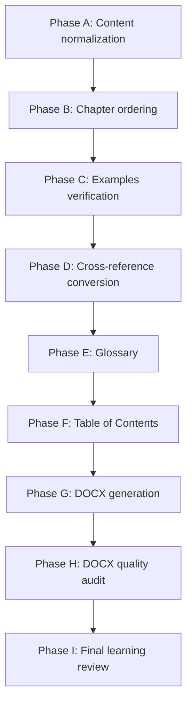

# Master Book Plan: सूत्र दर्शन (Sutra Darshana)

This planning document outlines the design structure, chapter mapping, formatting guidelines, and execution phases to consolidate the 45 canonical Sutra documentation files into a single educational book.

---

## 1. Title & Metadata Proposals

*   **Proposed Title**: **सूत्र दर्शन (Sutra Darshana)**
*   **Proposed Subtitle**: *एक पूर्ण प्रोग्रामिंग भाषा, रनटाइम और स्व-संकलक निर्देशिका (A Complete Programming Language, Runtime, and Self-Compiler Guide)*
*   **Core Objective**: Serve as a progressive educational guide that teaches the reader how to write programs in Sutra, understand the language grammar, build compilation pipelines, analyze garbage collectors, and write self-hosting compilers.

---

## 2. Chapter Structure Template

Each chapter in the book will follow this learning-focused layout:

```text
# [अध्याय संख्या] — [अध्याय का नाम (Chapter Name)]

## इस अध्याय में क्या सीखेंगे (Learning Objectives)
- [Objective 1]
- [Objective 2]

## पूर्व-ज्ञान (Prerequisites)
- [References to preceding chapters]

## मुख्य अवधारणा (Core Concept)
- [Plain language introduction explaining the concepts]
- [Bilingual terms: Hindi/Sanskrit terms accompanied by their English equivalents]

## Syntax (वाक्य-विन्यास)
- [Formal Sutra syntax layouts]

## उदाहरण (Examples)
- [Verified Devanagari code examples matching active repository implementations]

## उदाहरण की व्याख्या (Explanation)
- [Line-by-line or logical-block analysis of the code examples]

## नियम (Technical Rules)
- [Formal compiler check constraints, scoping limits, or runtime limits]

## अभ्यास (Exercises)
- [Hands-on tasks and review questions matching compiled test scopes]

## आगे क्या पढ़ें (Next Chapter Reference)
- [Direct link and recommendation to the next chapter]
```

---

## 3. Parts & Chapters Map

The book is structured into **10 Parts** consisting of **45 Chapters**:

### Part I — सूत्र से परिचय (Introduction to Sutra)
*Goal: Understand the philosophical design, Devanagari Unicode enforcements, double-execution paradigms, and workspace drivers setup.*
-   **Chapter 1: Sutra Overview & Map** *(Source: `०१-परिचय/अवलोकन.md`)*
-   **Chapter 2: Workspace Setup & Compiling** *(Source: `१२-शिक्षण/आरंभ_करें.md`)*

### Part II — भाषा की नींव (Foundations of the Language)
*Goal: Learn lexical scanning rules, identifier ranges, constants, primitive data types, variables scopes, and operators.*
-   **Chapter 3: Lexical Structure Specifications** *(Source: `०२-भाषा_विनिर्देश/शाब्दिक_संरचना.md`)*
-   **Chapter 4: Reserved Keywords Catalog** *(Source: `०२-भाषा_विनिर्देश/पहचानकर्ता_और_मुख्यशब्द.md`)*
-   **Chapter 5: Devanagari Unicode Ranges** *(Source: `०२-भाषा_विनिर्देश/यूनिकोड.md`)*
-   **Chapter 6: Numeric & String Constants** *(Source: `०२-भाषा_विनिर्देश/साहित्य.md`)*
-   **Chapter 7: Primitive Type System** *(Source: `०२-भाषा_विनिर्देश/प्रकार.md`)*
-   **Chapter 8: Local Variables Declarations** *(Source: `०२-भाषा_विनिर्देश/चर.md`)*
-   **Chapter 9: Assignments & Expressions** *(Source: `०२-भाषा_विनिर्देश/अभिव्यक्तियाँ.md`)*
-   **Chapter 10: Mathematical Operators Precedence** *(Source: `०२-भाषा_विनिर्देश/संचालक.md`)*
-   **Chapter 11: Statement Blocks and Semicolons** *(Source: `०२-भाषा_विनिर्देश/कथन.md`)*
-   **Chapter 12: Conditional if/else & while Loops** *(Source: `०२-भाषा_विनिर्देश/नियंत्रण_प्रवाह.md`)*

### Part III — वास्तविक प्रोग्राम लिखना (Writing Real Programs)
*Goal: Implement functions, call stack recursion, list buffers, dictionary maps, console input/output, and modules.*
-   **Chapter 13: Function Declarations & Signatures** *(Source: `०२-भाषा_विनिर्देश/कार्य.md`)*
-   **Chapter 14: Function Recursion Frames** *(Source: `०२-भाषा_विनिर्देश/पुनरावर्तन.md`)*
-   **Chapter 15: Lists & Dictionary Literals** *(Source: `०२-भाषा_विनिर्देश/संग्रह.md`)*
-   **Chapter 16: UTF-8 String Indices** *(Source: `०२-भाषा_विनिर्देश/पाठ.md`)*
-   **Chapter 17: Standard Console print/read APIs** *(Source: `०२-भाषा_विनिर्देश/निवेश_निर्गम.md`)*
-   **Chapter 18: Global Helper Mappings** *(Source: `०२-भाषा_विनिर्देश/अंतर्निर्मित.md`)*
-   **Chapter 19: आयात imports and paths** *(Source: `०२-भाषा_विनिर्देश/मापांक.md`)*

### Part IV — उन्नत भाषा (Advanced Language Concepts)
*Goal: Study Object-Oriented class instances, exceptions unwinding, formal grammars, and reference indexes.*
-   **Chapter 20: Object-Oriented Tutorial** *(Source: `१२-शिक्षण/वस्तु_उन्मुख.md`)*
-   **Chapter 21: Classes, Constructors, and Fields** *(Source: `०२-भाषा_विनिर्देश/वस्तु_उन्मुख.md`)*
-   **Chapter 22: Exceptions try-catch Propagation** *(Source: `०२-भाषा_विनिर्देश/अपवाद.md`)*
-   **Chapter 23: Specifications EBNF Grammars** *(Source: `०२-भाषा_विनिर्देश/व्याकरण.md`)*
-   **Chapter 24: Reference EBNF Grammar Catalog** *(Source: `०३-भाषा_संदर्भ/व्याकरण.md`)*
-   **Chapter 25: OOP Scope Field Offsets** *(Source: `०३-भाषा_संदर्भ/वस्तु_उन्मुख_क्षेत्र.md`)*

### Part V — Standard Library (मानक पुस्तकालय)
*Goal: Walk through the standard library math module, dynamic lists functions, and console streams API.*
-   **Chapter 26: math module (pow, round, sqrt) APIs** *(Source: `०४-मानक_पुस्तकालय/गणित.md`)*
-   **Chapter 27: lists & dictionaries APIs** *(Source: `०४-मानक_पुस्तकालय/संग्रह.md`)*
-   **Chapter 28: Stdin/Stdout file systems** *(Source: `०४-मानक_पुस्तकालय/निवेश_निर्गम.md`)*

### Part VI — Sutra Compiler (सूत्र संकलक)
*Goal: Trace the 6-stage compiler pipeline, frontend token parsing, AST building, and backend code lowerings.*
-   **Chapter 29: Compilation Pipeline Workflow** *(Source: `०५-संकलक/पाइपलाइन.md`)*
-   **Chapter 30: Token Scanner & AST Frontend** *(Source: `०५-संकलक/अग्र_भाग.md`)*
-   **Chapter 31: Transpiled lowerings & Linker** *(Source: `०५-संकलक/कोड_जनन.md`)*

### Part VII — Runtime & Memory (रनटाइम और स्मृति)
*Goal: Understand memory layouts, heap allocations alignment, setjmp stack try-catch frames, and garbage collection.*
-   **Chapter 32: Allocation alignment headers** *(Source: `०७-अनुष्ठान_प्रणाली/स्मृति_मॉडल.md`)*
-   **Chapter 33: Mark-and-sweep GC shadow stack** *(Source: `०७-अनुष्ठान_प्रणाली/कचरा_संग्रह.md`)*

### Part VIII — Toolchain & Testing (टूलचेन और परीक्षण)
*Goal: Configure packages manifests, implement formatter spacing rules, execute linter checks, and run LSP services.*
-   **Chapter 34: Manifest Package Driver** *(Source: `०८-उपकरण_शृंखला/चालक.md`)*
-   **Chapter 35: Formatting, Static Linters, and LSP** *(Source: `०८-उपकरण_शृंखला/सेवाएँ.md`)*
-   **Chapter 36: Regression Parity Test Suites** *(Source: `०९-परीक्षण/संकलन_परीक्षण.md`)*
-   **Chapter 37: Self-compiling code checks** *(Source: `०९-परीक्षण/सत्यापन.md`)*

### Part IX — Self-Hosting (स्व-संकलन)
*Goal: Map compiler self-hosting milestones, zero-English requirements, and bootstrap compiler generations.*
-   **Chapter 38: Self-compiling milestones convergence** *(Source: `०६-स्वसंकलन/योजना_पथ.md`)*
-   **Chapter 39: Gen 1 -> Gen 3 compilers cycle** *(Source: `०६-स्वसंकलन/बूटस्ट्रैप.md`)*

### Part X — Architecture & Deep Technical (वास्तुकला और तकनीकी गहराइयाँ)
*Goal: Walk through the software components architecture map, design ADR records, parser environments, and GC mark phases.*
-   **Chapter 40: Component diagrams layout** *(Source: `१०-वास्तुकला/घटक.md`)*
-   **Chapter 41: ADR Git Index & dynamic offsets** *(Source: `१०-वास्तुकला/वास्तु_निर्णय.md`)*
-   **Chapter 42: Sanskrit warnings diagnostics** *(Source: `११-निदान/निदान.md`)*
-   **Chapter 43: Self-hosted compiler symbols scope** *(Source: `१३-गहन_तकनीकी/संकलक.md`)*
-   **Chapter 44: setjmp exceptions & heap pointer checks** *(Source: `१३-गहन_तकनीकी/अनुष्ठान_प्रणाली.md`)*
-   **Chapter 45: Specification Map formal overview** *(Source: `०२-भाषा_विनिर्देश/अवलोकन.md`)*

---

## 4. Source-to-Chapter Mapping Table

This table maps all 45 canonical documentation files to ensure 100% preservation coverage:

| Source Document | Book Part | Chapter | Content Preserved |
|---|---|---|---|
| `०१-परिचय/अवलोकन.md` | Part I | Chapter 1 | 100% (Core Overview & Paradigms) |
| `१२-शिक्षण/आरंभ_करें.md` | Part I | Chapter 2 | 100% (Workspace & Setup Guides) |
| `०२-भाषा_विनिर्देश/शाब्दिक_संरचना.md` | Part II | Chapter 3 | 100% (Unicode scanners, comments) |
| `०२-भाषा_विनिर्देश/पहचानकर्ता_और_मुख्यशब्द.md` | Part II | Chapter 4 | 100% (26 reserved keywords list) |
| `०२-भाषा_विनिर्देश/यूनिकोड.md` | Part II | Chapter 5 | 100% (Devanagari range constraints) |
| `०२-भाषा_विनिर्देश/साहित्य.md` | Part II | Chapter 6 | 100% (Boolean, numeric, text constants) |
| `०२-भाषा_विनिर्देश/प्रकार.md` | Part II | Chapter 7 | 100% (Primitives variables type alignment) |
| `०२-भाषा_विनिर्देश/चर.md` | Part II | Chapter 8 | 100% (Shadowing rules & local scopes) |
| `०२-भाषा_विनिर्देश/अभिव्यक्तियाँ.md` | Part II | Chapter 9 | 100% (Assignments expressions checks) |
| `०२-भाषा_विनिर्देश/संचालक.md` | Part II | Chapter 10 | 100% (Math logical precedence hierarchy) |
| `०२-भाषा_विनिर्देश/कथन.md` | Part II | Chapter 11 | 100% (Block statements & semicolons rules) |
| `०२-भाषा_विनिर्देश/नियंत्रण_प्रवाह.md` | Part II | Chapter 12 | 100% (Branch structures and iteration loops) |
| `०२-भाषा_विनिर्देश/कार्य.md` | Part III | Chapter 13 | 100% (Signatures declaration mappings) |
| `०२-भाषा_विनिर्देश/पुनरावर्तन.md` | Part III | Chapter 14 | 100% (Recursive stack frames boundaries) |
| `०२-भाषा_विनिर्देश/संग्रह.md` | Part III | Chapter 15 | 100% (List lists and dictionaries mappings) |
| `०२-भाषा_विनिर्देश/पाठ.md` | Part III | Chapter 16 | 100% (UTF-8 arrays lengths and indexing) |
| `०२-भाषा_विनिर्देश/निवेश_निर्गम.md` | Part III | Chapter 17 | 100% (Write / read operations reference) |
| `०२-भाषा_विनिर्देश/अंतर्निर्मित.md` | Part III | Chapter 18 | 100% (Built-in global mapping API list) |
| `०२-भाषा_विनिर्देश/मापांक.md` | Part III | Chapter 19 | 100% (import path resolution scopes) |
| `१२-शिक्षण/वस्तु_उन्मुख.md` | Part IV | Chapter 20 | 100% (Objects basic OOP introduction) |
| `०२-भाषा_विनिर्देश/वस्तु_उन्मुख.md` | Part IV | Chapter 21 | 100% (Classes, स्व, रचना heap layout) |
| `०२-भाषा_विनिर्देश/अपवाद.md` | Part IV | Chapter 22 | 100% (Exception try-catch setjmp propagation) |
| `०२-भाषा_विनिर्देश/व्याकरण.md` | Part IV | Chapter 23 | 100% (Formal parser EBNF parser matches) |
| `०३-भाषा_संदर्भ/व्याकरण.md` | Part IV | Chapter 24 | 100% (Formal reference EBNF production rules) |
| `०३-भाषा_संदर्भ/वस्तु_उन्मुख_क्षेत्र.md` | Part IV | Chapter 25 | 100% (Dynamic property index offsets tables) |
| `०४-मानक_पुस्तकालय/गणित.md` | Part V | Chapter 26 | 100% (Math module pow, sqrt signatures) |
| `०४-मानक_पुस्तकालय/संग्रह.md` | Part V | Chapter 27 | 100% (Lists search operations APIs) |
| `०४-मानक_पुस्तकालय/निवेश_निर्गम.md` | Part V | Chapter 28 | 100% (Files / console streams specifications) |
| `०५-संकलक/पाइपलाइन.md` | Part VI | Chapter 29 | 100% (Six-stage compilations driver workflow) |
| `०५-संकलक/अग्र_भाग.md` | Part VI | Chapter 30 | 100% (Lexer token maps and parsing frontend) |
| `०५-संकलक/कोड_जनन.md` | Part VI | Chapter 31 | 100% (Assembly transpilations and link codes) |
| `०७-अनुष्ठान_प्रणाली/स्मृति_मॉडल.md` | Part VII | Chapter 32 | 100% (Allocation header allocations layout) |
| `०७-अनुष्ठान_प्रणाली/कचरा_संग्रह.md` | Part VII | Chapter 33 | 100% (Mark-and-sweep collections shadow stack) |
| `०८-उपकरण_शृंखला/चालक.md` | Part VIII | Chapter 34 | 100% (Driver package configurations settings) |
| `०८-उपकरण_शृंखला/सेवाएँ.md` | Part VIII | Chapter 35 | 100% (Formatter rules, Linters warnings, LSP) |
| `०९-परीक्षण/संकलन_परीक्षण.md` | Part VIII | Chapter 36 | 100% (Regression testing suite structure) |
| `०९-परीक्षण/सत्यापन.md` | Part VIII | Chapter 37 | 100% (compiler verification commands guide) |
| `०६-स्वसंकलन/योजना_पथ.md` | Part IX | Chapter 38 | 100% (Self-hosting milestones constraints) |
| `०६-स्वसंकलन/बूटस्ट्रैप.md` | Part IX | Chapter 39 | 100% (Gen 1 to Gen 3 compiler generations) |
| `१०-वास्तुकला/घटक.md` | Part X | Chapter 40 | 100% (High level software diagrams layout) |
| `१०-वास्तुकला/वास्तु_निर्णय.md` | Part X | Chapter 41 | 100% (Pure Git policies & class property offsets) |
| `११-निदान/निदान.md` | Part X | Chapter 42 | 100% (Hindi diagnostic recovery syntax lists) |
| `१३-गहन_तकनीकी/संकलक.md` | Part X | Chapter 43 | 100% (symbols table scoping scopes comparison) |
| `१३-गहन_तकनीकी/अनुष्ठान_प्रणाली.md` | Part X | Chapter 44 | 100% (setjmp exception registers & mark traversals) |
| `०२-भाषा_विनिर्देश/अवलोकन.md` | Part X | Chapter 45 | 100% (Language specification mapping summary) |

---

## 5. Appendices, Glossary, and Index Plan

To support full systems-level navigation, the final book will include:
*   **Appendix A: EBNF Parsing Grammar Index**: A single consolidated EBNF grammar production guide.
*   **Appendix B: Standalone Verification Commands Reference**: Complete list of driver parameters, formatting hooks, testing scripts, and LSP commands.
*   **Glossary**: Sanskrit/Hindi Devanagari programming terms side-by-side with standard English computer science equivalents (e.g. `स्वसंकलक` - *Self-Hosted Compiler*, `अक्षर-वाचक` - *Lexer Scanner*, `स्मृति संग्रहक` - *Garbage Collector*).
*   **Index**: Comprehensive cross-reference index linking keywords, function signatures, and modules.

---

## 6. Final Book Generation Plan

The compilation and distribution cycle of the master book will execute in **9 progressive phases**:



-   **Phase A — Content normalization**: Strip out ad-hoc headers and standardize bilingual formatting.
-   **Phase B — Chapter ordering**: Align files into the 10 Parts learning order.
-   **Phase C — Examples verification**: Audit every Devanagari code snippet to ensure it runs correctly on the active compiled compiler version.
-   **Phase D — Cross-reference conversion**: Translate raw markdown links to intra-book page offsets.
-   **Phase E — Glossary**: Index terms across Devanagari identifiers.
-   **Phase F — Table of Contents**: Generate structural sections hierarchy.
-   **Phase G — DOCX generation**: Transpile markdown documents into structured layout DOCX templates.
-   **Phase H — DOCX quality audit**: Verify margins, fonts, and inline tables page borders.
-   **Phase I — Final learning review**: Conduct readability pass.
