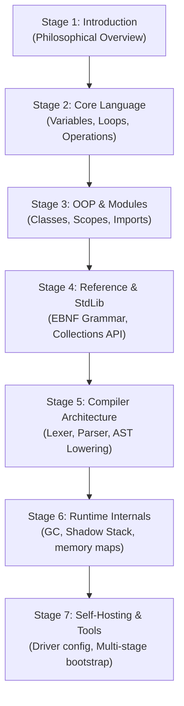

# Sutra Documentation Hub

Welcome to the documentation system for the **Sutra (सूत्र)** programming language ecosystem. Sutra is a general-purpose programming language designed around Sanskrit/Hindi-first terminology and native Devanagari syntax.

---

## Recommended Learning Path

This section guides you through a step-by-step reading progression to learn the Sutra language, standard library APIs, compiler construction, and runtime garbage collection internals.

### Stage 1 — भाषा से परिचय (Introduction to Language)
*Goal: Understand the philosophy, Devanagari syntax, double-execution interpreter/compiler paradigms, and setup your local workspace.*
-   **Introduction**: [Sutra Overview](०१-परिचय/अवलोकन.md) — Fundamental values, zero-English execution paradigms.
-   **Getting Started**: [Workspace Setup Guide](१२-शिक्षण/आरंभ_करें.md) — Running the compiler driver, building scripts.

### Stage 2 — भाषा की मूल संरचना (Basic Language Structure)
*Goal: Learn syntax basics, variable definitions, operators precedence, condition controls, and loops.*
-   **Language Specification Overview**: [Formal Specifications Scope](०२-भाषा_विनिर्देश/अवलोकन.md) — Document schemas structure.
-   **Lexical Structure**: [Lexical and scanning rules](०२-भाषा_विनिर्देश/शाब्दिक_संरचना.md) — Spaces, tabs, Unicode ranges.
-   **Identifiers & Keywords**: [Keywords Catalog](०२-भाषा_विनिर्देश/पहचानकर्ता_और_मुख्यशब्द.md) — List of the 26 reserved words.
-   **Unicode range**: [Devanagari Unicode enforcements](०२-भाषा_विनिर्देश/यूनिकोड.md) — Code-points scanning range.
-   **Literals**: [Literals constraints](०२-भाषा_विनिर्देश/साहित्य.md) — Integers, strings, booleans, arrays formatting.
-   **Types**: [Type Annotations & Alignment](०२-भाषा_विनिर्देश/प्रकार.md) — Core primitive types.
-   **Variables**: [Variables & Scopes](०२-भाषा_विनिर्देश/चर.md) — Declarations and mutation lifetimes.
-   **Expressions**: [Expressions semantics](०२-भाषा_विनिर्देश/अभिव्यक्तियाँ.md) — Assignments, arithmetic.
-   **Operators**: [Precedence & Associativity](०२-भाषा_विनिर्देश/संचालक.md) — Math and logical precedence table.
-   **Statements**: [Statements blocks](०२-भाषा_विनिर्देश/कथन.md) — Block boundaries and semicolons.
-   **Control Flow**: [Branching & Loops](०२-भाषा_विनिर्देश/नियंत्रण_प्रवाह.md) — `यदि` conditions and `यावत्` loops.

### Stage 3 — उन्नत भाषा विशेषताएँ (Advanced Language Features)
*Goal: Declare functions, implement recursion stacks, define object classes, catch exceptions, and link multi-file imports.*
-   **Functions**: [Function Declarations](०२-भाषा_विनिर्देश/कार्य.md) — Parameter bindings.
-   **Recursion**: [Recursion Stack boundaries](०२-भाषा_विनिर्देश/पुनरावर्तन.md) — Call stacks.
-   **Collections**: [Lists & Dictionaries](०२-भाषा_विनिर्देश/संग्रह.md) — Dynamic list buffers, string-keyed dictionaries.
-   **Strings**: [String handling APIs](०२-भाषा_विनिर्देश/पाठ.md) — UTF-8 byte array allocations.
-   **OOP Tutorial**: [Object-Oriented Tutorial](१२-शिक्षण/वस्तु_उन्मुख.md) — Basic introduction to classes.
-   **OOP Specification**: [Classes, constructors, fields](०२-भाषा_विनिर्देश/वस्तु_उन्मुख.md) — Object layouts.
-   **Exceptions**: [Try-catch unwinding](०२-भाषा_विनिर्देश/अपवाद.md) — Structured exception mechanics.
-   **Modules**: [आयात import statements](०२-भाषा_विनिर्देश/मापांक.md) — Relative path inclusions.
-   **I/O**: [Input/Output APIs](०२-भाषा_विनिर्देश/निवेश_निर्गम.md) — Stdio prints and file writing.
-   **Built-ins**: [Global Standard built-ins](०२-भाषा_विनिर्देश/अंतर्निर्मित.md) — Runtime helper mappings.

### Stage 4 — व्याकरण और सन्दर्भ (Grammar & Language Reference)
*Goal: Explore formal grammatical production rules, object memory layouts, and standard library reference manuals.*
-   **Formal Grammar**: [EBNF specifications](०२-भाषा_विनिर्देश/व्याकरण.md) — Syntactic production index.
-   **Reference Grammar**: [Reference production index](०३-भाषा_संदर्भ/व्याकरण.md) — Formal specifications reference.
-   **OOP Scopes**: [OOP properties heap offsets](०३-भाषा_संदर्भ/वस्तु_उन्मुख_क्षेत्र.md) — Pointer offsets.
-   **Math Standard Library**: [Math library manual](०४-मानक_पुस्तकालय/गणित.md) — `वर्गमूल`, `गोल` signatures.
-   **Collections Standard Library**: [Collections helpers](०४-मानक_पुस्तकालय/संग्रह.md) — List indexing algorithms.
-   **I/O Standard Library**: [I/O API signatures](०४-मानक_पुस्तकालय/निवेश_निर्गम.md) — Console streams mapping.

### Stage 5 — संकलक और रनटाइम (Compiler & Runtime Architecture)
*Goal: Study how the compiler tokenizes, parses, lowers to Intermediate Representation (IR), and runs on the memory heap.*
-   **Compilation Pipeline**: [Stages driver workflow](०५-संकलक/पाइपलाइन.md) — Main compiler driver passes.
-   **Lexer & Parser**: [Front-end parsing internals](०५-संकलक/अग्र_भाग.md) — Syntax scanners.
-   **Code Generation**: [IR Lowering & GCC linker](०५-संकलक/कोड_जनन.md) — Target code lowerings.
-   **Memory Model**: [Heap header byte alignments](०७-अनुष्ठान_प्रणाली/स्मृति_मॉडल.md) — String/array header representations.
-   **Garbage Collector**: [Mark-and-sweep root registries](०७-अनुष्ठान_प्रणाली/कचरा_संग्रह.md) — GC shadow stacks.
-   **Diagnostics**: [Diagnostics syntax recovery](११-निदान/निदान.md) — Sanskrit/Hindi compile warnings.

### Stage 6 — टूलचेन और विकास (Toolchain & Developer Guide)
*Goal: Use toolchain services (auto-formatter, static linter, LSP server) and verify the regression test suite.*
-   **Build Driver**: [Manifest package driver](०८-उपकरण_शृंखला/चालक.md) — Manifest dictionary flags.
-   **Toolchain Services**: [LSP, Formatter, Linter](०८-उपकरण_शृंखला/सेवाएँ.md) — Formatting rules.
-   **Testing suite**: [Regression test suites](०९-परीक्षण/संकलन_परीक्षण.md) — Parity validation.
-   **Verification**: [Self-compilation validation](०९-परीक्षण/सत्यापन.md) — Code stability checks.
-   **ADR**: [Git policy & Offsets design decisions](१०-वास्तुकला/वास्तु_निर्णय.md) — Architectural records.
-   **Components**: [Software components layout](१०-वास्तुकला/घटक.md) — High-level layout diagram.

### Stage 7 — स्व-संकलन और तकनीकी विनिर्देश (Self-Hosting & Deep Technical Specs)
*Goal: Analyze self-hosting bootstrap stage compilations and debug low-level runtime stack unwinding internals.*
-   **Self-hosting Roadmap**: [Zero-English compile convergence](०६-स्वसंकलन/योजना_पथ.md) — Milestones mapping.
-   **Bootstrap Stages**: [Multi-stage bootstrap cycle](०६-स्वसंकलन/बूटस्ट्रैप.md) — Stage 1 -> Gen 3 compilers.
-   **Deep Compiler**: [Self-hosted parser logic](१३-गहन_तकनीकी/संकलक.md) — Dynamic symbol scoping.
-   **Deep Runtime**: [setjmp exceptions & hash indexes](१३-गहन_तकनीकी/अनुष्ठान_प्रणाली.md) — GC pointers traversal.

---

## References & Directories
*   **Documentation Roadmap**: [Master checklists](दस्तावेज़ीकरण_योजना.md)
*   **Standard Library reference manual**: [STANDARD_LIBRARY.md](../प्रलेख/STANDARD_LIBRARY.md)
*   **Host Compiler wrapper contribution guide**: [DEVELOPMENT.md](../प्रलेख/DEVELOPMENT.md)
