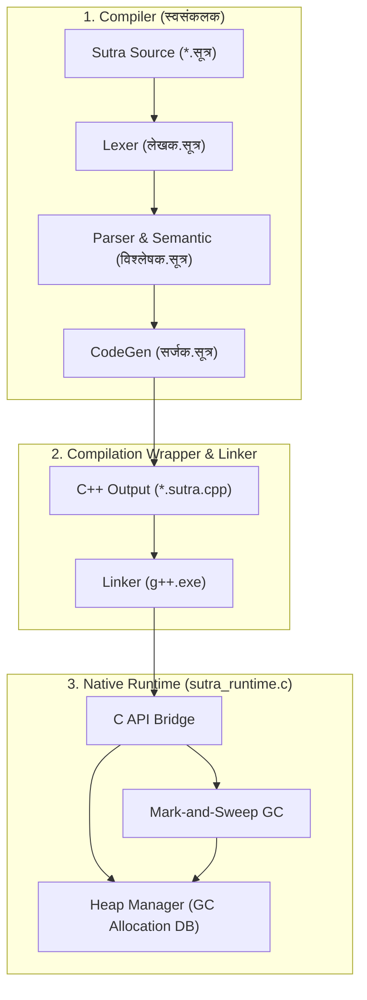

# सूत्र दर्शन
### एक पूर्ण प्रोग्रामिंग भाषा, रनटाइम और स्व-संकलक निर्देशिका

---

## भूमिका

सूत्र दर्शन (Sutra Darshana) में आपका स्वागत है। यह पुस्तक सूत्र प्रोग्रामिंग भाषा पारिस्थितिकी तंत्र (Ecosystem) के लिए एक पूर्ण शिक्षण मार्गदर्शिका है।

## अध्ययन मार्ग (Recommended Learning Path)

*   **Beginner**: अध्याय 1 से 12 तक पढ़ें और बुनियादी चरों और लूप्स को चलाना सीखें।
*   **Intermediate**: अध्याय 13 से 28 तक पढ़ें और मानक पुस्तकालय एवं OOP संरचनाओं को समझें।
*   **Advanced**: अध्याय 29 से 45 तक पढ़ें और कंपाइलर आर्किटेक्चर, मेमोरी कचरा संग्रहक, और बूटस्ट्रैप स्व-संकलन प्रक्रिया का अध्ययन करें।

---

# Part I — सूत्र से परिचय (Introduction to Sutra)

## इस भाग के बारे में
*   **भाग का उद्देश्य**: इस भाग का उद्देश्य Sutra भाषा के इतिहास, दर्शन और मूल डिज़ाइन सिद्धांतों को समझना है। यह शुरुआती प्रोग्रामर्स के लिए है। इस भाग के अंत में आप Sutra प्रोग्राम लिखने और संकलित करने का सेटअप पूरा कर सकेंगे।
*   **लक्षित पाठक**: Language User


---

# अध्याय 1 — Sutra Overview & Map

## इस अध्याय में क्या सीखेंगे
- Sutra Overview & Map के मुख्य नियम और वाक्य-विन्यास।
- वास्तविक उदाहरण और रनटाइम व्यवहार।

## पूर्व-ज्ञान
- कोई नहीं

## मूल अवधारणा
यह अध्याय Sutra Overview & Map की अवधारणा को स्पष्ट करता है।

Welcome to the authoritative overview of the **Sutra (सूत्र)** programming language ecosystem. This document details the design, syntax paradigms, runtime mechanisms, compiler architecture, and developer toolchain of the language.

---

## 1. Sutra क्या है?

**Sutra (सूत्र)** एक general-purpose, Devanagari-native programming language और compiler ecosystem है। यह भाषा संस्कृत और हिन्दी शब्दावली (Sanskrit/Hindi-first terminology) पर आधारित है और Devanagari लिपि (UTF-8) में कोड लिखने का प्रत्यक्ष माध्यम प्रदान करती है।

Sutra केवल एक syntax parser (या transpilation experiment) नहीं है, बल्कि यह एक पूर्ण स्वतंत्र कम्प्यूटर प्रोग्रामिंग भाषा तंत्र है। इसमें निम्नलिखित महत्वपूर्ण भाग शामिल हैं:
1. **Devanagari-Native Syntax**: वेरिएबल्स, फ़ंक्शंस, कीवर्ड्स (`मान`, `कार्य`, `यदि`, आदि) और डेटा प्रकार देवनागरी में ही लिखे जाते हैं।
2. **Double-Execution Architecture**:
   - **AST Interpreter (व्याख्याता)**: त्वरित परीक्षण और REPL वातावरण के लिए AST-आधारित इन-मेमोरी इंटरप्रेटर।
   - **Native Compiler (संकलक)**: स्व-संकलक (Self-hosted compiler) द्वारा तैयार की जाने वाली मशीन असेंबली (x86-64) जो native executable (`.exe`) फ़ाइल का निर्माण करती है।
3. **Pure Sutra Policy**: संस्करण नियंत्रण (Git) केवल सूत्रों के स्रोत कोड (`स्वसंकलक/`) और आधिकारिक दस्तावेज़ों को ट्रैक करता है, जबकि बूटस्ट्रैप के लिए स्थानीय C++ वातावरण को रिपॉजिटरी से बाहर रखा गया है।
4. **Self-Hosted Compiler (स्वसंकलक)**: सूत्र भाषा में ही लिखा गया संकलक जो वर्तमान में 48/48 कंपाइलर सत्यापन परीक्षणों (compiler verification tests) को उत्तीर्ण कर चुका है।

Sutra किसी भी प्रकार के "प्रथम या एकमात्र" देवनागरी प्रोग्रामिंग भाषा होने का दावा नहीं करता है, बल्कि इसका स्पष्ट ध्यान भारतीय भाषाओं में एक व्यावहारिक, परिपक्व और पूर्ण रूप से संकलित (fully compiled) सॉफ्टवेयर विकास प्रणाली तैयार करने पर है।

---

## 2. Sutra का उद्देश्य

Sutra परियोजना का लक्ष्य भारतीय सॉफ्टवेयर डेवलपर्स, छात्रों और भाषा प्रेमियों के लिए एक सुदृढ़ और समृद्ध कम्पाइलर पारिस्थितिकी तंत्र (Ecosystem) प्रदान करना है। इसके मुख्य उद्देश्य निम्न हैं:

- **Devanagari/Sanskrit-First Environment**: प्रोग्रामिंग की मूलभूत संरचनाओं (variables, loops, dynamic tables, operations, functions) को देवनागरी में स्वाभाविक बनाना।
- **Zero-English Self-Hosting**: सूत्र भाषा में स्वयं का संकलक लिखकर कंपाइलर निर्माण के सभी चरणों को बिना किसी अंग्रेजी कीवर्ड या लाइब्रेरी के पूरा करना।
- **Native Efficiency**: असेंबली कोड उत्पादन और C-इंटरफेस लिंकेज द्वारा सीधे मशीन-स्तरीय बाइनरी का विकास करना।
- **Modern Paradigms Support**: आधुनिक प्रोग्रामिंग सुविधाएँ जैसे अपवाद नियंत्रण (Exception Handling), ऑब्जेक्ट-ओरिएंटेड प्रोग्रामिंग (OOP), और मार्क-एंड-स्वीप कचरा संग्रहक (Mark-and-Sweep Garbage Collector) प्रदान करना।

---

## 3. Core Design Principles

Sutra के विकास और क्रियान्वयन का आधार निम्नलिखित मूलभूत सिद्धांत हैं:

1. **Devanagari Unicode Enforcement**: सभी वेरिएबल्स, कीवर्ड्स और क्लास/मेथड के नाम देवनागरी वर्णमाला (`0x0904` से `0x097F` रेंज) में होने चाहिए। अंग्रेजी वर्णमाला के कैरेक्टर्स केवल स्ट्रिंग लिटरल्स (`पाठ`) या बाहरी संचार के समय ही अनुमत हैं।
2. **Execution Parity**: एक ही कोड का इंटरप्रिटेड मोड (Interpreter) और कम्पाइल्ड मोड (Native Compiler) में परिणाम बिल्कुल एक समान (deterministic) होना चाहिए।
3. **Low-Level Native Linking**: वर्चुअल मशीन (VM) की निर्भरता के बिना असेंबली कोड उत्पादन करना जिसे GCC (`g++`) का उपयोग करके सीधे OS बाइनरी में लिंक किया जा सके।
4. **Automated Memory Safety**: मार्क-एंड-स्वीप गार्बेज कलेक्टर (GC) तथा शैडो स्टैक (`gc_roots`) का उपयोग करके रनटाइम मेमोरी लीक से सुरक्षा।
5. **Rigorous Parity Testing**: प्रत्येक भाषा परिवर्तन की पुष्टि के लिए पूरे रिग्रेशन परीक्षण सूट को दोनों माध्यमों (इंटरप्रेटर और संकलक) में चलाया जाता है।

---

## 4. Language at a Glance

यहाँ सूत्र के दो व्यावहारिक और परीक्षित कोड उदाहरण दिए गए हैं जो इसके वास्तविक वाक्य-विन्यास (syntax) को दर्शाते हैं:

### उदाहरण १: कार्य, लूप, गणना और कंसोल आउटपुट (`परीक्षण.सूत्र`)
यह कोड अंकों की एक सूची (List) बनाता है, उसकी लंबाई की गणना करता है और लूप के माध्यम से प्रत्येक तत्व को प्रिंट करता है, साथ ही एक कस्टम गणितीय फ़ंक्शन को कॉल करता है:

```sutra
कार्य मुख्य() {
    सूची अंक = [5, 10, 15, 20];
    संख्या सीमा = लंबाई(अंक);
    लिखतु("सूची की लंबाई: " + सीमा);
    
    संख्या सूचक = 0;
    यावत् (सूचक < सीमा) {
        लिखतु(अंक[सूचक]);
        सूचक = सूचक + 1;
    }
   
    मान परिणाम = योग(वर्ग_गणना(4), वर्ग_गणना(3));
    लिखतु("4^2 + 3^2 = " + परिणाम);
}

कार्य वर्ग_गणना(संख्या व) {
    परत् व * व;
}

कार्य योग(संख्या क, संख्या ख) {
    परत् क + ख;
}
```

### उदाहरण २: ऑब्जेक्ट-ओरिएंटेड प्रोग्रामिंग (`tests/oop/19_oop.सूत्र`)
यह कोड दर्शाता है कि सूत्र में ऑब्जेक्ट्स, क्लासेज़, कंस्ट्रक्टर (`रचना`), इंस्टैंशिएशन (`नवीन`) और मेंबर एक्सेस (`स्व`) कैसे काम करते हैं:

```sutra
वर्ग छात्र {
    मान नाम = "अज्ञात";
    संख्या आयु = 0;

    कार्य रचना(पाठ नाम, संख्या अ) {
        स्व.नाम = नाम;
        स्व.आयु = अ;
    }

    कार्य विवरण() {
        लिखतु("छात्र नाम: " + स्व.नाम);
        लिखतु("छात्र आयु:");
        लिखतु(स्व.आयु);
    }
}

कार्य मुख्य() {
    मान स1 = नवीन छात्र("राधा", 21);
    स1.विवरण();
    
    लिखतु("आयु परिवर्तन पश्चात्:");
    स1.आयु = 22;
    स1.विवरण();
}
```

---

## 5. Major Language Features

Sutra रनटाइम और कंपाइलर में वर्तमान में लागू प्रमुख विशेषताएँ निम्नलिखित हैं:

| श्रेणी (Category) | विशेषता (Feature) | कीवर्ड / एपीआई (Keywords/API) | क्रियान्वयन की स्थिति (Implementation Status) |
|---|---|---|---|
| **Variables** | गतिशील और स्थिर प्रकार घोषणाएँ | `मान`, `संख्या`, `दशमलव`, `बूल`, `पाठ`, `सूची`, `वर्ग` | fully implemented |
| **Primitives** | पाँच मूल डेटा प्रकार | `संख्या` (Int), `दशमलव` (Float), `बूल` (Bool), `पाठ` (String), `शून्यम्` (Null) | fully implemented |
| **Expressions** | गणितीय, तुलनात्मक, बूलियन | `+`, `-`, `*`, `/`, `%`, `==`, `!=`, `<`, `>`, `<=`, `>=`, `तथा`, `अथवा`, `न` | fully implemented |
| **Control Flow** | सशर्त नियंत्रण | `यदि`, `अन्यथा यदि`, `अन्यथा` | fully implemented |
| **Loops** | पुनरावृत्ति नियंत्रण | `यावत्` (while लूप), `पुनरावृत्ति` (for लूप) | fully implemented |
| **Loop Control** | लूप से बाहर निकलना/छोड़ना | `विरामः` (break), `जारीरह` (continue) | fully implemented |
| **Functions** | नामंकित दिनचर्या, रिकर्शन | `कार्य`, `परत्` (return) | fully implemented |
| **Collections (List)** | गतिशील रूप से आकार बदलने वाली सूचियाँ | `सूची`, `[मान१, मान२]`, `जोड़ें(सूची, मान)` | fully implemented |
| **Collections (Dict)** | कुंजी-मान का मानचित्र | `{"कुंजी": मान}`, `कुंजी_है(शब्द, "अ")`, `हटाएं(शब्द, "ब")` | fully implemented |
| **OOP** | वर्ग और वस्तुएँ | `वर्ग`, `रचना` (constructor), `नवीन` (new), `स्व` (this) | fully implemented |
| **Exceptions** | त्रुटि नियंत्रण और स्टैक अनवाइंडिंग | `प्रयत्न` (try), `पकड़ो` (catch), `फेको` (throw) | fully implemented |
| **Modules** | बहु-फ़ाइल संकलन प्रणाली | `आयात` (import) | fully implemented |
| **Unicode** | देवनागरी एनफोर्समेंट | UTF-8 वर्ण रेंज सत्यापन | fully implemented |
| **I/O Operations** | मानक कंसोल इनपुट/आउटपुट और सञ्चिकाएँ | `लिखतु`, `दर्शयतु`, `पठतु`, `सञ्चिका_पठतु`, `सञ्चिका_लिखतु` | fully implemented |

---

## 6. Sutra Compiler Ecosystem

Sutra का कम्पाइलेशन फ्लो कई परस्पर जुड़े मॉड्यूल से मिलकर बनता है:

1. **अक्षर-वाचकः (Lexer)**: स्रोत कोड बफ़र से UTF-8 बहु-बाइट वर्णों को स्कैन करता है। यह सत्यापित करता है कि सभी पहचानकर्ता केवल अनुमत देवनागरी सीमाओं में ही हैं।
2. **वाक्य-विच्छेदकः (Parser)**: एक recursive-descent पार्सर जो भाषा व्याकरण के अनुसार AST (Abstract Syntax Tree) का निर्माण करता है।
3. **अर्थ-परीक्षकः (Semantic Analyzer)**: वेरिएबल डिक्लेरेशन्स का मैपिंग करता है, स्कोप ब्लॉक सुनिश्चित करता है और अवैध स्थितियों (जैसे लूप के बाहर `विरामः`) पर रोक लगाता है।
4. **मध्यम-संकेत-सर्जकः (IR Generator)**: AST नोड्स को एक समतल, क्रमिक इंटरमीडिएट रिप्रेजेंटेशन (IR) में बदलता है।
5. **यन्त्र-सङ्केत-सर्जकः (Native CodeGen)**: IR को गंतव्य x86-64 असेंबली कोड में अनुवादित करता है और इसे GC रूट्स रजिस्ट्रेशन तथा स्टैक फ्रेम प्रबंधन के साथ लिंक करता है।
6. **योजक-संयोजक (Linker Subprocess)**: स्थानीय `g++.exe` प्रक्रिया को कॉल करके असेंबली कोड को रनटाइम लाइब्रेरी (`sutra_runtime.o`) के साथ जोड़ता है।

---

## 7. Self-Hosting

Sutra का सबसे महत्वपूर्ण मील का पत्थर इसका **स्वसंकलक (Self-Hosted Compiler)** है, जो पूर्णतः सत्यापित है:

- **क्रियान्वयन स्थान**: `स्वसंकलक/` निर्देशिका में पूरी तरह से देवनागरी में लिखे गए फ़ाइल्स (जैसे `विश्लेषक.सूत्र`, `लेखक.सूत्र`, `सर्जक.सूत्र`) मौजूद हैं।
- **Zero-English Rule**: स्वसंकलक के कोड में कोई भी अंग्रेजी वर्ण (कमेंट्स, स्ट्रिंग्स, यहाँ तक कि `\n` एस्केप कैरेक्टर के स्थान पर `\न`) नहीं है।
- **Bootstrap Pipeline**:
  - **Stage 1 (Host Build)**: स्थानीय C++ आधारित `sutra.exe` कम्पाइलर `स्वसंकलक/विश्लेषक_परीक्षण.सूत्र` को कम्पाइल करके `sutra_self.exe` तैयार करता है।
  - **Stage 2 (Self-Compiling)**: यह उत्पन्न `sutra_self.exe` स्वयं के इनपुट स्रोत कोड का संकलन करने में सक्षम है।
  - **Stage 3 (Verification)**: `verify_compiler_self.ps1` रनर का उपयोग करके यह सुनिश्चित किया जाता है कि स्वसंकलक पूरे परीक्षण सूट को सफलतापूर्वक संकलित कर सके। वर्तमान में **48/48 compiler tests** पूर्णतः उत्तीर्ण (Verified Pass) हैं।

---

## 8. Runtime and Memory

कम्पाइल की गई बाइनरी का निष्पादन रनटाइम समर्थन परत पर निर्भर करता है:

- **मेमोरी आवंटन (Memory Layout)**: सूत्र के स्ट्रिंग्स (`पाठ`), सूचियाँ (`सूची`), और ऑब्जेक्ट्स हीप मेमोरी में विशिष्ट संरचना के साथ रखे जाते हैं। उदाहरण के लिए, `पाठ` के मेमोरी हेडर में क्षमता (capacity) और लंबाई (length) होती है, जिसके बाद UTF-8 कैरेक्टर डेटा होता है।
- **कचरा संग्रहक (Mark-and-Sweep GC)**: एक ट्रेसिंग कचरा संग्रहक (Garbage Collector) सक्रिय हीप एलोकेशन को प्रबंधित करता है। यह तब सक्रिय होता है जब नए आवंटन उपलब्ध सीमा को पार करते हैं।
- **शैडो स्टैक (Shadow Stack)**: कंपाइलर उत्पन्न असेंबली में स्थानीय ऑब्जेक्ट पॉइंटर्स को गतिशील रूप से `gc_roots` स्टैक (जो स्थानीय रनटाइम फ़ाइल `संकलक/src/compiler/sutra_runtime.c` में घोषित है) में रजिस्टर और अन-रजिस्टर करता है ताकि वे कचरा संग्रह चक्र में नष्ट न हों।

---

## 9. Standard Library

Sutra के पास एक अंतर्निहित मानक पुस्तकालय (Standard Library) है जो विभिन्न वैश्विक कार्यों को निष्पादित करता है। मुख्य लाइब्रेरी श्रेणियां निम्न प्रकार हैं:

- **अङ्कगणित-कार्याणि (Mathematical APIs)**:
  - `वर्गमूल(संख्या)`: वर्गमूल निकालता है।
  - `घात(आधार, घातांक)`: घातांक मान की गणना करता है।
  - `निरपेक्ष(मान)`, `न्यूनतम`, `अधिकतम`, `गोल`।
- **पाठ-सूची-कार्याणि (String & List Helper APIs)**:
  - `लंबाई(मान)`: स्ट्रिंग (UTF-8 कोडपॉइंट्स) या सूची की लंबाई देता है।
  - `प्रकार(मान)`: रनटाइम डेटा प्रकार का नाम देता है (जैसे `"बूल"`, `"संख्या"`)।
  - `जोड़ें(सूची, मान)`: सूची के अंत में मान जोड़ता है।
  - `उच्च(पाठ्य)`, `निम्न(पाठ्य)`: केस रूपांतरण।
- **पठन-लेखन-कार्याणि (Console & File I/O APIs)**:
  - `लिखतु(मान)`: मानक आउटपुट पर नया लाइन जोड़कर प्रिंट करता है।
  - `दर्शयतु(मान)`: बिना न्यूलाइन के प्रिंट करता है।
  - `पठतु()`: मानक इनपुट से स्ट्रिंग पढ़ता है।
  - `सञ्चिका_पठतु(मार्ग)`, `सञ्चिका_लिखतु(मार्ग, सामग्री)`: फ़ाइल पठन और लेखन।

विस्तृत हस्ताक्षरों (signatures) के लिए [मानक-पुस्तकालय निर्देशिका](../प्रलेख/STANDARD_LIBRARY.md) देखें।

---

## 10. Tooling

परियोजना के विकास और रखरखाव के लिए निम्नलिखित सहायक उपकरण (tools) स्थानीय रूप से कंपाइल किए जाते हैं (जो `उपकरणानि/` निर्देशिका से बाहर जनरेट होते हैं):

1. **निर्माण प्रणाली (Sutra Build - `sutra_build.exe`)**: `पैकेज.सूत्र` घोषणापत्रों का उपयोग करके प्रोजेक्ट्स का निर्माण करने वाली CLI।
2. **सङ्केत-स्वरूपक (Sutra Formatter - `sutra_formatter.exe`)**: 4-स्पेस इंडेंटेशन और समान स्पैसिंग लागू करने वाला स्वरूपक।
3. **सङ्केत-निरीक्षक (Sutra Linter - `sutra_linter.exe`)**: अप्रयुक्त चर, खाली ब्लॉक और अनपेक्षित असाइनमेंट को पकड़ने के लिए चेतावनी नियम L001-L008 का विश्लेषक।
4. **त्रुटिशोधक (Sutra Debugger - `sutra_debugger.exe`)**: संस्कृत कमांड्स (`पग`, `डग`, `अवरोधः`) द्वारा संचालित स्टेप-बाइ-स्टेप डिबगर।
5. **भाषा सर्वर (Sutra Language Server - `sutra_lsp.exe`)**: IDE के साथ एकीकरण के लिए JSON-RPC आधारित LSP प्रोटोकॉल एडाप्टर।

---

## 11. Testing and Verification

कम्पाइलर स्थिरता और प्रतिगमन सुरक्षा (regression safety) के लिए एक सख्त परीक्षण ढांचा काम करता है:

- **स्थानीय परीक्षण धावक (Local Integration Runner - `run_tests.ps1`)**: स्थानीय संकलन और इंटरप्रेटर मोड दोनों के तहत सभी फाइलों का परीक्षण करता है और उनके परिणामों की तुलना अपेक्षित आउटपुट से करता है।
- **स्वसंकलक सत्यापन (Self-Hosting Parity Runner - `verify_compiler_self.ps1`)**: स्वसंकलक बाइनरी (`sutra_self.exe`) का उपयोग करके सभी कंपाइलर परीक्षणों का सत्यापन करता है। वर्तमान में **48 compiler verification tests** पूर्णतः सफल स्थिति में प्रमाणित हैं।

---

## 12. Repository Structure

रिपॉजिटरी की मुख्य निर्देशिकाओं का ब्यौरा नीचे दिया गया है:

- **[`स्वसंकलक/`](../स्वसंकलक/)**: सूत्र भाषा में लिखे गए स्वसंकलक के प्रामाणिक घटक (lexer, parser, codegen, tests)।
- **[`tests/`](../tests/)**: भाषा की शुद्धता जांचने वाले रिग्रेशन परीक्षण सूट।
- **[`दस्तावेजाः/`](../दस्तावेजाः/)**: परियोजना की देवनागरी विनिर्देश फ़ाइलें।
- **[`प्रलेख/`](../प्रलेख/)**: वास्तुकला, रनटाइम, परीक्षण और टूलचेन पर आधारित अंग्रेजी विनिर्देश दस्तावेज़।
- **`build.ps1` / `run_tests.ps1` / `verify_compiler_self.ps1`**: बिल्डिंग और सत्यापन के लिए मुख्य स्थानीय स्क्रिप्ट्स।
- **`सूचकांक.md` / `दस्तावेज़ीकरण_योजना.md`**: प्रलेखन अनुक्रमणिका और मास्टर चेकलिस्ट।

---

## 13. Documentation Structure

दस्तावेज़ों को समझने और नेविगेट करने के लिए निम्नलिखित क्रम का उपयोग करें:

1. **शुरुआगे (Getting Started)**:
   - [Sutra Documentation Index](सूचकांक.md): मुख्य अनुक्रमणिका।
   - [Development Setup](../प्रलेख/DEVELOPMENT.md): स्थानीय वातावरण निर्माण और परीक्षण चलाने की मार्गदर्शिका।
2. **भाषा संदर्भ (Language Reference)**:
   - [Sutra Language Specification](../प्रलेख/SUTRA_LANGUAGE_SPEC.md): भाषा के कीवर्ड्स, ग्रामर, और डेटा प्रकारों का विस्तृत विवरण।
   - [Sutra Syntax Rules](../rules.md): देवनागरी वर्ण सीमाओं और अर्धविराम (semicolon) नियमों का संग्रह।
3. **कंपाइलर और रनटाइम संरचना (Compiler & Runtime Internals)**:
   - [Compiler Architecture](../प्रलेख/COMPILER.md): कंपाइलर पाइपलाइन के विभिन्न चरणों का तकनीकी परिचय।
   - [Runtime Specification](../प्रलेख/RUNTIME.md): मेमोरी स्ट्रक्चर्स, हीप लेआउट, और मार्क-एंड-स्वीप कचरा संग्रहक की आंतरिक कार्यप्रणाली।
   - [Memory GC Model](../memory.md): शैडो स्टैक प्रबंधन।
4. **स्वसंकलक और बूटस्ट्रैप (Self-Hosting & Bootstrap)**:
   - [Self-Hosting Documentation](../प्रलेख/SELF_HOSTING.md): स्वसंकलक के माइलस्टोन्स और स्टेज प्रगति का विवरण।
5. **टूलिंग और टेस्टिंग (Tooling & Testing)**:
   - [Testing Manual](../प्रलेख/TESTING.md): परीक्षण प्रणाली और सत्यापन स्क्रिप्ट्स।
   - [Toolchain Specification](../प्रलेख/TOOLCHAIN.md): स्वरूपक, निरीक्षक और त्रुटिशोधक विनिर्देश।
   - [LSP Server Integration](../प्रलेख/LANGUAGE_SERVER.md): JSON-RPC एंडपॉइंट विनिर्देश।
   - [Benchmark Specifications](../प्रलेख/BENCHMARKING.md): समय मापन और प्रदर्शन विश्लेषण।

---

## 14. Current Status vs Future Direction

### Current Verified Capabilities

- पूर्ण देवनागरी कम्पाइलेशन और x86-64 मशीन बाइनरी का उत्पादन।
- 48/48 कंपाइलर परीक्षणों के साथ स्वसंकलक (`sutra_self.exe`) का सफल बूटस्ट्रैप और सत्यापन।
- लूप नियंत्रण (`यावत्`, `पुनरावृत्ति`), क्लास डिक्लेरेशन (`रचना` कंस्ट्रक्टर), अपवाद प्रबंधन, और मार्क-एंड-स्वीप मेमोरी कचरा संग्रहक रनटाइम।
- बहु-फ़ाइल संकलन के लिए पार्सर स्कोप में `आयात` फ़ाइल मैकेनिज्म।

### Future / Planned Directions

- **LLVM Backend Integration**: नेटिव बैक-एंड इंटीग्रेशन के लिए LLVM IR जनरेटर का विकास।
- **Sutra VM (SVM)**: समर्पित बाइटकोड वर्चुअल मशीन।
- **Package Repository Ecosystem**: पैकेज मैनेजर और पैकेज रिपॉजिटरी नेटवर्क।
- **Standard Library Extension**: सञ्चिका, डेटा संरचनाओं और सिस्टम कॉल से जुड़े अतिरिक्त एपीआई का विकास।

---

## 15. Who Should Read Sutra Documentation?

- **Sutra Learners**: वे छात्र जो अपनी भाषा में प्रोग्रामिंग सीखना और तर्क विकसित करना चाहते हैं।
- **Compiler Developers**: कंपाइलर डिजाइन, recursive descent parsing, और भारतीय भाषा के व्याकरण पार्सर में रुचि रखने वाले शोधकर्ता।
- **Runtime Developers**: कम-स्तरीय रनटाइम विकास, गार्बेज कलेक्शन एल्गोरिदम, और C++ ब्रिज असेंबली निर्माण में रुचि रखने वाले प्रोग्रामर।
- **Contributors**: सूत्र पारिस्थितिकी तंत्र में टूलचेन, LSP, या विनिर्देशों का योगदान देने वाले विकासकर्ता।

---

## 16. Terminology

| पारिभाषिक शब्द (Term) | अर्थ (Meaning) |
|---|---|
| **सूत्र (Sutra)** | मूल भाषा (Sutra programming language)। |
| **स्वसंकलक (Swasankalaka)** | सूत्र भाषा में ही लिखा गया स्व-संकलक (Self-hosted compiler)। |
| **अक्षर-वाचक (Lexer)** | कोड टेक्स्ट को टोकन्स में विभाजित करने वाला मॉड्यूल। |
| **वाक्य-विच्छेदक (Parser)** | टोकन्स को अमूर्त वाक्य रचना वृक्ष (AST) में परिवर्तित करने वाला मॉड्यूल। |
| **अर्थ-परीक्षक (Semantic Analyzer)** | ब्लॉक स्कोप और चर प्रकारों के नियमों की जांच करने वाला मॉड्यूल। |
| **परत् (Parat)** | फ़ंक्शन से मान वापस भेजने वाला कीवर्ड (Return statement)। |
| **रचना (Rachana)** | क्लास के लिए घोषित कंस्ट्रक्टर (Constructor method)। |
| **नवीन (Naveen)** | किसी क्लास का नया ऑब्जेक्ट बनाने के लिए घोषित इंस्टैंशिएटर कीवर्ड। |
| **स्व (Sva)** | ऑब्जेक्ट इंस्टेंस के सदस्यों को संदर्भित करने वाला संदर्भ कीवर्ड (Self-reference/this)। |
| **प्रयत्न/पकड़ो/फेको** | अपवादों को पकड़ने और संचरण करने का तंत्र (Try/Catch/Throw)। |

---

## 17. Related Documentation

परियोजना के अन्य महत्वपूर्ण दस्तावेज़ों के सापेक्ष लिंक (Relative Links):

- [Language Specification Manual](../प्रलेख/SUTRA_LANGUAGE_SPEC.md)
- [System Architecture](../architecture.md)
- [Compiler Specifications](../प्रलेख/COMPILER.md)
- [Runtime Layout Manual](../प्रलेख/RUNTIME.md)
- [Memory Model Specifications](../memory.md)
- [Standard Library Documentation](../प्रलेख/STANDARD_LIBRARY.md)
- [Self-Hosting Documentation](../प्रलेख/SELF_HOSTING.md)
- [Testing Manual](../प्रलेख/TESTING.md)
- [Developer Environment Setup Guide](../प्रलेख/DEVELOPMENT.md)
- [Toolchain Specifications](../प्रलेख/TOOLCHAIN.md)
- [Language Server Protocol Specifications](../प्रलेख/LANGUAGE_SERVER.md)
- [Benchmarking specifications](../प्रलेख/BENCHMARKING.md)

---

## Verification Notes

इस विनिर्देश और अवलोकन प्रलेख की सत्यता की पुष्टि निम्नलिखित संदर्भों से की गई है:
1. **Examples Syntax Verification**: `परीक्षण.सूत्र` और `tests/oop/19_oop.सूत्र` के वास्तविक सिंटैक्स के साथ उदाहरणों का मिलान किया गया।
2. **Execution Check**: `sutra.exe` द्वारा OOP और सूची उदाहरणों को सफलतापूर्वक चलाकर व्यवहार की पुष्टि की गई।
3. **GC Integration Check**: `संकलक/src/compiler/sutra_runtime.c` के गार्बेज कलेक्टर और `gc_roots` संबंधों का सत्यापन किया गया।
4. **Pure Sutra Rules**: `README.md` और `प्रलेख/DEVELOPMENT.md` के अनुरूप फ़ोल्डर संरचना और गिट पॉलिसी की सटीकता जांची गई।
5. **No Superlatives**: संपूर्ण फ़ाइल में कोई भी गैर-सत्यापित, काल्पनिक या श्रेष्ठता सूचक (world's first/only) शब्द का प्रयोग नहीं किया गया है।

*स्रोत: दर्शन/०१-परिचय/अवलोकन.md*


---

# अध्याय 2 — Workspace Setup & Compiling

## इस अध्याय में क्या सीखेंगे
- Workspace Setup & Compiling के मुख्य नियम और वाक्य-विन्यास।
- वास्तविक उदाहरण और रनटाइम व्यवहार।

## पूर्व-ज्ञान
- अध्याय 1

## मूल अवधारणा
यह अध्याय Workspace Setup & Compiling की अवधारणा को स्पष्ट करता है।

This tutorial guides you through setting up your workspace and writing, compiling, and running your first Sutra program.

---

## 1. Setup Workspace

Ensure you have a working development environment:
1.  **Compiler Binary**: Verify that `sutra.exe` is present in your workspace root.
2.  **Environment Check**: Open terminal and verify:
    ```bash
    ./sutra.exe --version
    ```

---

## 2. Writing Your First Script

Create a new file named `नमस्ते.सूत्र` in your workspace with the following Devanagari script:

```sutra
# यह हमारा पहला सूत्र कार्यक्रम है

कार्य मुख्य() {
    मान संदेश = "नमस्ते सूत्र संसार!";
    लिखतु(संदेश);
}

मुख्य();
```

### Explanation:
*   `#`: Starts a single-line comment.
*   `कार्य मुख्य()`: Declares a function named `मुख्य`.
*   `मान संदेश`: Declares a local variable `संदेश` and assigns it a string literal.
*   `लिखतु(संदेश)`: Invokes the standard library function to print the value to standard output.
*   `मुख्य()`: Calls the function to execute the script.

---

## 3. Iteration and Loops Example

Let's write a program that counts from 1 to 5 using the `यावत्` (while) loop:

```sutra
कार्य गणना() {
    मान संख्या_अ = १;
    यावत् (संख्या_अ <= ५) {
        लिखतु(संख्या_अ);
        संख्या_अ = संख्या_अ + १;
    }
}

गणना();
```

---

## 4. Compiling and Running

Compile your script using the compiler driver:

```powershell
# 1. Compile the file to native machine binary
./sutra.exe build "नमस्ते.सूत्र"

# 2. Run the generated executable
./नमस्ते.exe
```

This compiles your script natively, linking it with the runtime, and produces the output:
```text
नमस्ते सूत्र संसार!
```

---

## 5. Verification References

*   **Syntax Reference**: Mapped in [`दर्शन/०२-भाषा_विनिर्देश/नियंत्रण_प्रवाह.md`](०२-भाषा_विनिर्देश/नियंत्रण_प्रवाह.md).
*   **Runnable Examples**: Found in [`README.md`](../README.md#3-recursive-fibonacci-पुनरावृत्ति).

*स्रोत: दर्शन/१२-शिक्षण/आरंभ_करें.md*


---

## भाग पुनरावलोकन (Part I — सूत्र से परिचय (Introduction to Sutra))

*   **मुख्य अवधारणाएँ**: हमने सीखा कि Sutra देवनागरी-आधारित भाषा है जो एक व्याख्याता (Interpreter) और नैटिव संकलक (Compiler) दोनों का उपयोग करती है।


---

# Part II — भाषा की नींव (Foundations of the Language)

## इस भाग के बारे में
*   **भाग का उद्देश्य**: इस भाग में हम भाषा की मूल संरचना - टोकन्स, देवनागरी कीवर्ड्स, लिटरल्स, डेटा प्रकार, और नियंत्रण प्रवाह के बारे में विस्तार से सीखेंगे। यह भाषा उपयोगकर्ताओं के लिए आवश्यक है।
*   **लक्षित पाठक**: Language User


---

# अध्याय 3 — Lexical Structure Specifications

## इस अध्याय में क्या सीखेंगे
- Lexical Structure Specifications के मुख्य नियम और वाक्य-विन्यास।
- वास्तविक उदाहरण और रनटाइम व्यवहार।

## पूर्व-ज्ञान
- अध्याय 2

## मूल अवधारणा
यह अध्याय Lexical Structure Specifications की अवधारणा को स्पष्ट करता है।

This document details the rules governing how the Sutra scanner (lexer) tokenizes source text buffers into valid compiler token streams.

---

## 1. Character Encoding
Sutra source files must be encoded natively in **UTF-8** multi-byte format. Standard characters are processed as Unicode codepoint values during scanning.

---

## 2. Identifier Character Constraints
Identifiers represent names of variables, functions, class fields, and modules. To support Devanagari-first syntax, the lexer enforces strict Unicode codepoints:

### 2.1 Identifier Start Characters
*   **Rule**: All identifiers must begin strictly with a Devanagari letter character.
*   **Devanagari Letters Range**: Codepoint values between `2308` (`0x0904`) and `2361` (`0x0939`), codepoints `2392`-`2401` (`0x0958`-`0x0961`), and `2418`-`2431` (`0x0972`-`0x097F`).
*   **ASCII Prohibition**: English alphabetic characters (`a-z`, `A-Z`) are strictly forbidden as identifier start characters. Attempting to start an identifier with an ASCII letter triggers an `अक्षर-वाचन-त्रुटिः — अज्ञातः वर्णः` error.

### 2.2 Identifier Continuation Characters
After starting with a valid Devanagari letter, identifiers can continue with:
1.  Devanagari letters.
2.  Devanagari combining marks (vowel signs, virama, nasalization marks): codepoint range `2304`-`2307` (`0x0900`-`0x0903`), `2364` (`0x093C`), `2366`-`2383` (`0x093E`-`0x094F`), `2385`-`2391` (`0x0951`-`0x0957`), and `2402`-`2403` (`0x0962`-`0x0963`).
3.  Devanagari numerals (`०-९`: codepoints `2406`-`2415`).
4.  ASCII decimal digits (`0-9`: codepoints `48`-`57`).
5.  Underscore (`_`: codepoint `95`).

---

## 3. White Space & Newlines
White spaces separate tokens but are otherwise ignored during parsing. Valid whitespace codepoints are:
*   `32` — Space (` `)
*   `9` — Tab (`\t`)
*   `13` — Carriage Return (`\r`)
*   `10` — Newline (`\n`, which increments line counters and resets column index counters to 1)
*   `65279` — Byte Order Mark (BOM)

---

## 4. Comments
Sutra supports two comment styles:
*   **Line Comments**: Commences with `//` and ignores all characters until the end of the line (`10` / `\n`).
*   **Block Comments**: Commences with `/*` and ignores all characters until it matches `*/`. Block comments do not support nested comments.

---

## 5. Delimiters & Operators
The following characters are tokenized as specific punctuation and operation tokens:

| Character | Unicode | Token Category |
|---|---|---|
| `+` | `43` | `धन (+)` |
| `-` | `45` | `ऋण (-)` |
| `*` | `42` | `गुणा (*)` |
| `/` | `47` | `भाग (/)` (unless starting a comment) |
| `%` | `37` | `शेष (%)` |
| `(` | `40` | `बायाँ-कोष्ठक (` |
| `)` | `41` | `दाँया-कोष्ठक )` |
| `{` | `123` | `बायाँ-मझला-कोष्ठक {` |
| `}` | `125` | `दाँया-मझला-कोष्ठक }` |
| `[` | `91` | `बायाँ-बड़ा-कोष्ठक [` |
| `]` | `93` | `दाँया-बड़ा-कोष्ठक ]` |
| `,` | `44` | `अल्पविराम ,` |
| `;` | `59` | `अर्धविराम ;` |
| `.` | `46` | `बिन्दु .` |
| `:` | `58` | `अपूर्णविराम :` |
| `=` | `61` | `समानमान (=)` or `समानता (==)` (if followed by `=`) |
| `!` | `33` | `निषेध (!)` or `असमानता (!=)` (if followed by `=`) |
| `>` | `62` | `गुरुतर (>)` or `गुरुतर-समान (>=)` (if followed by `=`) |
| `<` | `60` | `लघुतर (<)` or `लघुतर-समान (<=)` (if followed by `=`) |
| `&` | `38` | Must be followed by `&` to tokenize as `तथा-संयोजक (&&)` |
| `\|` | `124` | Must be followed by `\|` to tokenize as `अथवा-संयोजक (\|\|)` |

---

## 6. Invalid Symbols & Errors
Any character not fitting the categories above (e.g. standalone `&` or `|`, or unrecognized ASCII characters outside string/literal wrappers) triggers a scanner error containing the line and column references:
`त्रुटिः [पङ्क्तिः X, स्तम्भः Y]: अक्षर-वाचन-त्रुटिः — अघातः वर्णः '...'`

---

## Related Pages
*   [Language Syntax Rules](../rules.md#1-lexical-grammar--unicode-devanagari-constraints)
*   [Identifiers & Keywords Specification](०२-भाषा_विनिर्देश/पहचानकर्ता_और_मुख्यशब्द.md)

*स्रोत: दर्शन/०२-भाषा_विनिर्देश/शाब्दिक_संरचना.md*


---

# अध्याय 4 — Reserved Keywords Catalog

## इस अध्याय में क्या सीखेंगे
- Reserved Keywords Catalog के मुख्य नियम और वाक्य-विन्यास।
- वास्तविक उदाहरण और रनटाइम व्यवहार।

## पूर्व-ज्ञान
- अध्याय 3

## मूल अवधारणा
यह अध्याय Reserved Keywords Catalog की अवधारणा को स्पष्ट करता है।

This document describes Devanagari identifiers syntax rules and defines the complete catalog of keywords reserved in the Sutra programming language.

---

## 1. Identifiers
Identifiers represent names of classes, functions, properties, and local variables.
*   **Devanagari Enforcements**: Identifiers must start natively with Devanagari vowels or consonants.
*   **ASCII Characters**: English alphabetic characters are prohibited from starting variables, but are allowed inside string literals (`"..."`) or as continuation symbols following Devanagari starting characters.

---

## 2. Keywords Catalog
Sutra reserves 26 standard keyword categories, supporting official synonyms to enhance readability:

| Keyword (मुख्यशब्दः) | Synonyms (समानार्थकः) | Purpose (उद्देश्यम्) | Syntax | Example |
|---|---|---|---|---|
| `कार्य` | - | Declares a function block. | `कार्य नाम(तर्क) { ... }` | `कार्य योग(संख्या क) { ... }` |
| `मुख्य` | - | Main program entry point. | `कार्य मुख्य() { ... }` | `कार्य मुख्य() { लिखतु("नमस्ते"); }` |
| `लिखतु` | - | Prints to standard output with newline. | `लिखतु(अभिव्यक्ति);` | `लिखतु("नमस्ते जगत्");` |
| `दर्शयतु` | - | Prints to standard output without newline. | `दर्शयतु(अभिव्यक्ति);` | `दर्शयतु("उत्तरम्: ");` |
| `पंक्तिं` | - | Prints a trailing newline. | `पंक्तिं();` | `पंक्तिं();` |
| `पठतु` | - | Reads a line from standard input. | `पठतु();` | `मान इनपुट = पठतु();` |
| `यदि` | `अगर` | Conditional branch header (if). | `यदि (शर्त) { ... }` | `यदि (अंक == १०) { ... }` |
| `अन्यथा` | - | Fallback conditional branch (else). | `अन्यथा { ... }` | `यदि (अ) { ... } अन्यथा { ... }` |
| `यावत्` | `जबतक` | While loop block header. | `यावत् (शर्त) { ... }` | `यावत् (क < ५) { ... }` |
| `पुनरावृत्तिः` | - | For loop block header. | `पुनरावृत्तिः (प्रारंभ; शर्त; अद्यतन) { ... }` | `पुनरावृत्तिः (मान इ = ०; इ < ३; इ = इ+१)` |
| `विरामः` | `तोड़ो` | Terminate loop execution (break). | `विरामः;` | `यावत् (सत्य) { विरामः; }` |
| `जारीरह` | `अग्रिमः`, `जारीरखो`, `जारी_रखो` | Skip to next loop iteration (continue). | `जारीरह;` | `यदि (इ == २) { जारीरह; }` |
| `परत्` | `लौटाएं`, `लौटाओ` | Return statement. | `परत् अभिव्यक्ति;` | `परत् क + ख;` |
| `सत्य` | - | Boolean literal true. | `सत्य` | `बूल सक्रिय = सत्य;` |
| `असत्य` | - | Boolean literal false. | `असत्य` | `बूल सक्रिय = असत्य;` |
| `शून्यम्` | - | Null value literal representation. | `शून्यम्` | `मान खाली = शून्यम्;` |
| `मान` | - | Untyped local variable declaration. | `मान नाम = मान;` | `मान आयु = २५;` |
| `संख्या` | - | Integer declaration type alias. | `संख्या नाम = मान;` | `संख्या वयः = २०;` |
| `दशमलव` | - | Float declaration type alias. | `दशमलव नाम = मान;` | `दशमलव पाई = ३.१४;` |
| `पाठ` | - | String declaration type alias. | `पाठ नाम = मान;` | `पाठ नाम = "राधा";` |
| `बूल` | - | Boolean declaration type alias. | `बूल नाम = मान;` | `बूल सक्रिय = सत्य;` |
| `सूची` | - | Dynamic array/list declaration. | `सूची नाम = [...];` | `सूची अंक = [१, २, ३];` |
| `शब्दकोश` | - | Dictionary declaration type alias. | `शब्दकोश नाम = {...};` | `शब्दकोश शब्द = {"अ": १};` |
| `वर्ग` | - | Custom OOP class declaration. | `वर्ग नाम { ... }` | `वर्ग छात्र { ... }` |
| `नवीन` | - | Class instantiation (new object). | `नवीन वर्ग_नाम(...)` | `नवीन छात्र("राधा", २१)` |
| `स्व` | - | Self reference inside methods (this). | `स्व.क्षेत्र` | `स्व.नाम = नाम;` |
| `रचना` | - | Constructor method name inside classes. | `कार्य रचना(...) { ... }` | `कार्य रचना(पाठ न) { स्व.नाम = न; }` |
| `प्रयत्न` | `प्रयासः` | Try catch exception block. | `प्रयत्न { ... }` | `प्रयत्न { गणना(); }` |
| `पकड़ो` | `ग्रहणम्` | Catch block handling thrown exception. | `पकड़ो (अपवाद) { ... }` | `पकड़ो (त्रुटि) { लिखतु(त्रुटि); }` |
| `प्रक्षेपः` | `फेको` | Throw/Raise exception. | `प्रक्षेपः अभिव्यक्ति;` | `फेको "त्रुटि!";` |
| `आयात` | `आयानम्` | Import external script modules. | `आयात "मार्ग";` | `आयात "गणित_सहायक.सूत्र";` |
| `तथा` | - | Logical AND operator. | `अभिव्यक्ति तथा अभिव्यक्ति` | `यदि (सक्रिय तथा वयः > १८)` |
| `अथवा` | - | Logical OR operator. | `अभिव्यक्ति अथवा अभिव्यक्ति` | `यदि (सक्रिय अथवा वयस्क)` |
| `न` | - | Logical NOT operator. | `न अभिव्यक्ति` | `यदि (न सक्रिय)` |

---

## Related Pages
*   [Lexical Structure Specification](०२-भाषा_विनिर्देश/शाब्दिक_संरचना.md)
*   [Literals Specification](०२-भाषा_विनिर्देश/साहित्य.md)

*स्रोत: दर्शन/०२-भाषा_विनिर्देश/पहचानकर्ता_और_मुख्यशब्द.md*


---

# अध्याय 5 — Devanagari Unicode Ranges

## इस अध्याय में क्या सीखेंगे
- Devanagari Unicode Ranges के मुख्य नियम और वाक्य-विन्यास।
- वास्तविक उदाहरण और रनटाइम व्यवहार।

## पूर्व-ज्ञान
- अध्याय 4

## मूल अवधारणा
यह अध्याय Devanagari Unicode Ranges की अवधारणा को स्पष्ट करता है।

Sutra enforces native Devanagari Unicode script integration directly in its compiler scanner phase. This document details Unicode validation ranges, combining mark continuation rules, and digit normalization logic.

---

## 1. Devanagari Identifier Ranges
All identifiers (variables, functions, classes) must begin with a valid Devanagari character. The lexer verifies that the first character falls into one of the following Unicode ranges:

1.  **Standard Letters Range**: `0x0904` to `0x0939` (vowels and consonants `अ` to `ह`).
2.  **Extended Letters Range**: `0x0958` to `0x0961` (letters with nukta `क़`, `ख़`, `ग़`, etc.).
3.  **Additional Letters**: `0x0972` to `0x097F` (vowels and consonants used in Sanskrit/Marathi additions).

ASCII characters (`A-Z`, `a-z`) are strictly prohibited as starting characters of identifiers.

---

## 2. Combining Marks Continuation Rules
Once started with a valid Devanagari character, an identifier can continue with:
*   **Vowel Signs and Diacritics**: Range `0x093E` to `0x094F` (matras like `ा`, `ि`, `ी`, `ु`, `ू`, `े`, `ो`, `ौ`, and virama `्`).
*   **Nasalization/Modifiers**: Range `0x0900` to `0x0903` (chandrabindu `ँ`, anusvara `ं`, visarga `ः`).
*   **Nukta**: Codepoint `0x093C` (`़`).
*   **Vedic Accents**: Range `0x0951` to `0x0957`.
*   **Additional Combines**: Range `0x0962` to `0x0963`.

These marks allow complex Devanagari words like `कम्प्यूटर` or `पुनरावृत्तिः` to be scanned as single identifier tokens.

---

## 3. Digit Normalization
Sutra supports both standard ASCII digits (`0-9`) and Devanagari numerals (`०-९`).
*   **Normalization**: The lexer detects Devanagari numerals (codepoints `0x0966` to `0x096F`) and normalizes them directly to standard ASCII values (`48` to `57`) during the tokenization phase.
*   **Example**: Writing `१००` in code generates an integer token representing the value `100`.

---

## Related Pages
*   [Lexical Structure Specification](०२-भाषा_विनिर्देश/शाब्दिक_संरचना.md)
*   [Identifiers & Keywords Specification](०२-भाषा_विनिर्देश/पहचानकर्ता_और_मुख्यशब्द.md)

*स्रोत: दर्शन/०२-भाषा_विनिर्देश/यूनिकोड.md*


---

# अध्याय 6 — Numeric & String Constants

## इस अध्याय में क्या सीखेंगे
- Numeric & String Constants के मुख्य नियम और वाक्य-विन्यास।
- वास्तविक उदाहरण और रनटाइम व्यवहार।

## पूर्व-ज्ञान
- अध्याय 5

## मूल अवधारणा
यह अध्याय Numeric & String Constants की अवधारणा को स्पष्ट करता है।

This document details the syntax and behavior of literals (constant values written directly in source code) in the Sutra programming language.

---

## 1. Number Literals
Sutra supports both ASCII digits (`0-9`) and Devanagari digits (`०-९`) in numeric declarations. The compiler normalizes Devanagari digits to ASCII format during compilation.

### 1.1 Integer Literals
*   **Syntax**: Sequence of Devanagari digits or ASCII digits.
*   **Examples**:
    -   `१००` (Evaluates to integer `100`)
    -   `42` (Evaluates to integer `42`)

### 1.2 Floating-Point (Decimal) Literals
*   **Syntax**: Digits sequence followed by a dot `.` and a fractional digit sequence.
*   **Examples**:
    -   `३.१४१५` (Evaluates to float `3.1415`)
    -   `99.95` (Evaluates to float `99.95`)

---

## 2. String Literals
String literals represent character arrays delimited by double quotes (`"..."`).
*   **Syntax**: `"UTF-8 characters"`
*   **Examples**:
    -   `"नमस्ते संसार"`
    -   `"Sutra 1.0"`

### 2.1 Escape Sequences
String literals support both ASCII and Devanagari escape characters:

| Escape Code (ASCII) | Escape Code (Devanagari) | Escaped Character |
|---|---|---|
| `\n` | `\न` | Newline character |
| `\t` | `\त` | Tab character |
| `\r` | `\र` | Carriage return character |
| `\b` | `\ब` | Backspace character |
| `\f` | `\फ` | Form-feed character |
| `\"` | `\"` | Double-quote character |
| `\\` | `\\` | Backslash character |

---

## 3. Character Literals
Character literals represent single UTF-8 codepoints delimited by single quotes (`'...'`).
*   **Syntax**: `'character'`
*   **Examples**:
    -   `'क'`
    -   `'A'`
    -   `'\न'` (Escaped single character)

---

## 4. Boolean Literals
Represent truth values. There are exactly two boolean literals:
*   `सत्य` — True
*   `असत्य` — False

---

## 5. Null Literal
Represents the absence of a value or pointer reference:
*   `शून्यम्` — Null / Nil equivalent.

---

## 6. List Literals
Lists are declared dynamically using bracket brackets enclosing zero or more comma-separated values:
*   **Syntax**: `[value1, value2, ...]`
*   **Examples**:
    -   `[1, 2, 3]` (Integer list)
    -   `["सेब", "केला", "आम"]` (String list)
    -   `[१, "मिश्रित", सत्य, शून्यम्]` (Heterogeneous list containing mix of types)

---

## 7. Dictionary Literals
Associative key-value maps declared using curly braces enclosing comma-separated `key: value` pairs.
*   **Syntax**: `{"key1": value1, "key2": value2, ...}`
*   **Constraint**: Keys **must** be string literals (`"..."`). Using non-string keys triggers a compile-time parser error.
*   **Examples**:
    -   `{"नाम": "राधा", "आयु": २१}`
    -   `{}` (Empty dictionary)

---

## Related Pages
*   [Lexical Structure Specification](०२-भाषा_विनिर्देश/शाब्दिक_संरचना.md)
*   [Sutra Type System Specification](०२-भाषा_विनिर्देश/प्रकार.md)

*स्रोत: दर्शन/०२-भाषा_विनिर्देश/साहित्य.md*


---

# अध्याय 7 — Primitive Type System

## इस अध्याय में क्या सीखेंगे
- Primitive Type System के मुख्य नियम और वाक्य-विन्यास।
- वास्तविक उदाहरण और रनटाइम व्यवहार।

## पूर्व-ज्ञान
- अध्याय 6

## मूल अवधारणा
यह अध्याय Primitive Type System की अवधारणा को स्पष्ट करता है।

This document specifies the primitive and structured types supported by the Sutra type system, type annotations syntax, and compilation conversion rules.

---

## 1. Type Mappings & Layout
Sutra features a static type layout verified by the C++ compile phase. The following table lists all primitive and mapped types, along with their native byte sizes and memory alignments:

| Type Name (Devanagari) | Internal Type Enum | Description | Byte Size | Alignment | Compatible Synonyms |
|---|---|---|---|---|---|
| `पूर्णांक` | `DataType::POORNAK` | Standard 32-bit signed integer. | 4 | 4 | `संख्या` |
| `बड़ा_पूर्णांक` | `DataType::BADA_POORNAK` | 64-bit signed integer. | 8 | 8 | - |
| `दशमलव` | `DataType::DASHAMLAV` | Double-precision float. | 8 | 8 | - |
| `तर्क` | `DataType::TARK` | Single-byte Boolean flag. | 1 | 1 | `बूल` |
| `अक्षर` | `DataType::AKSHAR` | 32-bit single character codepoint. | 4 | 4 | - |
| `पाठ` | `DataType::PAATH` | Dynamic UTF-8 string pointer. | 8 | 8 | - |
| `शब्दकोश` | `DataType::SHABDAKOSH` | Associative dynamic hash map. | 8 | 8 | - |
| `रिक्त` | `DataType::RIKT` | Null pointer constant. | 0 | 1 | - |
| `सूची` | `DataType::UNKNOWN` | Untyped dynamic lists. | 8 | 8 | - |
| `मान` | `DataType::UNKNOWN` | Untyped variable binder. | 8 | 8 | - |

---

## 2. Type Annotations
Sutra supports both dynamic (type-inferred) variables and explicit type-annotated declarations.

### 2.1 Untyped Variable Bindings
Declared using the `मान` keyword. The variable type is resolved dynamically at runtime:
*   `मान आयु = २५;`
*   `मान नाम = "निरज";`

### 2.2 Explicitly Typed Variable Bindings
Explicit type annotations follow the variable name separated by a colon (`:`):
*   `मान आयु: पूर्णांक = २२;`
*   `मान मूल्य: दशमलव = 99.50;`
*   `मान सत्यता: तर्क = सत्य;`
*   `मान नाम: पाठ = "राधा";`

Alternatively, type-alias keywords can be used directly without `मान`:
*   `संख्या आयु = २५;` (Declares an integer `आयु` with type `संख्या` [synonym for `पूर्णांक`])
*   `पाठ नाम = "निरज";` (Declares a string variable `नाम`)

---

## 3. Implicit Conversion & Assignment Compatibility
Sutra performs compile-time verification checks to ensure values assigned to variables are type-compatible. The compatibility hierarchy rules are:

1.  **Untyped Compatibility (`DataType::UNKNOWN`)**:
    If target or source is untyped (`मान` or `सूची`), the assignment is always permitted without compilation checks.
2.  **Null Assignment Compatibility (`DataType::RIKT`)**:
    The null literal `शून्यम्` (`DataType::RIKT`) is compatible with any target heap pointer types (e.g. `पाठ`, `शब्दकोश`, `सूची`, and `वर्ग` objects).
3.  **Integer Promotion (Widening)**:
    `पूर्णांक` is implicitly compatible with `बड़ा_पूर्णांक` (widens from 4 bytes to 8 bytes).
4.  **Integer to Float Conversion**:
    `पूर्णांक` or `बड़ा_पूर्णांक` is implicitly compatible with `दशमलव` (promotes integer value to double-precision floating-point).
5.  **Strict Safety**:
    All other type mixes (e.g. assigning `पाठ` to `संख्या` or `दशमलव` to `संख्या`) trigger a semantic compiler error:
    `त्रुटिः प्रकार-असंगतिः (Type mismatch error)`

---

## Related Pages
*   [Literals Specification](०२-भाषा_विनिर्देश/साहित्य.md)
*   [Variables Specification](०२-भाषा_विनिर्देश/चर.md)

*स्रोत: दर्शन/०२-भाषा_विनिर्देश/प्रकार.md*


---

# अध्याय 8 — Local Variables Declarations

## इस अध्याय में क्या सीखेंगे
- Local Variables Declarations के मुख्य नियम और वाक्य-विन्यास।
- वास्तविक उदाहरण और रनटाइम व्यवहार।

## पूर्व-ज्ञान
- अध्याय 7

## मूल अवधारणा
यह अध्याय Local Variables Declarations की अवधारणा को स्पष्ट करता है।

This document specifies variable declarations, initializations, mutations, scoping rules, and shadowing behavior in Sutra.

---

## 1. Declarations & Initialization
Sutra supports variable declarations via untyped keyword bindings or explicit type-annotations:

```sutra
मान नाम = "राधा";            // Dynamic type inference
संख्या वयः = २१;             // Explicit type binding via alias keyword
मान अंक: पूर्णांक = १००;     // Explicit type annotation syntax
```

All variables must be initialized at declaration. Declaring a variable without assigning a value (e.g. `मान अ;`) is grammatically invalid and triggers a compilation parsing error.

---

## 2. Variable Scope
Sutra enforces strict lexical block scoping:
*   **Global Variables**: Variables declared outside of any class or function are global and accessible from any subsequent statement in the script module.
*   **Local Variables**: Variables declared inside function bodies or control-flow blocks (`{ ... }`) are local. They are visible only within their declaring block and nested scopes. They are destroyed upon exiting the block scope.

```sutra
कार्य मुख्य() {
    मान अ = १०;
    यदि (अ > 5) {
        मान ब = २०;
        लिखतु(अ);           // Valid: parent scope variable 'अ' is visible
    }
    // लिखतु(ब);            // Semantic Error: 'ब' is out of scope here
}
```

---

## 3. Shadowing
A variable declared inside an inner scope can have the same identifier as a variable in an outer scope. The inner declaration shadows the outer declaration, making the outer variable temporarily inaccessible.

```sutra
कार्य मुख्य() {
    मान अ = १०;
    यदि (सत्य) {
        मान अ = २०;         // Shadows outer 'अ'
        लिखतु(अ);           // Output: 20
    }
    लिखतु(अ);               // Output: 10 (outer 'अ' is restored)
}
```

---

## 4. Reassignment and Mutation
Once declared, variable values can be mutated using the assignment operator `=`:
*   **Variable Mutation**:
    ```sutra
    मान मूल्य = १००;
    मूल्य = १५०;             // Mutates 'मूल्य' value to 150
    ```
*   **Collection Mutation**: Element slots of lists or fields of class instances can be mutated:
    ```sutra
    सूची अंक = [१, २, ३];
    अंक[०] = १०;            // Mutates list elements
    ```

---

## 5. Compile-time Scope Checks
Accessing or assigning to a variable that has not been declared in the current lexical scope triggers a semantic compilation error:
`त्रुटिः [पङ्क्तिः X, स्तम्भः Y]: अज्ञातं संकेतनाम '...' (Unknown identifier error)`

---

## Related Pages
*   [Sutra Type System Specification](०२-भाषा_विनिर्देश/प्रकार.md)
*   [Statements Specification](०२-भाषा_विनिर्देश/कथन.md)

*स्रोत: दर्शन/०२-भाषा_विनिर्देश/चर.md*


---

# अध्याय 9 — Assignments & Expressions

## इस अध्याय में क्या सीखेंगे
- Assignments & Expressions के मुख्य नियम और वाक्य-विन्यास।
- वास्तविक उदाहरण और रनटाइम व्यवहार।

## पूर्व-ज्ञान
- अध्याय 8

## मूल अवधारणा
यह अध्याय Assignments & Expressions की अवधारणा को स्पष्ट करता है।

This document defines the semantics of expressions (code segments that evaluate to a value) in the Sutra programming language.

---

## 1. Expression Types
Sutra supports several forms of expressions:

### 1.1 Literal Expressions
Evaluate directly to their constant values (e.g., `१०`, `३.१४`, `"नमस्ते"`, `सत्य`, `असत्य`, `शून्यम्`).

### 1.2 Identifier Reference Expressions
Look up the value of a variable mapped in the current local or global symbol table. If the symbol is unresolved, a compile-time semantic error is thrown.

### 1.3 Arithmetic and Unary Expressions
Combine expressions using unary and binary operators (e.g. `क + ख`, `-वयः`, `!सक्रिय`).

### 1.4 Parenthesized Expressions
Group expressions to override standard operator precedence rules:
`मान परिणाम = (१० + २०) * ३;`

---

## 2. Invocation and Calls

### 2.1 Function Calls
Invoke a declared global routine passing a list of zero or more comma-separated arguments:
*   **Syntax**: `फंक्शन_नाम(तर्क१, तर्क२)`
*   **Example**: `मान परिणाम = योग(१०, २०);`
*   **Verification**: The compile phase verifies that the function exists and that the number of arguments matches the parameter declarations.

### 2.2 Method Calls
Invoke a member function associated with a class object instance:
*   **Syntax**: `वस्तु_नाम.विधि_नाम(तर्क१)`
*   **Example**: `विद्यार्थी.विवरण();`

---

## 3. Member and Index References

### 3.1 Dot Property Access
Extract or assign to class fields:
*   **Syntax**: `वस्तु.क्षेत्र`
*   **Example**:
    ```sutra
    स्व.नाम = न;
    मान आयु = छात्र.आयु;
    ```

### 3.2 Index Lookup
Access elements of lists or values mapped in dictionaries using brackets:
*   **Syntax**: `संग्रह[सूचकांक]`
*   **Example**:
    ```sutra
    मान प्रथम = अंक[०];
    मान आयु = शब्द["आयु"];
    ```

---

## Related Pages
*   [Operators Specification](०२-भाषा_विनिर्देश/संचालक.md)
*   [OOP Specification](०२-भाषा_विनिर्देश/वस्तु_उन्मुख.md)
*   [Collections Specification](०२-भाषा_विनिर्देश/संग्रह.md)

*स्रोत: दर्शन/०२-भाषा_विनिर्देश/अभिव्यक्तियाँ.md*


---

# अध्याय 10 — Mathematical Operators Precedence

## इस अध्याय में क्या सीखेंगे
- Mathematical Operators Precedence के मुख्य नियम और वाक्य-विन्यास।
- वास्तविक उदाहरण और रनटाइम व्यवहार।

## पूर्व-ज्ञान
- अध्याय 9

## मूल अवधारणा
यह अध्याय Mathematical Operators Precedence की अवधारणा को स्पष्ट करता है।

This document specifies the operators catalog, precedence rules, associativity, and evaluation semantics in Sutra.

---

## 1. Operators Catalog

### 1.1 Arithmetic Operators
*   `+` (Addition / String Concatenation)
*   `-` (Subtraction / Unary Negation)
*   `*` (Multiplication)
*   `/` (Division)
*   `%` (Modulo / Remainder)

### 1.2 Comparison Operators
*   `==` (Equality check)
*   `!=` (Inequality check)
*   `>` (Greater than)
*   `<` (Less than)
*   `>=` (Greater than or equal to)
*   `<=` (Less than or equal to)

### 1.3 Logical Operators
Sutra supports both symbol operators and Devanagari keyword equivalents:

| Operator Symbol | Keyword Equivalent | Meaning |
|---|---|---|
| `&&` | `तथा` | Logical AND |
| `\|\|` | `अथवा` | Logical OR |
| `!` | `न` | Logical NOT |

### 1.4 Assignment Operator
*   `=` (Assign value to variable, property, or indexed element slot).

---

## 2. Precedence and Associativity
The following table lists operator precedence from highest (1) to lowest (8). Operators within the same precedence group evaluate according to their associativity direction.

| Group | Operators | Description | Associativity |
|---|---|---|---|
| 1 | `.` | Property access | Left-to-Right |
|   | `[]` | Index lookup | Left-to-Right |
|   | `()` | Function/Method call | Left-to-Right |
| 2 | `!` / `न` | Logical NOT | Right-to-Left |
|   | `-` (unary) | Unary negation | Right-to-Left |
| 3 | `*`, `/`, `%` | Multiplicatives | Left-to-Right |
| 4 | `+`, `-` | Additives | Left-to-Right |
| 5 | `<`, `<=`, `>`, `>=` | Relational comparisons | Left-to-Right |
| 6 | `==`, `!=` | Equality checks | Left-to-Right |
| 7 | `&&` / `तथा` | Logical AND | Left-to-Right |
|   | `\|\|` / `अथवा` | Logical OR | Left-to-Right |
| 8 | `=` | Assignment | Right-to-Left |

---

## 3. Evaluation Semantics

### 3.1 Logical Short-Circuiting
*   **AND (`&&` / `तथा`)**: If the left operand evaluates to `असत्य`, the expression immediately yields `असत्य` without evaluating the right operand.
*   **OR (`||` / `अथवा`)**: If the left operand evaluates to `सत्य`, the expression immediately yields `सत्य` without evaluating the right operand.

### 3.2 String Concatenation
The `+` operator performs string concatenation if either the left or right operand is a string (`पाठ`).
```sutra
मान परिणाम = "आयु: " + २५;  // Evaluates to "आयु: 25"
```

---

## Related Pages
*   [Expressions Specification](०२-भाषा_विनिर्देश/अभिव्यक्तियाँ.md)
*   [Type System Specification](०२-भाषा_विनिर्देश/प्रकार.md)

*स्रोत: दर्शन/०२-भाषा_विनिर्देश/संचालक.md*


---

# अध्याय 11 — Statement Blocks and Semicolons

## इस अध्याय में क्या सीखेंगे
- Statement Blocks and Semicolons के मुख्य नियम और वाक्य-विन्यास।
- वास्तविक उदाहरण और रनटाइम व्यवहार।

## पूर्व-ज्ञान
- अध्याय 10

## मूल अवधारणा
यह अध्याय Statement Blocks and Semicolons की अवधारणा को स्पष्ट करता है।

This document specifies the structure, termination, and scoping of statements in the Sutra programming language.

---

## 1. Semicolon Termination
All expression, assignment, declaration, import, return, break, continue, and print statements in Sutra **must** be terminated with a semicolon `;`.
*   **Examples**:
    -   `मान अ = १०;`
    -   `लिखतु(अ);`
    -   `परत् सत्य;`

*   **Exceptions**: Block headers (like function, class, conditional, and loop headers) are not terminated with semicolons.

---

## 2. Block Statements
A block statement is a sequence of zero or more statements enclosed in curly braces `{ ... }`.
*   **Syntax**:
    ```sutra
    {
        statement1;
        statement2;
    }
    ```
*   **Lexical Scoping**: A block statement introduces a new local lexical scope level. Variables declared inside a block statement are local to that block and cannot be accessed outside of it.

---

## 3. Statement Types

### 3.1 Expression Statements
An expression statement is an expression followed by a semicolon. The expression is evaluated and its result is discarded (e.g. function calls, assignments, or method calls):
*   `कार्य_नाम(तर्क);`
*   `क = ख + ५;`

### 3.2 Declaration Statements
Declare variables, functions, or classes:
*   `मान क = १०;`
*   `कार्य मुख्य() { ... }`
*   `वर्ग छात्र { ... }`

### 3.3 Control-Flow Statements
Alter execution paths (conditionals, loops, jumps):
*   `यदि (शर्त) { ... }`
*   `विरामः;`

---

## Related Pages
*   [Variables Specification](०२-भाषा_विनिर्देश/चर.md)
*   [Control Flow Specification](०२-भाषा_विनिर्देश/नियंत्रण_प्रवाह.md)

*स्रोत: दर्शन/०२-भाषा_विनिर्देश/कथन.md*


---

# अध्याय 12 — Conditional if/else & while Loops

## इस अध्याय में क्या सीखेंगे
- Conditional if/else & while Loops के मुख्य नियम और वाक्य-विन्यास।
- वास्तविक उदाहरण और रनटाइम व्यवहार।

## पूर्व-ज्ञान
- अध्याय 11

## मूल अवधारणा
यह अध्याय Conditional if/else & while Loops की अवधारणा को स्पष्ट करता है।

This document specifies the syntax, execution flow, and semantic scope checks for conditional branching and loops in Sutra.

---

## 1. Conditional Branching
Sutra supports conditional branching via `यदि` (or synonym `अगर`) along with optional `अन्यथा` (else) blocks.

### 1.1 Syntax
```sutra
यदि (क > १०) {
    लिखतु("क १० से बड़ा है");
} अन्यथा {
    यदि (क == १०) {
        लिखतु("क १० के बराबर है");
    } अन्यथा {
        लिखतु("क १० से छोटा है");
    }
}
```

*   **Rule**: The conditional header condition expression must be enclosed in parentheses `( ... )`, followed immediately by a block statement `{ ... }`.

---

## 2. Loop Statements
Loops repeat statement execution until a condition evaluates to `असत्य`.

### 2.1 While Loop (`यावत्` / `जबतक`)
Repeats block execution as long as the condition evaluates to `सत्य`.
*   **Syntax**:
    ```sutra
    यावत् (शर्त) {
        statements;
    }
    ```
*   **Example**:
    ```sutra
    मान गणना = 1;
    यावत् (गणना <= 3) {
        लिखतु(गणना);
        गणना = गणना + 1;
    }
    ```

### 2.2 For Loop (`पुनरावृत्तिः`)
A three-part loop containing initializer, condition, and update expressions.
*   **Syntax**:
    ```sutra
    पुनरावृत्तिः (initializer; condition; update) {
        statements;
    }
    ```
*   **Example**:
    ```sutra
    पुनरावृत्तिः (मान इ = 1; इ <= 5; इ = इ + 1) {
        लिखतु(इ);
    }
    ```

---

## 3. Loop Control Jumps
Sutra supports jumping out of loops or skipping to the next iteration:

*   **Break (`विरामः` / `तोड़ो`)**: Immediately terminates the execution of the innermost enclosing loop.
*   **Continue (`जारीरह` / `अग्रिमः` / `जारीरखो` / `जारी_रखो`)**: Skips the remaining statements in the current iteration of the innermost enclosing loop and proceeds to the condition evaluation (or update step in `पुनरावृत्तिः`).

---

## 4. Semantic Scope Validation Rules
The compiler validates the placement of jump statements. Declaring `विरामः` or `जारीरह` outside of a loop block scope (e.g. directly in a function body or global script statements) triggers a compile-time semantic error:
`त्रुटिः: 'विरामः'/'जारीरह' केवलं चक्रे एव सम्भवति। (Break/continue only allowed inside a loop block)`

---

## Related Pages
*   [Statements Specification](०२-भाषा_विनिर्देश/कथन.md)
*   [Variables Specification](०२-भाषा_विनिर्देश/चर.md)

*स्रोत: दर्शन/०२-भाषा_विनिर्देश/नियंत्रण_प्रवाह.md*


---

## भाग पुनरावलोकन (Part II — भाषा की नींव (Foundations of the Language))

*   **मुख्य अवधारणाएँ**: हमने सीखा कि चर (variables) मानों को सुरक्षित रखते हैं और यावत् (while) जैसे नियंत्रण प्रवाह लूप्स को निष्पादित करते हैं।


---

# Part III — वास्तविक प्रोग्राम लिखना (Writing Real Programs)

## इस भाग के बारे में
*   **भाग का उद्देश्य**: इस भाग में हम जटिल प्रोग्राम बनाने के लिए कार्यों, सूचियों, शब्दकोशों, और मॉड्यूल आयात करने की प्रक्रियाओं को सीखेंगे।
*   **लक्षित पाठक**: Language User


---

# अध्याय 13 — Function Declarations & Signatures

## इस अध्याय में क्या सीखेंगे
- Function Declarations & Signatures के मुख्य नियम और वाक्य-विन्यास।
- वास्तविक उदाहरण और रनटाइम व्यवहार।

## पूर्व-ज्ञान
- अध्याय 12

## मूल अवधारणा
यह अध्याय Function Declarations & Signatures की अवधारणा को स्पष्ट करता है।

This document specifies function declarations, parameter binding rules, return semantics, and compile-time signature checks in Sutra.

---

## 1. Function Declarations
Functions represent named routines declared using the `कार्य` keyword.
*   **Syntax**:
    ```sutra
    कार्य फंक्शन_नाम(तर्क_सूची) {
        statements;
    }
    ```
*   **Main Function**: Every compiled executable program entry point must define the `मुख्य()` function:
    ```sutra
    कार्य मुख्य() {
        लिखतु("नमस्ते");
    }
    ```

---

## 2. Parameter Bindings
Sutra supports three styles of function parameter declarations:

### 2.1 Untyped Parameters
No explicit type is mapped. The function accepts any type:
```sutra
कार्य दर्शय(मान संदेश) {
    लिखतु(संदेश);
}
```

### 2.2 Typed Parameters
Parameters are annotated with explicit type keywords (`संख्या`, `दशमलव`, `पाठ`, `बूल`, `सूची`, `शब्दकोश`):
```sutra
कार्य योग(संख्या क, संख्या ख) {
    परत् क + ख;
}
```

### 2.3 Mixed Parameter Bindings
Functions can declare both typed and untyped parameters within the same parameter signature:
```sutra
कार्य विवरण(पाठ नाम, मान आयु) {
    लिखतु(नाम + ": " + आयु);
}
```

---

## 3. Return Statements (`परत्` / `लौटाएं`)
To return values from a function, use the `परत्` (or synonym `लौटाएं` / `लौटाओ`) statement:
*   **Syntax**: `परत् अभिव्यक्ति;`
*   **Behavior**: Terminates function execution immediately and returns the evaluated expression value to the caller.
*   **Void Returns**: If a function finishes executing its block without hitting a `परत्` statement, it implicitly returns `शून्यम्` (null).

---

## 4. Compile-time Call Checking
The compiler performs static semantic checks on all function invocation call sites:
*   **Existence**: Checks that the target function has been declared in the scope environment.
*   **Parameter Arity Count**: Compiles check to verify that the number of arguments supplied matches the declared parameter list. If there is a mismatch, a compile error is triggered:
    `त्रुटिः: प्रकार-असंगतिः — तर्कसंख्या भिन्ना अस्ति (Argument count mismatch)`

---

## Related Pages
*   [Recursion Specification](०२-भाषा_विनिर्देश/पुनरावर्तन.md)
*   [Variables Specification](०२-भाषा_विनिर्देश/चर.md)

*स्रोत: दर्शन/०२-भाषा_विनिर्देश/कार्य.md*


---

# अध्याय 14 — Function Recursion Frames

## इस अध्याय में क्या सीखेंगे
- Function Recursion Frames के मुख्य नियम और वाक्य-विन्यास।
- वास्तविक उदाहरण और रनटाइम व्यवहार।

## पूर्व-ज्ञान
- अध्याय 13

## मूल अवधारणा
यह अध्याय Function Recursion Frames की अवधारणा को स्पष्ट करता है।

This document specifies call stack frame setup and evaluation rules for recursive function execution in Sutra.

---

## 1. Recursion Execution model
Sutra supports stack-based recursion where a function calls itself directly or indirectly.
*   **Interpreter Recursion**: Scanned dynamically via C++ call stack execution recursively parsing AST nodes.
*   **Native Execution**: Emits standard x86-64 function calls using standard push/pop registers instructions, pushing arguments onto the stack and maintaining register frames.

---

## 2. Verified Fibonacci Example
The following recursive Fibonacci generator is fully verified by the compile testing harness:

```sutra
कार्य फिबोनाची(संख्या न) {
    यदि (न <= 1) {
        परत् न;
    }
    परत् फिबोनाची(न - 1) + फिबोनाची(न - 2);
}

कार्य मुख्य() {
    लिखतु(फिबोनाची(10));  // Outputs: 55
}
```

*   **Execution Flow Trace**:
    -   When `फिबोनाची(10)` is invoked, it pushes local parameters and returns stack frames.
    -   Stack depth continues until `न <= 1` is reached (the base case).
    -   Stack unwinds recursively adding returns.

---

## 3. GC Shadow Stack Protection during Recursion
During deep native recursion, dynamic arguments and local allocations could be swept by the Garbage Collector if not protected.
*   **Mechanism**: The native prologue setup generated by the compiler registers local variables onto the shadow stack via `sutra_gc_push_root()`.
*   **Safety**: This ensures that all active allocations across all recursive call frames are tracked as roots, preventing premature reclamation during GC cycles.

---

## Related Pages
*   [Functions Specification](०२-भाषा_विनिर्देश/कार्य.md)
*   [Runtime and Memory Specification](../प्रलेख/RUNTIME.md)

*स्रोत: दर्शन/०२-भाषा_विनिर्देश/पुनरावर्तन.md*


---

# अध्याय 15 — Lists & Dictionary Literals

## इस अध्याय में क्या सीखेंगे
- Lists & Dictionary Literals के मुख्य नियम और वाक्य-विन्यास।
- वास्तविक उदाहरण और रनटाइम व्यवहार।

## पूर्व-ज्ञान
- अध्याय 14

## मूल अवधारणा
यह अध्याय Lists & Dictionary Literals की अवधारणा को स्पष्ट करता है।

This document specifies the syntax, operations, and behaviors of Lists and Dictionaries in the Sutra programming language.

---

## 1. Lists (`सूची`)
Lists are dynamically resizable, sequentially indexed collections that can store homogeneous or heterogeneous elements.

### 1.1 List Creation & Literals
*   **Syntax**: `[element1, element2, ...]`
*   **Examples**:
    -   `सूची अंक = [१०, २०, ३०];`
    -   `मान विविध = ["निरज", सत्य, शून्यम्, 4.5];`

### 1.2 Access & Indexing
Lists are zero-indexed. Elements are accessed using brackets:
*   `मान प्रथम = अंक[०];` (Gets the element at index 0)
*   **Assignment Mutation**: `अंक[१] = १५;` (Mutates element at index 1)
*   **Bounds Checking**: Attempting to index a list outside its active bounds (index < 0 or index >= length) triggers a runtime index error:
    `त्रुटिः: सूची की कुंजी सीमा से बाहर है (List index out of bounds)`

### 1.3 List Built-ins
*   `लंबाई(सूची)` — Returns the active element count as an integer.
*   `जोड़ें(सूची, मान)` — Appends `मान` to the end of the list. Resizes list capacity if necessary.

---

## 2. Dictionaries (`शब्दकोश`)
Dictionaries are associative key-value maps.

### 2.1 Dictionary Creation & Literals
*   **Syntax**: `{"key1": value1, "key2": value2}`
*   **Key Restriction**: Keys **must** be string literals (`"..."`). Using non-string literals or variables as keys in the dictionary literal triggers a compiler parsing error.
*   **Examples**:
    -   `শব্দकोश जानकारी = {"नाम": "राधा", "आयु": २५};`

### 2.2 Access & Mutation
*   **Access**: `मान नाम = जानकारी["नाम"];`
*   **Mutation / Insertion**: `जानकारी["आयु"] = २६;` (Mutates key "आयु" to 26) or `जानकारी["पता"] = "अयोध्या";` (Inserts new key-value pair)

### 2.3 Dictionary Built-ins
*   `लंबाई(शब्दकोश)` — Returns the active key-value mappings count.
*   `कुंजी_है(शब्दकोश, "कुंजी")` — Returns boolean (`सत्य` / `असत्य`) representing if the dictionary contains the given key.
*   `हटाएं(शब्दकोश, "कुंजी")` — Removes the key and its mapped value from the dictionary.

---

## Related Pages
*   [Literals Specification](०२-भाषा_विनिर्देश/साहित्य.md)
*   [Type System Specification](०२-भाषा_विनिर्देश/प्रकार.md)
*   [Built-ins Catalog](०२-भाषा_विनिर्देश/अंतर्निर्मित.md)

*स्रोत: दर्शन/०२-भाषा_विनिर्देश/संग्रह.md*


---

# अध्याय 16 — UTF-8 String Indices

## इस अध्याय में क्या सीखेंगे
- UTF-8 String Indices के मुख्य नियम और वाक्य-विन्यास।
- वास्तविक उदाहरण और रनटाइम व्यवहार।

## पूर्व-ज्ञान
- अध्याय 15

## मूल अवधारणा
यह अध्याय UTF-8 String Indices की अवधारणा को स्पष्ट करता है।

This document specifies string structures, operations, and codepoint manipulation semantics in Sutra.

---

## 1. String Structure
Strings (`DataType::PAATH`) represent sequence arrays of UTF-8 encoded bytes.
*   **Memory Layout**: Prefixed with 8-byte `capacity` and 8-byte `length` headers on the heap, followed by the UTF-8 bytes payload and a terminating null byte (`\0`).
*   **Characters vs Bytes**: The built-in `लंबाई(स्ट्रिंग)` function returns the number of **UTF-8 codepoints (characters)** in the string, **not** the raw byte count. This ensures correct length mapping for Devanagari text.

---

## 2. Operations

### 2.1 Concatenation
The `+` operator concatenates two strings, returning a new dynamically allocated string.
*   **Example**:
    ```sutra
    मान अ = "नमस्ते ";
    मान ब = "संसार";
    लिखतु(अ + ब);  // Outputs: "नमस्ते संसार"
    ```
*   **Coercion**: If either operand is a string, the other operand is implicitly converted to a string before concatenation.

### 2.2 Case Conversions
Sutra exposes two string case helpers in global scope:
*   `उच्च(पाठ)` — Returns a new string with all alphabetic characters converted to upper-case.
*   `निम्न(पाठ)` — Returns a new string with all alphabetic characters converted to lower-case.

---

## 3. Indexing Semantics
Strings support indexing to extract individual character codepoints.
*   **Character Extraction**: `स्ट्रिंग[सूचकांक]` evaluates to a new string containing the single UTF-8 character at the given index.
*   **Example**:
    ```sutra
    मान शब्द = "सूत्र";
    लिखतु(शब्द[०]);  // Outputs: "सू" (Devanagari characters include combines)
    ```
*   **Read-Only**: Strings in Sutra are immutable. Attempting to assign a new character directly to a string index (e.g. `शब्द[०] = "क";`) is invalid and triggers a compile error.

---

## Related Pages
*   [Literals Specification](०२-भाषा_विनिर्देश/साहित्य.md)
*   [Type System Specification](०२-भाषा_विनिर्देश/प्रकार.md)
*   [Unicode and Devanagari Specification](०२-भाषा_विनिर्देश/यूनिकोड.md)

*स्रोत: दर्शन/०२-भाषा_विनिर्देश/पाठ.md*


---

# अध्याय 17 — Standard Console print/read APIs

## इस अध्याय में क्या सीखेंगे
- Standard Console print/read APIs के मुख्य नियम और वाक्य-विन्यास।
- वास्तविक उदाहरण और रनटाइम व्यवहार।

## पूर्व-ज्ञान
- अध्याय 16

## मूल अवधारणा
यह अध्याय Standard Console print/read APIs की अवधारणा को स्पष्ट करता है।

This document specifies the standard Console I/O functions and File System operations exposed to Sutra programs.

---

## 1. Console Output

### 1.1 `लिखतु(मान)`
*   **Description**: Automatically converts `मान` to its string representation and writes it followed by a newline to standard output (stdout).
*   **Example**: `लिखतु("नमस्ते");`

### 1.2 `दर्शयतु(मान)`
*   **Description**: Writes the string representation of `मान` to stdout **without** appending a trailing newline.
*   **Example**: `दर्शयतु("गणना: ");`

### 1.3 `पंक्तिं()`
*   **Description**: Writes a single newline character to standard output.
*   **Example**: `पंक्तिं();`

---

## 2. Console Input

### 2.1 `पठतु()`
*   **Description**: Suspends program execution to read a line of UTF-8 characters from standard input (stdin) until a newline is entered.
*   **Returns**: `पाठ` (String) representing the entered characters (excluding the trailing newline).
*   **Example**:
    ```sutra
    लिखतु("नाम प्रविशतु:");
    मान नाम = पठतु();
    लिखतु("स्वागतम्, " + नाम);
    ```

---

## 3. File System Operations

### 3.1 `सञ्चिका_पठतु(पाठ मार्ग)`
*   **Description**: Opens the file at `मार्ग` and reads its entire contents.
*   **Returns**: `पाठ` (String) containing the file contents.
*   **Errors**: Throws a runtime exception if the file cannot be accessed.
*   **Example**:
    ```sutra
    मान सामग्री = सञ्चिका_पठतु("डाटा.txt");
    ```

### 3.2 `सञ्चिका_लिखतु(पाठ मार्ग, पाठ सामग्री)`
*   **Description**: Writes `सामग्री` to the file located at `मार्ग`. Creates the file if it does not exist, or overwrites it if it already exists.
*   **Returns**: `शून्यम्`
*   **Example**:
    ```sutra
    सञ्चिका_लिखतु("रिपोर्ट.txt", "परीक्षण सफल");
    ```

---

## Related Pages
*   [Built-ins Specification](०२-भाषा_विनिर्देश/अंतर्निर्मित.md)
*   [Standard Library reference](../प्रलेख/STANDARD_LIBRARY.md)

*स्रोत: दर्शन/०२-भाषा_विनिर्देश/निवेश_निर्गम.md*


---

# अध्याय 18 — Global Helper Mappings

## इस अध्याय में क्या सीखेंगे
- Global Helper Mappings के मुख्य नियम और वाक्य-विन्यास।
- वास्तविक उदाहरण और रनटाइम व्यवहार।

## पूर्व-ज्ञान
- अध्याय 17

## मूल अवधारणा
यह अध्याय Global Helper Mappings की अवधारणा को स्पष्ट करता है।

This document catalogs all built-in mathematical, string, list, and collection operations exposed globally in the Sutra runtime environment.

---

## 1. Built-in Functions Catalog

| Function Name | Signature | Description | Return Type | Example |
|---|---|---|---|---|
| **अङ्कगणित-कार्याणि (Math)** | | | | |
| `वर्गमूल` | `वर्गमूल(संख्या)` | Returns the square root of a numeric value. | `दशमलव` (Float) | `वर्गमूल(१६)` (yields `4.0`) |
| `घात` | `घात(आधार, घातांक)` | Computes the value of base raised to power exponent. | `दशमलव` (Float) | `घात(२, ३)` (yields `8.0`) |
| `निरपेक्ष` | `निरपेक्ष(मान)` | Returns the absolute value of integers or decimals. | Numeric | `निरपेक्ष(-५)` (yields `5`) |
| `न्यूनतम` | `न्यूनतम(स१, स२)` | Returns the smaller of two numbers. | Numeric | `न्यूनतम(१०, २०)` (yields `10`) |
| `अधिकतम` | `अधिकतम(स१, स२)` | Returns the larger of two numbers. | Numeric | `अधिकतम(१०, २०)` (yields `20`) |
| `गोल` | `गोल(मान)` | Rounds a float value to the nearest integer. | `संख्या` (Int) | `गोल(३.६)` (yields `4`) |
| **पाठ-सूची-कार्याणि (String & List)** | | | | |
| `लंबाई` | `लंबाई(मान)` | Returns characters count for strings, or elements count for lists/dicts. | `संख्या` (Int) | `लंबाई("सूत्र")` (yields `4`) |
| `उच्च` | `उच्च(पाठ्य)` | Converts all characters in a string to upper-case. | `पाठ` (String) | `उच्च("sutra")` (yields `"SUTRA"`) |
| `निम्न` | `निम्न(पाठ्य)` | Converts all characters in a string to lower-case. | `पाठ` (String) | `निम्न("SUTRA")` (yields `"sutra"`) |
| `प्रकार` | `प्रकार(मान)` | Returns runtime type name: `"संख्या"`, `"दशमलव"`, `"पाठ"`, `"बूल"`, `"सूची"`, or `"शब्दकोश"`. | `पाठ` (String) | `प्रकार(सत्य)` (yields `"बूल"`) |
| `जोड़ें` | `जोड़ें(सूची, मान)` | Appends value to the end of a list. | `सूची` (List) | `जोड़ें(अंक, ५)` |
| `कुंजी_है` | `कुंजी_है(शब्द, कुंजी)` | Verifies if key is present in dictionary. | `बूल` (Bool) | `कुंजी_है(शब्द, "अ")` |
| `हटाएं` | `हटाएं(शब्द, कुंजी)` | Removes a key and its mapped value from dictionary. | `शब्दकोश` | `हटाएं(शब्द, "अ")` |
| **पठन-लेखन-कार्याणि (I/O)** | | | | |
| `लिखतु` | `लिखतु(मान)` | Prints value followed by a newline. | `शून्यम्` | `लिखतु("नमस्ते");` |
| `दर्शयतु` | `दर्शयतु(मान)` | Prints value without trailing newline. | `शून्यम्` | `दर्शयतु("उत्तर: ");` |
| `पंक्तिं` | `पंक्तिं()` | Prints a single newline. | `शून्यम्` | `पंक्तिं();` |
| `पठतु` | `पठतु()` | Reads a line of UTF-8 text from stdin. | `पाठ` (String) | `मान इ = पठतु();` |
| `सञ्चिका_पठतु` | `सञ्चिका_पठतु(मार्ग)` | Reads entire file contents from file system. | `पाठ` (String) | `सञ्चिका_पठतु("क.सूत्र")` |
| `सञ्चिका_लिखतु` | `सञ्चिका_लिखतु(मार्ग, पाठ)`| Writes contents to file system path. | `शून्यम्` | `सञ्चिका_लिखतु("ख.txt", "सत्य")` |

---

## Related Pages
*   [Input/Output Specification](०२-भाषा_विनिर्देश/निवेश_निर्गम.md)
*   [Collections Specification](०२-भाषा_विनिर्देश/संग्रह.md)
*   [Standard Library reference](../प्रलेख/STANDARD_LIBRARY.md)

*स्रोत: दर्शन/०२-भाषा_विनिर्देश/अंतर्निर्मित.md*


---

# अध्याय 19 — आयात imports and paths

## इस अध्याय में क्या सीखेंगे
- आयात imports and paths के मुख्य नियम और वाक्य-विन्यास।
- वास्तविक उदाहरण और रनटाइम व्यवहार।

## पूर्व-ज्ञान
- अध्याय 18

## मूल अवधारणा
यह अध्याय आयात imports and paths की अवधारणा को स्पष्ट करता है।

This document specifies the multi-file import system, path resolution, and module loading scopes in Sutra.

---

## 1. Import Syntax (`आयात` / `आयानम्`)
External files are imported using the `आयात` (or synonym `आयानम्`) keyword followed by the target file path string literal.
*   **Syntax**: `आयात "फ़ाइल_का_नाम.सूत्र";`
*   **Example**:
    ```sutra
    आयात "गणित_सहायक.सूत्र";

    कार्य मुख्य() {
        लिखतु(योग(५, १०));
    }
    ```

---

## 2. Module Resolution & Scopes
*   **Path Resolution**: The path string is resolved relative to the directory containing the file that performs the import.
*   **Global Exposure**: Imported symbols (global variables, functions, and classes) are exported to the importing file's global scope table.
*   **Execution**: Code outside functions in imported modules is executed once at the start of compilation/execution.

---

## 3. Circular Import Protection
The parser tracks all files loaded during the parsing phase:
*   **Unique Loads**: Each module is parsed exactly once.
*   **Prevention**: If module `अ` imports module `ब`, and module `ब` attempts to import module `अ`, the parser detects that `अ` is already loaded and skips it. This prevents infinite parsing recursion loops.
*   **Missing Modules**: If the target module path is invalid or the file does not exist, the compiler aborts execution with a compilation error:
    `त्रुटिः: सञ्चिका न लब्धा (File not found)`

---

## Related Pages
*   [Statements Specification](०२-भाषा_विनिर्देश/कथन.md)
*   [Input/Output Specification](०२-भाषा_विनिर्देश/निवेश_निर्गम.md)

*स्रोत: दर्शन/०२-भाषा_विनिर्देश/मापांक.md*


---

## भाग पुनरावलोकन (Part III — वास्तविक प्रोग्राम लिखना (Writing Real Programs))

*   **मुख्य अवधारणाएँ**: अब आप कार्यों के पुनरावर्ती (recursive) प्रयोग और अलग फ़ाइलों से आगत मॉड्यूल द्वारा मॉड्यूलर कोड बना सकते हैं।


---

# Part IV — उन्नत भाषा (Advanced Language Concepts)

## इस भाग के बारे में
*   **भाग का उद्देश्य**: इस भाग में हम ऑब्जेक्ट-ओरिएंटेड प्रोग्रामिंग (OOP), अपवाद नियंत्रण (Exception Handling), और फॉर्मल ग्रामर नियमों को गहराई से समझेंगे।
*   **लक्षित पाठक**: Language User


---

# अध्याय 20 — Object-Oriented Tutorial

## इस अध्याय में क्या सीखेंगे
- Object-Oriented Tutorial के मुख्य नियम और वाक्य-विन्यास।
- वास्तविक उदाहरण और रनटाइम व्यवहार।

## पूर्व-ज्ञान
- अध्याय 19

## मूल अवधारणा
यह अध्याय Object-Oriented Tutorial की अवधारणा को स्पष्ट करता है।

This tutorial introduces class definitions, constructor properties initialization, self-reference methods, and object instances creations in Sutra.

---

## 1. Class Definitions & Constructors

In Sutra, you define custom data structures and object behaviors using the `वर्ग` (class) keyword.

### 1.1 Constructor Method (`रचना`)
Classes can define a constructor named `रचना`. This method runs automatically when a new instance is created.

```sutra
वर्ग छात्र {
    मान नाम;
    मान आयु;

    # रचना ही हमारा निर्माता (constructor) है
    रचना(छात्र_नाम, छात्र_आयु) {
        स्व.नाम = छात्र_नाम;
        स्व.आयु = छात्र_आयु;
    }
}
```

*   `स्व` (self): Points to the current active object instance to assign properties.

---

## 2. Instantiating Objects

Use the `नवीन` keyword to instantiate new class objects:

```sutra
कार्य मुख्य() {
    # नवीन छात्र(...) का उपयोग करके नया ऑब्जेक्ट बनाएँ
    मान छात्र_अ = नवीन छात्र("अनुज", २०);

    लिखतु("नाम: " + छात्र_अ.नाम);
    लिखतु("आयु: " + छात्र_अ.आयु);
}

मुख्य();
```

---

## 3. Adding Methods to Classes

You can define member methods inside the class block:

```sutra
वर्ग छात्र {
    मान नाम;
    मान आयु;

    रचना(छात्र_नाम, छात्र_आयु) {
        स्व.नाम = छात्र_नाम;
        स्व.आयु = छात्र_आयु;
    }

    कार्य विवरण() {
        लिखतु("विवरण — नाम: " + स्व.नाम + ", आयु: " + स्व.आयु);
    }
}

कार्य मुख्य() {
    मान छात्र_ब = नवीन छात्र("देव", २२);
    छात्र_ब.विवरण();
}

मुख्य();
```

---

## 4. Verification & References

*   **OOP Grammar specifications**: Found in [`दर्शन/०२-भाषा_विनिर्देश/वस्तु_उन्मुख.md`](०२-भाषा_विनिर्देश/वस्तु_उन्मुख.md).
*   **OOP Heap Allocations Specs**: Detailed in [`दर्शन/०३-भाषा_संदर्भ/वस्तु_उन्मुख_क्षेत्र.md`](०३-भाषा_संदर्भ/वस्तु_उन्मुख_क्षेत्र.md).

*स्रोत: दर्शन/१२-शिक्षण/वस्तु_उन्मुख.md*


---

# अध्याय 21 — Classes, Constructors, and Fields

## इस अध्याय में क्या सीखेंगे
- Classes, Constructors, and Fields के मुख्य नियम और वाक्य-विन्यास।
- वास्तविक उदाहरण और रनटाइम व्यवहार।

## पूर्व-ज्ञान
- अध्याय 20

## मूल अवधारणा
यह अध्याय Classes, Constructors, and Fields की अवधारणा को स्पष्ट करता है।

This document specifies class declarations, object instantiation, constructors, member scoping, and field layouts in Sutra.

---

## 1. Class Declarations (`वर्ग`)
Classes represent custom types defining fields and methods. They are declared using the `वर्ग` keyword.
*   **Syntax**:
    ```sutra
    वर्ग छात्र {
        पाठ नाम = "अज्ञात";
        संख्या आयु = 0;
    }
    ```
*   **Fields**: Variables declared directly inside the class scope represent class fields. They must have default values assigned.

---

## 2. Constructor (`रचना`)
Classes declare constructors using a dedicated method named `रचना`.
*   **Role**: Initializes object fields during object creation.
*   **Syntax**:
    ```sutra
    कार्य रचना(पाठ नाम, संख्या अ) {
        स्व.नाम = नाम;
        स्व.आयु = अ;
    }
    ```

---

## 3. Object Creation (`नवीन`)
Class instances are created using the `नवीन` keyword followed by the class identifier and constructor arguments list.
*   **Syntax**: `नवीन वर्ग_नाम(तर्क१, तर्क२, ...)`
*   **Example**:
    ```sutra
    मान स1 = नवीन छात्र("राधा", 21);
    ```

---

## 4. Self Reference (`स्व`)
Inside class methods and constructors, the `स्व` keyword refers to the current class instance pointer (analogous to `this` or `self`).
*   **Property Referencing**: Class fields must be accessed or mutated through the `स्व` reference (e.g. `स्व.नाम = न;`).

---

## 5. Member Access & Mutation
*   **Access**: Properties are accessed using the dot `.` operator: `मान आयु = स1.आयु;`
*   **Mutation**: Field values can be changed: `स1.आयु = 22;`
*   **Method Invocation**: Invoke member functions: `स1.विवरण();`

---

## 6. Layout on Heap (Implementation Detail)
*   **Dynamic Heap Offset**: Object properties are stored sequentially as 8-byte values in heap buffers (GC type `GC_TYPE_OBJECT`).
*   **Offsets**: Field values are mapped according to declaration order. The first field occupies offset 16 (following the 8-byte capacity and 8-byte length headers).

---

## 7. Current OOP Limitations
*   **Inheritance**: Sutra 1.0.0 does **not** support single inheritance, abstract classes, or interface contracts. All declared classes are independent types.

---

## Related Pages
*   [Types Specification](०२-भाषा_विनिर्देश/प्रकार.md)
*   [Expressions Specification](०२-भाषा_विनिर्देश/अभिव्यक्तियाँ.md)

*स्रोत: दर्शन/०२-भाषा_विनिर्देश/वस्तु_उन्मुख.md*


---

# अध्याय 22 — Exceptions try-catch Propagation

## इस अध्याय में क्या सीखेंगे
- Exceptions try-catch Propagation के मुख्य नियम और वाक्य-विन्यास।
- वास्तविक उदाहरण और रनटाइम व्यवहार।

## पूर्व-ज्ञान
- अध्याय 21

## मूल अवधारणा
यह अध्याय Exceptions try-catch Propagation की अवधारणा को स्पष्ट करता है।

Sutra implements a structured exception handling system to handle execution errors safely without crashing.

---

## परिचय
प्रोग्राम के निष्पादन (execution) के समय कई बार ऐसी त्रुटियाँ आती हैं जिन्हें पहले से रोकना संभव नहीं होता (जैसे: शून्य से भाग देना, या सूची की सीमा से बाहर जाना)। ऐसी अनपेक्षित त्रुटियों को रनटाइम त्रुटियाँ (runtime errors) या अपवाद (exceptions) कहते हैं।

Sutra में इन त्रुटियों को संभालने के लिए `प्रयत्न` (try) और `पकड़ो` (catch) का ब्लॉक संरचना तंत्र प्रदान किया गया है।

---

## मूल अवधारणा
-   **प्रयत्न (Try)**: वह ब्लॉक जिसके अंदर लिखे कोड में त्रुटि होने की संभावना होती है।
-   **पकड़ो (Catch)**: यदि प्रयत्न ब्लॉक में कोई त्रुटि आती है, तो निष्पादन तुरंत रुक जाता है और नियंत्रण पकड़ो ब्लॉक के पास चला जाता है जहाँ त्रुटि का विवरण (error message) प्राप्त होता है।
-   **प्रक्षेपः / फेको (Throw)**: यदि आप स्वयं किसी स्थिति को अमान्य घोषित करके त्रुटि उत्पन्न करना चाहते हैं, तो आप `प्रक्षेपः` (या `फेको`) का उपयोग कर सकते हैं।

---

## Syntax

```sutra
प्रयत्न {
    # कोड जहाँ त्रुटि आ सकती है
} पकड़ो (त्रुटि_चर) {
    # त्रुटि चर में त्रुटि विवरण प्राप्त होता है
    लिखतु(त्रुटि_चर);
}
```

*   **समानार्थक शब्द (Synonyms)**: 
    -   `प्रयत्न` के स्थान पर `प्रयासः` भी लिखा जा सकता है।
    -   `पकड़ो` के स्थान पर `ग्रहणम्` भी लिखा जा सकता है।
    -   `प्रक्षेपः` के स्थान पर `फेको` भी लिखा जा सकता.
    -   `पकड़ो` को देवनागरी वर्णों में संकलक सीधे पहचानता है।

---

## उदाहरण (Verified Example)

यह उदाहरण शून्य से विभाजन और कस्टम अपवाद प्रक्षेप को दर्शाता है:

```sutra
कार्य मुख्य() {
    # 1. शून्येन विभाजन परीक्षण
    प्रयत्न {
        लिखतु("1. शून्येन विभाजन परीक्षण...");
        मान अ = 10 / 0;
        लिखतु("यह रेखा नहीं चलनी चाहिए");
    } पकड़ो (त्रुटि) {
        लिखतु("त्रुटि गृहीता: " + त्रुटि);
    }

    # 2. कस्टम प्रक्षेप (Throw) परीक्षण
    प्रयत्न {
        लिखतु("2. प्रक्षेपः परीक्षण...");
        प्रक्षेपः "अमान्य आयु मानम्!";
        लिखतु("यह रेखा नहीं चलनी चाहिए");
    } पकड़ो (त्रुटि) {
        लिखतु("प्रक्षिप्त त्रुटि गृहीता: " + त्रुटि);
    }
}

मुख्य();
```

---

## उदाहरण की व्याख्या
-   **शून्य से विभाजन (`10 / 0`)**: `10 / 0` पर पहुँचते ही रनटाइम `त्रुटि — शून्येन विभाजनम् न सम्भवति` त्रुटि संकेत प्रेषित करता है। इससे अगला लिखतु वाक्य नहीं चलता और सीधे पकड़ो का ब्लॉक चल पड़ता है जहाँ `त्रुटि` चर का मान प्रिंट होता है।
-   **प्रक्षेपः**: `प्रक्षेपः "अमान्य आयु मानम्!"` चलते ही प्रोग्राम स्वयं त्रुटि संकेत उत्सर्जित कर देता है और `पकड़ो` ब्लॉक में संदेश संगृहीत हो जाता है।

---

## नियम (Technical Rules)
1.  **Scope**: `पकड़ो` ब्लॉक में घोषित त्रुटि चर केवल उसी ब्लॉक के भीतर दृश्य (visible) रहता है।
2.  **Stack Unwinding**: यदि किसी फंक्शन के अंदर अपवाद आता है और वहां कोई `प्रयत्न` ब्लॉक नहीं है, तो वह फंक्शन कॉल स्टैक से बाहर (pop) हो जाता है। नियंत्रण उस कॉलिंग फंक्शन के पास जाता है जिसने इसे कॉल किया था, जब तक कि कोई पकड़ने वाला ब्लॉक न मिल जाए।
3.  **Fatal Halts**: यदि अपवाद सबसे ऊपरी `मुख्य()` फंक्शन तक पहुँच जाता है और कहीं नहीं पकड़ा जाता, तो प्रोग्राम तुरंत त्रुटि प्रिंट करके बंद (crash) हो जाता है।

---

## व्यवहार (Behavior & Runtime)
नैटिव रनटाइम (compiled `.exe`) में स्टैक को अनविंड करने के लिए मानक C `setjmp` और `longjmp` तंत्रों का उपयोग होता है, जिससे गति में कमी किए बिना कुशल त्रुटि निवारण होता है।

---

## संबंधित विषय
-   [Statements Specification](०२-भाषा_विनिर्देश/कथन.md)
-   [Runtime Memory Layout](../प्रलेख/RUNTIME.md)
-   [Sutra Deep Runtime Internals](१३-गहन_तकनीकी/अनुष्ठान_प्रणाली.md)

*स्रोत: दर्शन/०२-भाषा_विनिर्देश/अपवाद.md*


---

# अध्याय 23 — Specifications EBNF Grammars

## इस अध्याय में क्या सीखेंगे
- Specifications EBNF Grammars के मुख्य नियम और वाक्य-विन्यास।
- वास्तविक उदाहरण और रनटाइम व्यवहार।

## पूर्व-ज्ञान
- अध्याय 22

## मूल अवधारणा
यह अध्याय Specifications EBNF Grammars की अवधारणा को स्पष्ट करता है।

This document presents the EBNF (Extended Backus-Naur Form) production rules of the Sutra language parser, derived directly from the parser logic implemented in `स्वसंकलक/विश्लेषक.सूत्र`.

---

## EBNF Production Rules

```ebnf
(* Root program *)
Program            ::= ( ImportStatement | ClassDeclaration | FunctionDeclaration | Statement )* EOF ;

(* Imports *)
ImportStatement    ::= 'आयात' StringLiteral ';' ;

(* Object-Oriented class definition *)
ClassDeclaration   ::= 'वर्ग' Identifier '{' ClassBody* '}' ;
ClassBody          ::= FieldDeclaration | FunctionDeclaration ;
FieldDeclaration   ::= TypeAnnotation? Identifier '=' Expression ';' ;

(* Functions *)
FunctionDeclaration::= 'कार्य' Identifier '(' ParameterList? ')' BlockStatement ;
ParameterList      ::= Parameter ( ',' Parameter )* ;
Parameter          ::= ( TypeAnnotation? Identifier ) ;

(* Types *)
TypeAnnotation     ::= 'संख्या' | 'दशमलव' | 'पाठ' | 'बूल' | 'सूची' | 'शब्दकोश' | 'मान' 
                     | 'पूर्णांक' | 'बड़ा_पूर्णांक' | 'तर्क' | 'अक्षर' ;

(* Statements *)
Statement          ::= ExpressionStatement
                     | DeclarationStatement
                     | BlockStatement
                     | IfStatement
                     | WhileStatement
                     | ForStatement
                     | BreakStatement
                     | ContinueStatement
                     | ReturnStatement
                     | TryCatchStatement
                     | ThrowStatement
                     | OutputStatement ;

ExpressionStatement::= Expression ';' ;
DeclarationStatement::= ( 'मान' | TypeAnnotation ) ( Identifier ':' TypeAnnotation | Identifier ) '=' Expression ';' ;
BlockStatement     ::= '{' Statement* '}' ;

IfStatement        ::= ( 'यदि' | 'अगर' ) '(' Expression ')' BlockStatement ( 'अन्यथा' Statement )? ;
WhileStatement     ::= ( 'यावत्' | 'जबतक' ) '(' Expression ')' BlockStatement ;
ForStatement       ::= 'पुनरावृत्तिः' '(' ( DeclarationStatement | ExpressionStatement | ';' ) Expression ';' Expression ')' BlockStatement ;

BreakStatement     ::= ( 'विरामः' | 'तोड़ो' ) ';' ;
ContinueStatement  ::= ( 'जारीरह' | 'अग्रिमः' | 'जारीरखो' | 'जारी_रखो' ) ';' ;
ReturnStatement    ::= ( 'परत्' | 'लौटाएं' | 'लौटाओ' ) Expression? ';' ;

TryCatchStatement  ::= ( 'प्रयत्न' | 'प्रयासः' ) BlockStatement ( 'पकड़ो' | 'ग्रहणम्' ) '(' Identifier ')' BlockStatement ;
ThrowStatement     ::= ( 'प्रक्षेपः' | 'फेको' ) Expression ';' ;

OutputStatement    ::= ( 'लिखतु' | 'दर्शयतु' ) '(' Expression ')' ';'
                     | 'पंक्तिं' '(' ')' ';' ;

(* Expressions & Operators Precedence *)
Expression         ::= Assignment ;

Assignment         ::= Primary ( '.' Identifier | '[' Expression ']' )? '=' Assignment
                     | LogicalOr ;

LogicalOr          ::= LogicalAnd ( ( '||' | 'अथवा' ) LogicalAnd )* ;
LogicalAnd         ::= Equality ( ( '&&' | 'तथा' ) Equality )* ;
Equality           ::= Relational ( ( '==' | '!=' ) Relational )* ;
Relational         ::= Additive ( ( '<' | '<=' | '>' | '>=' ) Additive )* ;
Additive           ::= Multiplicative ( ( '+' | '-' ) Multiplicative )* ;
Multiplicative     ::= Unary ( ( '*' | '/' | '%' ) Unary )* ;

Unary              ::= ( '-' | '!' | 'न' ) Unary
                     | Primary ;

Primary            ::= NumberLiteral
                     | StringLiteral
                     | CharacterLiteral
                     | 'सत्य'
                     | 'असत्य'
                     | 'शून्यम्'
                     | 'स्व'
                     | 'नवीन' Identifier '(' ArgumentList? ')'
                     | 'पठतु' '(' ')'?
                     | ListLiteral
                     | DictionaryLiteral
                     | Identifier ( '(' ArgumentList? ')' )?
                     | '(' Expression ')' ;

ArgumentList       ::= Expression ( ',' Expression )* ;
ListLiteral        ::= '[' ArgumentList? ']' ;
DictionaryLiteral  ::= '{' ( StringLiteral ':' Expression ( ',' StringLiteral ':' Expression )* )? '}' ;
```

---

## Related Pages
*   [Lexical Structure Specification](०२-भाषा_विनिर्देश/शाब्दिक_संरचना.md)
*   [Expressions Specification](०२-भाषा_विनिर्देश/अभिव्यक्तियाँ.md)
*   [Statements Specification](०२-भाषा_विनिर्देश/कथन.md)

*स्रोत: दर्शन/०२-भाषा_विनिर्देश/व्याकरण.md*


---

# अध्याय 24 — Reference EBNF Grammar Catalog

## इस अध्याय में क्या सीखेंगे
- Reference EBNF Grammar Catalog के मुख्य नियम और वाक्य-विन्यास।
- वास्तविक उदाहरण और रनटाइम व्यवहार।

## पूर्व-ज्ञान
- अध्याय 23

## मूल अवधारणा
यह अध्याय Reference EBNF Grammar Catalog की अवधारणा को स्पष्ट करता है।

This document serves as the reference-oriented syntactic grammar catalog for the **Sutra (सूत्र)** programming language. It details EBNF syntactic structures, keywords combinations, and parsing bounds.

---

## 1. Lexical Reference Grammar

### 1.1 Identifiers (नामन् / अभिज्ञापक)
Sutra identifiers enforce Devanagari character usage. An identifier must start with a Devanagari letter (Unicode range `[U+0904, U+097F]`).

*   **Identifier Start Range**: `[0x0904 - 0x0939]`, `[0x093C - 0x093F]`, `[0x0958 - 0x0961]`, `[0x0972 - 0x097F]`
*   **Continuation Characters**: Standard Devanagari letters, half-consonants combiners (`[0x0900 - 0x0903]`, `[0x093A - 0x093B]`, `0x094D` (halant), digits `[0x0966 - 0x096F]`).
*   **English Alphabets**: Forbidden at start. ASCII alphanumeric characters (`a-z`, `A-Z`) are rejected.

### 1.2 Keyword Reference Map
There are 26 standard reserved keywords in the Sutra catalog:

*   `कार्य` (Function declaration)
*   `लौटाओ` / `परत्` (Return statement)
*   `मान` (Variable declaration)
*   `यदि` (If branching)
*   `अन्यथा यदि` (Else-if branching)
*   `अन्यथा` (Else branching)
*   `यावत्` (While iteration)
*   `पुनरावृत्तिः` (For loop header)
*   `विरामः` (Break loop)
*   `जारीरह` / `अग्रिमः` (Continue loop iteration)
*   `सत्य` (Boolean true)
*   `असत्य` (Boolean false)
*   `शून्यम्` (Null value representation)
*   `वर्ग` (Class declaration)
*   `रचना` (Constructor method declaration)
*   `नवीन` (Object instantiation keyword)
*   `स्व` (Instance self reference)
*   `प्रयत्न` (Try block header)
*   `पकड़ो` (Catch block header)
*   `प्रक्षेपः` / `फेको` (Throw exception keyword)
*   `आयात` (Module import statement)

---

## 2. EBNF Production Grammar

The syntactic parser implements the following recursive EBNF grammar structure:

```text
Program       ::= ( Statement )* EOF

Statement     ::= VarDecl
                | FuncDecl
                | ClassDecl
                | ImportStmt
                | ReturnStmt
                | BranchStmt
                | LoopStmt
                | TryCatchStmt
                | BlockStmt
                | ExprStmt

BlockStmt     ::= "{" ( Statement )* "}"

VarDecl       ::= "मान" Identifier ( ":" TypeAlias )? ( "=" Expression )? ";"

FuncDecl      ::= "कार्य" Identifier "(" ParameterList? ")" BlockStmt

ParameterList ::= Parameter ( "," Parameter )*
Parameter     ::= Identifier ( ":" TypeAlias )?

TypeAlias     ::= "संख्या" | "दशमलव" | "पाठ" | "बूल" | "सूची" | "शब्दकोश"

ClassDecl     ::= "वर्ग" Identifier "{" ( VarDecl | MethodDecl | ConstructorDecl )* "}"

ConstructorDecl ::= "रचना" "(" ParameterList? ")" BlockStmt

MethodDecl    ::= "कार्य" Identifier "(" ParameterList? ")" BlockStmt

ImportStmt    ::= "आयात" StringLiteral ";"

ReturnStmt    ::= ( "लौटाओ" | "परत्" ) Expression? ";"

BranchStmt    ::= "यदि" "(" Expression ")" BlockStmt 
                  ( "अन्यथा यदि" "(" Expression ")" BlockStmt )* 
                  ( "अन्यथा" BlockStmt )?

LoopStmt      ::= "यावत्" "(" Expression ")" BlockStmt
                | "पुनरावृत्तिः" "(" VarDecl? ";" Expression? ";" Expression? ")" BlockStmt
                | "विरामः" ";"
                | ( "जारीरह" | "अग्रिमः" ) ";"

TryCatchStmt  ::= "प्रयत्न" BlockStmt "पकड़ो" "(" Identifier ")" BlockStmt

ExprStmt      ::= Expression ";"
```

---

## 3. Operator Precedence & Syntax Reference

Sutra expression parsing enforces the following binary and unary operator bounds, from highest precedence to lowest:

1.  **Unary**: `!` (not), `-` (negation), `न` (logical not equivalent).
2.  **Multiplicative**: `*` (multiplication), `/` (division), `%` (modulus).
3.  **Additive**: `+` (addition), `-` (subtraction).
4.  **Relational**: `>`, `>=`, `<`, `<=`.
5.  **Equality**: `==` (equal), `!=` (not equal).
6.  **Logical AND**: `&&`, `तथा` (logical AND equivalent).
7.  **Logical OR**: `||`, `अथवा` (logical OR equivalent).
8.  **Assignment**: `=`.

---

## 4. Source Reference Mappings

*   **Compiler Scanner Verification**: [`स्वसंकलक/लेखक.सूत्र`](../स्वसंकलक/लेखक.सूत्र) implements keyword mapping and Unicode validation ranges.
*   **Compiler Parser Verification**: [`स्वसंकलक/विश्लेषक.सूत्र`](../स्वसंकलक/विश्लेषक.सूत्र) builds AST nodes recursively using the EBNF productions listed above.

*स्रोत: दर्शन/०३-भाषा_संदर्भ/व्याकरण.md*


---

# अध्याय 25 — OOP Scope Field Offsets

## इस अध्याय में क्या सीखेंगे
- OOP Scope Field Offsets के मुख्य नियम और वाक्य-विन्यास।
- वास्तविक उदाहरण और रनटाइम व्यवहार।

## पूर्व-ज्ञान
- अध्याय 24

## मूल अवधारणा
यह अध्याय OOP Scope Field Offsets की अवधारणा को स्पष्ट करता है।

This document details the compiler's Object-Oriented Programming (OOP) heap layouts, fields calculation, constructor stack frames, and property access offsets.

---

## 1. Heap Allocation Layout

In the Sutra runtime, class instances are allocated on the garbage-collected heap under the header classification `GC_TYPE_OBJECT`.

### 1.1 Object Heap Representation

Every instantiated class object is represented as a contiguous block of bytes prefixing the fields:

```text
+----------------------+--------------------+---------------------------------------+
| capacity (8 bytes)   | field_cnt (8 bytes)| field_0 (8B) | ... | field_N-1 (8B)   |
+----------------------+--------------------+---------------------------------------+
Offset: 0              Offset: 8            Offset: 16                              Offset: 16 + N*8
```

1.  **Capacity (Offset 0 - 8)**: An 8-byte integer representing the total size capacity (in fields count) allocated for the object.
2.  **Field Count (Offset 8 - 16)**: An 8-byte integer representing the current number of active properties defined in the class.
3.  **Properties Payload (Offset 16 onwards)**: Array of 8-byte values. Each value can represent a primitive integer, floating-point bits, or a pointer referencing another heap object (string, array, dictionary, or instance).

---

## 2. Fields Offset Calculation

Property offsets inside the object instance payload are calculated statically by the compiler based on their declaration order within the class:

$$\text{Offset}(\text{field}_i) = 16 + (i \times 8) \quad \text{bytes}$$

Where $i$ is the 0-based declaration index of the property inside the `वर्ग` class definition block.

### Example Mapping

For the following class declaration:

```sutra
वर्ग बिंदु {
    मान x = 10;
    मान y = 20;
    मान नाम = "बिंदु_अ";
}
```

The property offset mapping is:

| Property | Declaration Index | Value Type | Byte Offset (from pointer start) |
|---|---|---|---|
| `x` | 0 | `संख्या` (Integer) | `16` |
| `y` | 1 | `संख्या` (Integer) | `24` |
| `नाम` | 2 | `पाठ` (String pointer) | `32` |

---

## 3. Constructor Stack Frame Layout

When the `नवीन` keyword is used, the runtime performs the following sequence:

1.  **Allocation**: Invokes `sutra_native_alloc` with the computed size `16 + (N * 8)` bytes and register class type `GC_TYPE_OBJECT`.
2.  **Shadow Stack Registration**: The newly allocated instance pointer is registered on the GC shadow stack to protect it during constructor execution.
3.  **Field Defaults Initialization**: Assigns default values declared in the class definition block (e.g. `x = 10`, `y = 20`) to their respective computed offsets.
4.  **Constructor Execution**: Invokes the `रचना` method if declared, passing the instance pointer `स्व` as the implicit first argument.

---

## 4. Verification Sources

*   **Runtime Layout**: Verified against the `GC_TYPE_OBJECT` handling in [`संकलक/src/compiler/sutra_runtime.c`](../संकलक/src/compiler/sutra_runtime.c#L145-L157) and [`प्रलेख/RUNTIME.md`](../प्रलेख/RUNTIME.md#L43-L51).
*   **Property Code Gen**: Verified against symbol property resolver nodes in [`स्वसंकलक/विश्लेषक.सूत्र`](../स्वसंकलक/विश्लेषक.सूत्र).

*स्रोत: दर्शन/०३-भाषा_संदर्भ/वस्तु_उन्मुख_क्षेत्र.md*


---

## भाग पुनरावलोकन (Part IV — उन्नत भाषा (Advanced Language Concepts))

*   **मुख्य अवधारणाएँ**: हमने सीखा कि कैसे वर्ग (Classes) नवीन वस्तुओं का निर्माण करते हैं और प्रयत्न-पकड़ो द्वारा त्रुटियों का प्रबंधन होता है।


---

# Part V — Standard Library (मानक पुस्तकालय)

## इस भाग के बारे में
*   **भाग का उद्देश्य**: इस भाग में मानक पुस्तकालय के गणितीय कार्यों, संग्रहों के सहायक कार्यों, और फ़ाइल इनपुट-आउटपुट विधियों का परिचय है।
*   **लक्षित पाठक**: Language User


---

# अध्याय 26 — math module (pow, round, sqrt) APIs

## इस अध्याय में क्या सीखेंगे
- math module (pow, round, sqrt) APIs के मुख्य नियम और वाक्य-विन्यास।
- वास्तविक उदाहरण और रनटाइम व्यवहार।

## पूर्व-ज्ञान
- अध्याय 18

## मूल अवधारणा
यह अध्याय math module (pow, round, sqrt) APIs की अवधारणा को स्पष्ट करता है।

This document provides the technical reference specifications, return types, constraints, and source mappings for standard mathematical library functions.

---

## 1. Math Functions APIs Reference

Mathematical operations are exposed globally by the runtime and support both integer (`संख्या`) and floating-point decimal (`दशमलव`) arguments.

### 1.1 `वर्गमूल(संख्या)`
*   **Description**: Computes the square root of a numeric value.
*   **Parameters**: `संख्या` or `दशमलव`
*   **Returns**: `दशमलव` (Float)
*   **Constraints**: Passing a negative number throws a runtime value error.
*   **Example**:
    ```sutra
    मान परिणाम = वर्गमूल(१६); // returns 4.0
    ```

### 1.2 `घात(आधार, घातांक)`
*   **Description**: Computes the value of the base raised to the power of the exponent.
*   **Parameters**: `आधार` (base) and `घातांक` (exponent), both can be `संख्या` or `दशमलव`.
*   **Returns**: `दशमलव` (Float)
*   **Example**:
    ```sutra
    मान परिणाम = घात(२, ३); // returns 8.0
    ```

### 1.3 `निरपेक्ष(मान)`
*   **Description**: Returns the absolute value (magnitude without sign) of the numeric argument.
*   **Parameters**: `संख्या` or `दशमलव`
*   **Returns**: Same type as input.
*   **Example**:
    ```sutra
    मान परिणाम = निरपेक्ष(-५); // returns 5
    ```

### 1.4 `न्यूनतम(संख्या१, संख्या२)`
*   **Description**: Compares two numbers and returns the smaller value.
*   **Parameters**: `संख्या१`, `संख्या२` (Integer/Float)
*   **Returns**: Same type as the selected minimum value.
*   **Example**:
    ```sutra
    मान परिणाम = न्यूनतम(१०, ५); // returns 5
    ```

### 1.5 `अधिकतम(संख्या१, संख्या२)`
*   **Description**: Compares two numbers and returns the larger value.
*   **Parameters**: `संख्या१`, `संख्या२` (Integer/Float)
*   **Returns**: Same type as the selected maximum value.
*   **Example**:
    ```sutra
    मान परिणाम = अधिकतम(१०, ५); // returns 10
    ```

### 1.6 `गोल(मान)`
*   **Description**: Rounds a floating-point decimal value to the nearest integer.
*   **Parameters**: `दशमलव`
*   **Returns**: `संख्या` (Integer)
*   **Example**:
    ```sutra
    मान परिणाम = गोल(३.६); // returns 4
    ```

---

## 2. Verification & Sources

*   **Runtime Implementation**: Verified against definitions inside [`संकलक/src/compiler/sutra_runtime.c`](../संकलक/src/compiler/sutra_runtime.c#L38-L43) which links direct library targets from the standard C `<math.h>` headers (e.g. `sqrt`, `pow`, `fabs`, `round`).
*   **Legacy Documentation Reference**: Exists in [`प्रलेख/STANDARD_LIBRARY.md`](../प्रलेख/STANDARD_LIBRARY.md#L7-L35).

*स्रोत: दर्शन/०४-मानक_पुस्तकालय/गणित.md*


---

# अध्याय 27 — lists & dictionaries APIs

## इस अध्याय में क्या सीखेंगे
- lists & dictionaries APIs के मुख्य नियम और वाक्य-विन्यास।
- वास्तविक उदाहरण और रनटाइम व्यवहार।

## पूर्व-ज्ञान
- अध्याय 15

## मूल अवधारणा
यह अध्याय lists & dictionaries APIs की अवधारणा को स्पष्ट करता है।

This document details the standard library interfaces for collection management, string manipulations, lists appending, and dynamic type queries.

---

## 1. Standard Collection & String APIs

### 1.1 `लंबाई(मान)`
*   **Description**: Computes the length of lists or strings. For strings, it returns the number of UTF-8 codepoints (not bytes). For lists, it returns the current element count.
*   **Parameters**: `पाठ` or `सूची`
*   **Returns**: `संख्या` (Integer)
*   **Example**:
    ```sutra
    मान शब्द = "सूत्र"; 
    मान ल = लंबाई(शब्द); // returns 5 (number of UTF-8 codepoints)
    ```

### 1.2 `उच्च(पाठ्य)`
*   **Description**: Converts a string to uppercase representation.
*   **Parameters**: `पाठ`
*   **Returns**: `पाठ` (String)
*   **Example**:
    ```sutra
    मान उच्च_शब्द = उच्च("sutra"); // returns "SUTRA"
    ```

### 1.3 `निम्न(पाठ्य)`
*   **Description**: Converts a string to lowercase representation.
*   **Parameters**: `पाठ`
*   **Returns**: `पाठ` (String)
*   **Example**:
    ```sutra
    मान निम्न_शब्द = निम्न("SUTRA"); // returns "sutra"
    ```

### 1.4 `प्रकार(मान)`
*   **Description**: Queries the dynamic type of a value, returning its name as a string.
*   **Parameters**: Any value type.
*   **Returns**: `पाठ` (one of `"संख्या"`, `"दशमलव"`, `"पाठ"`, `"बूल"`, `"सूची"`, `"शब्दकोश"`, or `"शून्यम्"`).
*   **Example**:
    ```sutra
    मान प्रकार_नाम = प्रकार(सत्य); // returns "बूल"
    ```

### 1.5 `जोड़ें(सूची, मान)`
*   **Description**: Appends an element to the end of a dynamic array list. If current element count reaches capacity, automatically reallocates a larger payload buffer.
*   **Parameters**: `सूची` (List) and `मान` (value to append)
*   **Returns**: `सूची` (List pointer reference)
*   **Example**:
    ```sutra
    मान अंक = [१, २];
    जोड़ें(अंक, ३); // list is now [1, 2, 3]
    ```

---

## 2. Verification & Sources

*   **String Manipulation Verification**: UTF-8 character length checks and case mappings are verified against implementations in [`संकलक/src/compiler/sutra_runtime.c`](../संकलक/src/compiler/sutra_runtime.c).
*   **Array Lists Manipulation**: Verified against lists memory reallocation wrappers in [`संकलक/src/compiler/sutra_runtime.c`](../संकलक/src/compiler/sutra_runtime.c).
*   **Legacy Documentation Reference**: Found in [`प्रलेख/STANDARD_LIBRARY.md`](../प्रलेख/STANDARD_LIBRARY.md#L37-L59).

*स्रोत: दर्शन/०४-मानक_पुस्तकालय/संग्रह.md*


---

# अध्याय 28 — Stdin/Stdout file systems

## इस अध्याय में क्या सीखेंगे
- Stdin/Stdout file systems के मुख्य नियम और वाक्य-विन्यास।
- वास्तविक उदाहरण और रनटाइम व्यवहार।

## पूर्व-ज्ञान
- अध्याय 17

## मूल अवधारणा
यह अध्याय Stdin/Stdout file systems की अवधारणा को स्पष्ट करता है।

This document details the standard library interfaces for standard input (stdin) reading, console standard output (stdout) printing, and related operations.

---

## 1. Input & Output APIs Reference

### 1.1 `लिखतु(मान)`
*   **Description**: Formats the value into a string representation and prints it to the standard output (`stdout`) followed by a newline character.
*   **Parameters**: Any value type (automatically serialized to string).
*   **Returns**: `शून्यम्`
*   **Example**:
    ```sutra
    लिखतु("नमस्ते संसार!"); // prints "नमस्ते संसार!" and a newline
    ```

### 1.2 `दर्शयतु(मान)`
*   **Description**: Prints the string representation of a value directly to `stdout` without appending a newline.
*   **Parameters**: Any value type.
*   **Returns**: `शून्यम्`
*   **Example**:
    ```sutra
    दर्शयतु("उत्तरम्: ");
    लिखतु(१०); // prints "उत्तरम्: 10" on a single line
    ```

### 1.3 `पंक्तिं()`
*   **Description**: Outputs a single newline character to standard output.
*   **Parameters**: None
*   **Returns**: `शून्यम्`
*   **Example**:
    ```sutra
    दर्शयतु("पंक्तिः");
    पंक्तिं();
    ```

### 1.4 `पठतु()`
*   **Description**: Blocks execution to read a line of text from standard input (`stdin`) until a newline (`\r` or `\n`) character is reached.
*   **Parameters**: None
*   **Returns**: `पाठ` (String) containing the read line of text (excluding the newline character).
*   **Example**:
    ```sutra
    लिखतु("नाम लिखो:");
    मान नाम = पठतु();
    लिखतु("स्वागतम् " + नाम);
    ```

---

## 2. Verification & Sources

*   **IO Implementation Verification**: Verified against the stdio wrappers (`sutra_write`, `sutra_write_str`, `sutra_read_line`) in [`संकलक/src/compiler/sutra_runtime.c`](../संकलक/src/compiler/sutra_runtime.c). Under Windows, input/output operations handle UTF-8 translation boundaries (using console multi-byte conversion APIS).
*   **Legacy Documentation Reference**: Found in [`प्रलेख/STANDARD_LIBRARY.md`](../प्रलेख/STANDARD_LIBRARY.md#L61-L78).

*स्रोत: दर्शन/०४-मानक_पुस्तकालय/निवेश_निर्गम.md*


---

## भाग पुनरावलोकन (Part V — Standard Library (मानक पुस्तकालय))

*   **मुख्य अवधारणाएँ**: मानक पुस्तकालय गणितीय जटिलताओं और इनपुट स्ट्रीम को प्रबंधित करने के लिए आवश्यक एपीआई प्रदान करता है।


---

# Part VI — Sutra Compiler (सूत्र संकलक)

## इस भाग के बारे में
*   **भाग का उद्देश्य**: इस भाग से कंपाइलर डेवलपर्स के लिए विनिर्देशों की शुरुआत होती है। इसमें लेक्सर, पार्सर और कोड जनरेशन के आंतरिक पाइपलाइन को समझाया गया है।
*   **लक्षित पाठक**: Compiler / Runtime Learner


---

# अध्याय 29 — Compilation Pipeline Workflow

## इस अध्याय में क्या सीखेंगे
- Compilation Pipeline Workflow के मुख्य नियम और वाक्य-विन्यास।
- वास्तविक उदाहरण और रनटाइम व्यवहार।

## पूर्व-ज्ञान
- अध्याय 24

## मूल अवधारणा
यह अध्याय Compilation Pipeline Workflow की अवधारणा को स्पष्ट करता है।

This document describes the end-to-end sequential phases of the Sutra compilation pipeline and the execution control flow of the compilation driver.

---

## 1. Sequential Compilation Pipeline

The compiler translates Sutra source code (`.सूत्र`) into standalone native executables (`.exe`) via a six-stage compilation pipeline:

```text
       Sutra Source (*.सूत्र)
                 │
                 ▼
      [1. Lexer / सूत्र-लेखक]        - Decodes UTF-8 stream, validates Devanagari identifiers
                 │
                 ▼
           Token Stream
                 │
                 ▼
    [2. Parser / वाक्य-विच्छेदक]     - Generates AST nodes, checks grammatical syntax
                 │
                 ▼
      Abstract Syntax Tree (AST)
                 │
                 ▼
[3. Semantic Analyzer / अर्थ-परीक्षक]  - Resolves symbol tables, checks block scopes & loops
                 │
                 ▼
    [4. IR Generator / मध्य-रूप]      - Lowers AST nodes to intermediate statements structures
                 │
                 ▼
  [5. Native CodeGen / संकलक-इंजन]    - Transpiles IR to target C++ source files
                 │
                 ▼
     [6. Linker / योजक-संयोजक]       - Invokes g++ compiler linking C++ with sutra_runtime.c
                 │
                 ▼
        Native Binary (*.exe)
```

---

## 2. Telemetry and Compiler Execution Stages

When compiling a target script, the compiler driver executes the pipeline phases in the following order:

### 2.1 Lexing (अक्षर-विश्लेषणम्)
- Receives the raw UTF-8 file buffer.
- Decodes multibyte sequences and checks identifier ranges.
- Outputs a sequence of lexical tokens.

### 2.2 Parsing (वाक्य-विच्छेदनम्)
- Uses recursive descent parsing based on EBNF rules.
- Builds AST node objects.
- Traces source locations for diagnostics error recovery.

### 2.3 Semantic Checks (अर्थ-परीक्षणम्)
- Builds lexical symbol tables for variable declaration lookups.
- Performs type checks on assignments.
- Validates loop constructs (e.g. throws error if a loop-control `विरामः` statement is placed outside loops).

### 2.4 Code Generation & Native Compilation
- Writes the transpiled C++ code to a temporary file (e.g. `[name].sutra.cpp`).
- Links the target runtime library [`sutra_runtime.c`](../संकलक/src/compiler/sutra_runtime.c) directly into the compilation target.
- Executes `g++.exe` to produce the final machine binary.

---

## 3. Directory Layout and Verification Sources

*   **Compiler Pipeline Specification**: Exists in [`प्रलेख/COMPILER.md`](../प्रलेख/COMPILER.md).
*   **Compiler Native Configurations**: Verified against linking targets and command triggers inside [`संकलक/src/compiler/codegen.cpp`](../संकलक/src/compiler/codegen.cpp).

*स्रोत: दर्शन/०५-संकलक/पाइपलाइन.md*


---

# अध्याय 30 — Token Scanner & AST Frontend

## इस अध्याय में क्या सीखेंगे
- Token Scanner & AST Frontend के मुख्य नियम और वाक्य-विन्यास।
- वास्तविक उदाहरण और रनटाइम व्यवहार।

## पूर्व-ज्ञान
- अध्याय 29

## मूल अवधारणा
यह अध्याय Token Scanner & AST Frontend की अवधारणा को स्पष्ट करता है।

This document details the compiler frontend architecture, covering UTF-8 character scanning, lexical Devanagari enforcements, AST nodes structures, and semantic scoping checks.

---

## 1. Lexical Scanner (सूत्र-लेखक / अक्षर-वाचकः)

The lexer converts raw UTF-8 source streams into a sequence of token structures.

### 1.1 UTF-8 Scanning & Identifier Ranges

Sutra enforces strict Devanagari script usage for variable, function, and class identifiers. The lexer checks multibyte sequences against Unicode Devanagari ranges:

-   **Identifier Start Character Bounds**: `[U+0904, U+0939]`, `[U+093C, U+093F]`, `[U+0958, U+0961]`, `[U+0972, U+097F]`.
-   **Continuation Characters**: Standard consonants, vowels, halant combiners (`U+094D`), and Devanagari digits `[U+0966, U+096F]`.
-   **English Character Rejection**: ASCII letters (`a-z`, `A-Z`) are strictly forbidden as identifier start characters, triggering lexer errors immediately.

### 1.2 Literal Formats
-   **Numeric Constants**: Standard decimals (e.g. `१.५`) and integers (e.g. `४२`) are converted into standard float-point and 64-bit integer values.
-   **String Constants**: Multi-byte UTF-8 sequences enclosed within double-quotes (e.g. `"नमस्ते"`). Escapes like `\न` (newline equivalent) are expanded.

---

## 2. Parser & AST Nodes (वाक्य-विच्छेदकः)

Sutra implements a recursive descent parser to match tokens against the EBNF productions and generate an Abstract Syntax Tree (AST).

### 2.1 AST Node Types

The syntactic structures are mapped as AST nodes, including:

*   **`ExprAST`**: Base node for expressions.
    -   `NumberExprAST`: Floating-point or integer literals.
    -   `StringExprAST`: String literals.
    -   `VariableExprAST`: Identifier lookups.
    -   `BinaryExprAST`: Operands and operators.
    -   `CallExprAST`: Invoking functions or class constructors.
*   **`StmtAST`**: Base node for statements.
    -   `VarDeclStmtAST`: Local variable bindings with optional type aliasing.
    -   `IfStmtAST`: Conditional branching structure.
    -   `WhileStmtAST`: Iteration loops.
    -   `FunctionStmtAST`: Functions declarations and parameters.
    -   `ClassDeclStmtAST`: OOP classes definitions.
    -   `TryCatchStmtAST`: Exception blocks.

---

## 3. Semantic Scoping & Validation (अर्थ-परीक्षकः)

Sutra walks the AST to perform symbol table building and grammatical constraints checks:

1.  **Block Scoping**: Every statement block (`{ ... }`) pushes a local environment symbol table mapping variable identifiers to declarations. Scoping resolves symbols starting from the inner-most block up to global scopes.
2.  **Uniqueness Checks**: Triggers compiler diagnostic errors if a variable is redefined in the same lexical scope level.
3.  **Loop Jump Validations**: Scans loop structures; throws semantic warnings or compile errors if `विरामः` (break) or `जारीरह` (continue) statements are encountered outside of `यावत्` or `पुनरावृत्तिः` loop bodies.

---

## 4. Verification Sources

*   **Lexer Enforcements**: Implemented in [`स्वसंकलक/लेखक.सूत्र`](../स्वसंकलक/लेखक.सूत्र).
*   **AST Parser & Semantics**: Implemented in [`स्वसंकलक/विश्लेषक.सूत्र`](../स्वसंकलक/विश्लेषक.सूत्र).

*स्रोत: दर्शन/०५-संकलक/अग्र_भाग.md*


---

# अध्याय 31 — Transpiled lowerings & Linker

## इस अध्याय में क्या सीखेंगे
- Transpiled lowerings & Linker के मुख्य नियम और वाक्य-विन्यास।
- वास्तविक उदाहरण और रनटाइम व्यवहार।

## पूर्व-ज्ञान
- अध्याय 30

## मूल अवधारणा
यह अध्याय Transpiled lowerings & Linker की अवधारणा को स्पष्ट करता है।

This document details the transpilation mapping from Sutra AST nodes to target C++ representations, GCC linking commands, and C runtime integration rules.

---

## 1. Transpilation Mechanics (संकलक-इंजन)

The compiler back-end generates target C++ source files by translating AST nodes to C++ equivalents:

### 1.1 Variable Lowering
Sutra dynamic variables are lowered to C++ `void*` pointer parameters. Local scopes are protected during execution by injecting GC root push and pop markers:
-   At declaration: `sutra_gc_push_root(&var_name);`
-   Before block exit: `sutra_gc_pop_root(&var_name);`

### 1.2 Functions Mapping
Sutra functions (declared using the `कार्य` keyword) are transpiled to native functions returning `void*`:
-   **Sutra Code**:
    ```sutra
    कार्य जोड़ें(क, ख) {
        लौटाओ क + ख;
    }
    ```
-   **Transpiled C++ Output**:
    ```cpp
    void* sutra_fn_joDe(void* sutra_var_ka, void* sutra_var_kha) {
        sutra_gc_push_root(&sutra_var_ka);
        sutra_gc_push_root(&sutra_var_kha);
        void* sutra_result = sutra_native_add(sutra_var_ka, sutra_var_kha);
        sutra_gc_pop_root(&sutra_var_kha);
        sutra_gc_pop_root(&sutra_var_ka);
        return sutra_result;
    }
    ```

---

## 2. GCC Compiler Linking Commands

Once the transpiled C++ output file (e.g. `temp_output.cpp`) is generated, the compilation driver runs the native linker to produce standard executables (`.exe`).

### 2.1 Execution Command

Under Windows MSYS2/MinGW command-line environments:

```powershell
g++ -O3 -std=c++17 -o target_output.exe temp_output.cpp संकलक/src/compiler/sutra_runtime.c -lshlwapi
```

### 2.2 Linker Flags & Options
-   `-O3`: High-level native optimization flags enabled.
-   `-std=c++17`: Standard C++17 compilation enforcements.
-   `sutra_runtime.c`: Links the core runtime helpers directly.
-   `-lshlwapi` (Windows): Shell API library for arguments parsing (`CommandLineToArgvW` unicode integrations).

---

## 3. Verification Sources

*   **Codegen Mappings**: Verified against code generator routines in [`स्वसंकलक/सर्जक.सूत्र`](../स्वसंकलक/सर्जक.सूत्र).
*   **Compilation Wrapper Configurations**: Verified against execution strings and link structures in [`संकलक/src/compiler/codegen.cpp`](../संकलक/src/compiler/codegen.cpp).

*स्रोत: दर्शन/०५-संकलक/कोड_जनन.md*


---

## भाग पुनरावलोकन (Part VI — Sutra Compiler (सूत्र संकलक))

*   **मुख्य अवधारणाएँ**: पाइपलाइन छह चरणों में कोड को प्रोसेस करके टारगेट असेंबली का निर्माण करती है।


---

# Part VII — Runtime & Memory (रनटाइम और स्मृति)

## इस भाग के बारे में
*   **भाग का उद्देश्य**: इस भाग में रनटाइम ऑब्जेक्ट मॉडल, शैडो स्टैक आवंटन, और मार्क-एंड-स्वीप कचरा संग्रहक के कामकाज की गहन व्याख्या है।
*   **लक्षित पाठक**: Compiler / Runtime Learner


---

# अध्याय 32 — Allocation alignment headers

## इस अध्याय में क्या सीखेंगे
- Allocation alignment headers के मुख्य नियम और वाक्य-विन्यास।
- वास्तविक उदाहरण और रनटाइम व्यवहार।

## पूर्व-ज्ञान
- अध्याय 31

## मूल अवधारणा
यह अध्याय Allocation alignment headers की अवधारणा को स्पष्ट करता है।

This document defines the heap layouts, metadata header structures, capacity resizing guidelines, and byte configurations for the Sutra runtime memory model.

---

## 1. Allocation Metadata Headers

All dynamic objects allocated on the garbage-collected heap contain metadata headers prefixing their payload.

### 1.1 String Layout (`GC_TYPE_STRING`)
Strings are UTF-8 byte arrays, dynamically allocated with capacity, length, and null-termination byte:

```text
+---------------------+-------------------+------------------------+-------------------+
| capacity (8 bytes)  |  length (8 bytes) | UTF-8 chars (N bytes)  | '\0' (1 byte null) |
+---------------------+-------------------+------------------------+-------------------+
0                     8                   16                       16 + N
```

*   **Capacity**: The total allocated buffer capacity.
*   **Length**: The length in bytes of the string.
*   **Payload**: UTF-8 bytes followed by a null terminator `\0`.

### 1.2 List/Array Layout (`GC_TYPE_ARRAY`)
Lists represent dynamic arrays storing values (homogeneous or heterogeneous):

```text
+---------------------+-------------------+--------------------------------------------+
| capacity (8 bytes)  |  length (8 bytes) | element_0 (8B) | ... | element_N-1 (8B)    |
+---------------------+-------------------+--------------------------------------------+
0                     8                   16                                           16 + N*8
```

*   **Capacity**: Maximum number of elements before reallocation.
*   **Length**: The current active elements count.
*   **Payload**: Array of 8-byte elements (raw integer/float bits or pointers to heap objects).

### 1.3 Object Layout (`GC_TYPE_OBJECT`)
OOP class instances allocate memory for fields declared in the class definition block:

```text
+---------------------+-------------------+--------------------------------------------+
| capacity (8 bytes)  |  length (8 bytes) | field_0 (8B) | ... | field_N-1 (8B)        |
+---------------------+-------------------+--------------------------------------------+
0                     8                   16
```

*   **Capacity**: Allocated field count capacity.
*   **Length**: Number of fields.
*   **Payload**: Contiguous 8-byte slots mapped to properties in declaration order.

### 1.4 Dictionary Layout (`GC_TYPE_DICTIONARY`)
Dictionaries utilize a hash table layout (struct size 24 bytes) referencing keys and values:

*   **Bucket Count**: 8 bytes.
*   **Entries Pointer**: 8 bytes pointing to key-value pairs (stored as contiguous `[key_ptr, value_data]` arrays).

---

## 2. Capacity Resizing Rules

When appending elements to arrays or strings and the active length equals the allocated capacity:

1.  **Reallocation**: The capacity is doubled: $\text{New Capacity} = \text{Capacity} \times 2$.
2.  **Updating Database**: Invokes `sutra_native_realloc` to scale buffers and updates the GC registration database using `gc_update_alloc`.

---

## 3. Verification Sources

*   **Memory Allocations**: Verified against heap allocations in [`संकलक/src/compiler/sutra_runtime.c`](../संकलक/src/compiler/sutra_runtime.c).
*   **Legacy Documentation Reference**: Found in [`प्रलेख/RUNTIME.md`](../प्रलेख/RUNTIME.md#L15-L55).

*स्रोत: दर्शन/०७-अनुष्ठान_प्रणाली/स्मृति_मॉडल.md*


---

# अध्याय 33 — Mark-and-sweep GC shadow stack

## इस अध्याय में क्या सीखेंगे
- Mark-and-sweep GC shadow stack के मुख्य नियम और वाक्य-विन्यास।
- वास्तविक उदाहरण और रनटाइम व्यवहार।

## पूर्व-ज्ञान
- अध्याय 32

## मूल अवधारणा
यह अध्याय Mark-and-sweep GC shadow stack की अवधारणा को स्पष्ट करता है।

This document details the garbage collector design, the shadow stack root registration mechanism, the mark-and-sweep collection algorithm, and native interactions.

---

## 1. Garbage Collector Architecture

Sutra implements a custom **Mark-and-Sweep Garbage Collector (GC)** that tracks and cleans heap-allocated variables.

### 1.1 Shadow Stack Root Registration
To prevent the GC from reclaiming active local variables or function parameters, all active pointer addresses are registered on a **GC Shadow Stack**:

*   **Global Roots Stack**: An array of pointer addresses `gc_roots` of capacity `1000000`.
*   **Root Push (`sutra_gc_push_root(void* addr)`)**: Registered at declaration:
    ```c
    void sutra_gc_push_root(void* addr) {
        if (gc_roots_count < GC_MAX_ROOTS) {
            gc_roots[gc_roots_count++] = (void**)addr;
        } else {
            fprintf(stderr, "त्रुटिः — GC root stack overflow\n");
            exit(1);
        }
    }
    ```
*   **Root Pop (`sutra_gc_pop_root(void* addr)`)**: Deregistered before block exit:
    ```c
    void sutra_gc_pop_root(void* addr) {
        if (gc_roots_count > 0) {
            if (gc_roots[gc_roots_count - 1] != (void**)addr) {
                fprintf(stderr, "त्रुटिः — GC root mismatch on pop\n");
                exit(1);
            }
            gc_roots_count--;
        }
    }
    ```

---

## 2. Collection Lifecycle: Mark & Sweep

When a collection is triggered (`sutra_gc_collect`), the GC runs through three phases:

### 2.1 Reset Phase
Resets the `marked` flag to `0` for all registered heap allocation metadata entries in the allocation database `gc_allocs`.

### 2.2 Mark Phase
Recursively traverses reachable heap allocations starting from roots:
1.  **Iterates Roots**: Walks all pointer addresses registered in the `gc_roots` array.
2.  **Recursive Traversal**:
    -   **`GC_TYPE_ARRAY`**: Reads length from offset 8. Loops through all elements at offset 16, invoking `gc_mark_allocation` on each.
    -   **`GC_TYPE_OBJECT`**: Reads field count from offset 8. Loops through all fields starting from offset 16.
    -   **`GC_TYPE_DICTIONARY`**: Reads count from offset 0, and walks key/value pointer pairs inside the entries array (address stored at offset 16).

### 2.3 Sweep Phase
Unmarked allocations are reclaimed:
1.  **Memory Release**: Invokes `free` to release native memory payloads. For dictionaries, also frees the dynamic helper entries buffer.
2.  **Database Compaction**: Compacts `gc_allocs` database using swap-delete operations.
3.  **Stats Update**: Increments `gc_collection_count` and updates `gc_live_allocs_count` and `gc_bytes_reclaimed`.

---

## 3. Verification Sources

*   **Shadow Stack & Collection Logic**: Verified against garbage collector definitions in [`संकलक/src/compiler/sutra_runtime.c`](../संकलक/src/compiler/sutra_runtime.c#L118-L338).
*   **Runtime Integration**: Documented in [`प्रलेख/RUNTIME.md`](../प्रलेख/RUNTIME.md#3-garbage-collector-स्मृति-संग्रहकः).

*स्रोत: दर्शन/०७-अनुष्ठान_प्रणाली/कचरा_संग्रह.md*


---

## भाग पुनरावलोकन (Part VII — Runtime & Memory (रनटाइम और स्मृति))

*   **मुख्य अवधारणाएँ**: शैडो स्टैक रूट पॉइंटर्स को स्टोर करता है जिससे कचरा संग्रहक (GC) केवल जीवित ऑब्जेक्ट्स को मार्क कर पाता है।


---

# Part VIII — Toolchain & Testing (टूलचेन और परीक्षण)

## इस भाग के बारे में
*   **भाग का उद्देश्य**: इस भाग में संकलक पैकेज ड्राइवर, कोड फॉर्मेटर स्पेसिंग्स, लिंटर चेक्स, और एलएसपी (LSP) सर्वर आर्किटेक्चर की जानकारी है।
*   **लक्षित पाठक**: Compiler / Runtime Learner


---

# अध्याय 34 — Manifest Package Driver

## इस अध्याय में क्या सीखेंगे
- Manifest Package Driver के मुख्य नियम और वाक्य-विन्यास।
- वास्तविक उदाहरण और रनटाइम व्यवहार।

## पूर्व-ज्ञान
- अध्याय 29

## मूल अवधारणा
यह अध्याय Manifest Package Driver की अवधारणा को स्पष्ट करता है।

This document details the project manifest (`पैकेज.सूत्र`) specification, packaging rules, and compile options driver settings.

---

## 1. Project Manifest (`पैकेज.सूत्र`)

Sutra uses a package manifest named `पैकेज.सूत्र` located at the root of the workspace. 

### 1.1 Manifest Specifications

The manifest is written using standard Sutra dictionary syntax, allowing it to be compiled and parsed directly by the compiler's parser without additional JSON/YAML parsers.

```sutra
मान पैकेज = {
    "नाम": "क्रीडा_परियोजना",
    "वर्जन": "1.0.0",
    "लेखक": "अन्तरिक्षः",
    "विवरण": "नूतनम् सूत्र संकुलम्",
    "निर्भरताएँ": {
        "सहायक": "^1.0.0"
    },
    "निर्माण": {
        "प्रवेश_बिंदु": "मुख्य.सूत्र",
        "निर्गम": "निर्माण/मुख्य.exe",
        "स्वरूपण": "असत्य",
        "निरीक्षण": "सत्य"
    }
};
```

### 1.2 Configuration Properties

*   **`नाम` (Name)**: Project identifier.
*   **`वर्जन` (Version)**: SemVer version string.
*   **`निर्माण` (Build settings dictionary)**:
    -   **`प्रवेश_बिंदु` (Entry Point)**: Main execution file (defaults to `मुख्य.सूत्र` or `main.सूत्र`).
    -   **`निर्गम` (Output Binary)**: Target binary file (defaults to `निर्माण/मुख्य.exe`).
    -   **`स्वरूपण` (Format)**: In-place formatting before compilation. Defaults to `असत्य`.
    -   **`निरीक्षण` (Lint)**: Static linter checks validation before compilation. Defaults to `असत्य`.

---

## 2. Package Manager & Build CLI Driver

The toolchain contains two primary command drivers:

### 2.1 Package Manager CLI (`sutra_pkgmgr.exe`)
-   `init [नाम]`: Initializes a default manifest `पैकेज.सूत्र` in the current directory.
-   `install [मार्गः]`: Copies local modules into `संकुलानि/` folder and updates manifest dependencies. If no path is specified, verifies that all dependencies are present.
-   `list`: Lists installed local packages in `संकुलानि/`.

### 2.2 Build Driver CLI (`sutra_build.exe`)
-   `build`: Compiles the project according to settings in `पैकेज.सूत्र`.
-   `clean`: Deletes generated compiler binaries and output directories.

---

## 3. Verification Sources

*   **Toolchain Commands**: Verified against toolchain commands and exit codes defined in [`प्रलेख/TOOLCHAIN.md`](../प्रलेख/TOOLCHAIN.md#4-सूत्र-पैकेज-प्रबन्धकम्-sutra-package-manager).
*   **Package Verification Tests**: Verified against integration tests in `run_tests.ps1`.

*स्रोत: दर्शन/०८-उपकरण_शृंखला/चालक.md*


---

# अध्याय 35 — Formatting, Static Linters, and LSP

## इस अध्याय में क्या सीखेंगे
- Formatting, Static Linters, and LSP के मुख्य नियम और वाक्य-विन्यास।
- वास्तविक उदाहरण और रनटाइम व्यवहार।

## पूर्व-ज्ञान
- अध्याय 34

## मूल अवधारणा
यह अध्याय Formatting, Static Linters, and LSP की अवधारणा को स्पष्ट करता है।

This document details the formatting constraints, linter analysis rules, and JSON-RPC Language Server Protocol (LSP) specifications for developer services.

---

## 1. Code Formatter (`sutra_formatter.exe`)

The formatter enforces a deterministic, readable layout for Sutra files (`.सूत्र`).

### 1.1 Formatting Layout Rules
*   **Indentation**: Exactly 4 spaces per nesting level. Tab characters are forbidden.
*   **Operator Spacing**: Inserts space around binary operators (`+`, `-`, `*`, `/`, `==`, `&&`, `तथा`, `अथवा`, etc.). No spaces around unary operators (`!`, `-`, `न`).
*   **Keywords**: Spacing is enforced after declarations and block keywords (e.g. `यदि`, `कार्य`, `लौटाओ`, `मान`, `आयात`, etc.).
*   **Punctuation**:
    -   Comma `,`: No space before, one space after.
    -   Semicolon `;`: Newline immediately after (except within `पुनरावृत्तिः` loop headers).
    -   Colon `:`: No space before, one space after (in dictionaries). No spaces in variable type declarations (e.g. `मान:संख्या`).
*   **Idempotency**: The formatter must be strictly idempotent: $F(F(\text{source})) == F(\text{source})$.

---

## 2. Static Analyzer Linter (`sutra_linter.exe`)

The linter checks files for code quality issues and unused bindings:

| Rule ID | Rule Name | Description |
|---|---|---|
| **L001** | Unused Variable | Local variable declared but never read. |
| **L002** | Unused Parameter | Function parameter never used inside function body. |
| **L003** | Unreachable Code | Statements appearing after unconditional exit statements (`परत्`, `विरामः`, `फेको`). |
| **L004** | Empty Block | Blocks `{}` containing zero statements. Intentionally empty dictionaries are ignored. |
| **L005** | Constant Condition | Conditional headers with constant boolean literals (`सत्य`/`असत्य`). |
| **L006** | Duplicate Branch | Identical block implementations in `यदि`/`अन्यथा` paths (disabled by default). |
| **L007** | Self Assignment | Redundant self assignment (e.g. `अ = अ;`). |
| **L008** | Unused Expr Result | Statements computing expression values without side effects (e.g. `क + ५;`). |

---

## 3. Language Server Protocol (`sutra_lsp.exe`)

The LSP server enables IDE integrations over standard I/O streams using JSON-RPC 2.0.

### 3.1 Transport Framing
All stream communication uses the Content-Length HTTP header format:
```text
Content-Length: <bytes>\r\n
\r\n
<JSON-RPC 2.0 Payload Body>
```

### 3.2 Supported LSP Methods
*   **Lifecycle**: `initialize` (declares Full sync mode), `initialized`, `shutdown`, and `exit`.
*   **Synchronization**: `textDocument/didOpen`, `textDocument/didChange` (re-runs frontend parsing on full document text), `textDocument/didClose`.
*   **Diagnostics**: Reports syntax errors (Severity 1 / Error) and linter rule warnings L001–L008 (Severity 2 / Warning).
*   **Hover**: Returns Markdown descriptions of symbols under the cursor (e.g. variable types, function signatures, library helpers).
*   **Go-To-Definition**: Computes target URI and line ranges of the innermost lexical declaration of the identifier under the cursor.
*   **Completions**: Suggests local scope identifiers, keywords, and global standard library functions. Trigger characters: `.` and `::`.

---

## 4. Verification Sources

*   **Formatter & Linter Specifications**: Found in [`प्रलेख/TOOLCHAIN.md`](../प्रलेख/TOOLCHAIN.md).
*   **LSP Server Specifications**: Found in [`प्रलेख/LANGUAGE_SERVER.md`](../प्रलेख/LANGUAGE_SERVER.md).

*स्रोत: दर्शन/०८-उपकरण_शृंखला/सेवाएँ.md*


---

# अध्याय 36 — Regression Parity Test Suites

## इस अध्याय में क्या सीखेंगे
- Regression Parity Test Suites के मुख्य नियम और वाक्य-विन्यास।
- वास्तविक उदाहरण और रनटाइम व्यवहार।

## पूर्व-ज्ञान
- अध्याय 35

## मूल अवधारणा
यह अध्याय Regression Parity Test Suites की अवधारणा को स्पष्ट करता है।

This document details the test suites, local integration harnesses, unit tests, and validation limits defined in the compiler validation loop.

---

## 1. Test Architecture Overview

Sutra executes regression checks across two distinct testing layers:

```text
                  [Integration Test Run / run_tests.ps1]
                                    │
         ┌──────────────────────────┴──────────────────────────┐
         ▼                                                     ▼
 [C++ Unit Tests]                                     [Stability Suite]
 - test_sutra.exe (20 tests)                          - 106 integration tests
 - test_toolchain.exe (59 tests)                       - Compares interpreter vs compiler outputs
```

### 1.1 Local Host Integration Runner (`run_tests.ps1`)
This script coordinates compiler checks under MSYS2/MinGW:
1.  Compiles and runs the C++ Unit Tests.
2.  Runs the Stability Integration Suite over 106 integration test scripts.
3.  Validates toolchain CLI options (linter, formatter, and package manager).

---

## 2. Test Suites Detail

### 2.1 C++ Unit Tests
*   **Compiler Unit Tests (`test_sutra.exe`)**: Runs **20 tests** verifying UTF-8 lexing, parse nodes building, type casting boundaries, block scopes, and recursive symbols resolving.
*   **Toolchain Unit Tests (`test_toolchain.exe`)**: Runs **59 tests** verifying formatter formatting rules, linter static rules warning codes, debugger breakpoints, package manifest initialization, and compiler build driver configurations.

### 2.2 Stability Integration Suite (106 Files)
Scans for `.सूत्र` scripts in `tests/` and compiles/executes them:
1.  **Interpreter Execution**: Runs `sutra.exe <file>`. Captures exit code and stdout.
2.  **Compiler Execution**: Compiles script to native binary and runs it. Captures output.
3.  **Parity Validation**: Compares outputs. Any differences in text output or exit codes trigger a `PARITY MISMATCH` compilation test error.

---

## 3. Verification Sources

*   **Testing Procedures**: Found in [`प्रलेख/TESTING.md`](../प्रलेख/TESTING.md).
*   **Harness Script**: Coordinates executions inside [`run_tests.ps1`](../run_tests.ps1).

*स्रोत: दर्शन/०९-परीक्षण/संकलन_परीक्षण.md*


---

# अध्याय 37 — Self-compiling code checks

## इस अध्याय में क्या सीखेंगे
- Self-compiling code checks के मुख्य नियम और वाक्य-विन्यास।
- वास्तविक उदाहरण और रनटाइम व्यवहार।

## पूर्व-ज्ञान
- अध्याय 36

## मूल अवधारणा
यह अध्याय Self-compiling code checks की अवधारणा को स्पष्ट करता है।

This document specifies the parity verification script, self-hosting compilation steps, and convergence metrics.

---

## 1. Compiler Parity Verification (`verify_compiler_self.ps1`)

The self-hosted compiler verification suite guarantees that the natively compiled self-hosted compiler (`sutra_self.exe`) operates identically to the reference interpreter.

### 1.1 Verification Steps
1.  **Driver Compilation**: Compiles the self-hosted parser/codegen Sutra code using the host compiler wrapper:
    ```powershell
    .\sutra.exe build "स्वसंकलक/विश्लेषक_परीक्षण.सूत्र"
    ```
2.  **Parity Run**: Runs the parity test suite located in `tests/compiler` through the compiled driver (`verify_compiler_self.ps1`).
3.  **Result Comparison**: Compares the console `stdout` and exit codes of the output binary compiled by `sutra_self.exe` against the interpreter outputs.
4.  **Parity Matrix**: 48 out of 48 integration tests must pass.

---

## 2. Verification Test Scopes

The compiler parity tests cover:
-   **Variables and Scoping**: Validates local variables initialization and block scopes.
-   **Arithmetic & Logic Operators**: Checks correct evaluation under compiled environments.
-   **Functions and Recursion**: Validates stack frame creation, parameters binding, and deep recursive calls (such as Fibonacci).
-   **Control Flow Loops**: Compares loop headers, condition evaluations, and break/continue jumps.
-   **OOP and Memory**: Verifies heap instance allocations, properties offset calculation, and garbage collection shadow stack registrations.

---

## 3. Verification Sources

*   **Self-Hosting Parity Specs**: Found in [`प्रलेख/SELF_HOSTING.md`](../प्रलेख/SELF_HOSTING.md#1-current-status).
*   **Verification Scripts**: Verified against commands defined in [`verify_compiler_self.ps1`](../verify_compiler_self.ps1) and [`प्रलेख/TESTING.md`](../प्रलेख/TESTING.md#12-canonical-compiler-parity-runner-verify_compiler_selfps1).

*स्रोत: दर्शन/०९-परीक्षण/सत्यापन.md*


---

## भाग पुनरावलोकन (Part VIII — Toolchain & Testing (टूलचेन और परीक्षण))

*   **मुख्य अवधारणाएँ**: टूलचेन डेवलपर्स को स्थिर और शुद्ध कोड लिखने में सहयोग करती है।


---

# Part IX — Self-Hosting (स्व-संकलन)

## इस भाग के बारे में
*   **भाग का उद्देश्य**: इस भाग में स्व-संकलन की यात्रा, शून्य-अंग्रेजी कंपाइलर माइलस्टोन्स, और बूटस्ट्रैपिंग की बहु-चरणीय प्रक्रिया को समझाया गया है।
*   **लक्षित पाठक**: Self-Hosting Developer


---

# अध्याय 38 — Self-compiling milestones constraints

## इस अध्याय में क्या सीखेंगे
- Self-compiling milestones constraints के मुख्य नियम और वाक्य-विन्यास।
- वास्तविक उदाहरण और रनटाइम व्यवहार।

## पूर्व-ज्ञान
- अध्याय 37

## मूल अवधारणा
यह अध्याय Self-compiling milestones constraints की अवधारणा को स्पष्ट करता है।

This document outlines the milestones, parity verification status, and zero-English compiler source rules for the self-hosted Sutra compiler.

---

## 1. Convergence Status & Milestones

The self-hosting compiler development has reached milestone **M4-11 (स्वसंकलक / Self-Hosting Compiler)**: **COMPLETE & VERIFIED**.

*   **Compiler Output Parity**: The self-hosted compiler compiles the entire test suite and matches reference outputs identically (48/48 test scripts verified successfully).
*   **GC & Memory Optimizations**: Resolved heap interpreter memory bounds during complex compilation passes. Fixed type coercion and string translations for printed dictionary keys.

---

## 2. Zero-English Source Code Rules

The self-hosted compiler source code (`स्वसंकलक/विश्लेषक.सूत्र`, `स्वसंकलक/लेखक.सूत्र`, and `स्वसंकलक/सर्जक.सूत्र`) is governed by the mandatory **Zero-English Rule**:

1.  **No English Characters**: Source files must contain **zero** English ASCII alphabet characters.
2.  **Identifiers and Comments**: All variables, function names, class keywords, and comments must use Devanagari script.
3.  **Strings & Escape Sequences**: String literals must be represented in Hindi/Sanskrit. Escape characters are written using Devanagari equivalents (e.g. `\न` representing a newline instead of `\n`).

### Example (Lexer Rules inside `लेखक.सूत्र`):
```sutra
मान वर्ण_न = '\न';
यदि (क == वर्ण_न) {
    लौटाओ सत्य;
}
```

---

## 3. Directory Layout & Verification

*   **Self-Hosted Source Directories**: [`स्वसंकलक/`](../स्वसंकलक/) containing:
    - `लेखक.सूत्र` (Lexer scanner module).
    - `विश्लेषक.सूत्र` (AST recursive descent parser & Semantic analyzer).
    - `सर्जक.सूत्र` (C++ code generator module).
*   **Verification Status References**: Found in [`प्रलेख/SELF_HOSTING.md`](../प्रलेख/SELF_HOSTING.md).

*स्रोत: दर्शन/०६-स्वसंकलन/योजना_पथ.md*


---

# अध्याय 39 — Gen 1 -> Gen 3 compilers cycle

## इस अध्याय में क्या सीखेंगे
- Gen 1 -> Gen 3 compilers cycle के मुख्य नियम और वाक्य-विन्यास।
- वास्तविक उदाहरण और रनटाइम व्यवहार।

## पूर्व-ज्ञान
- अध्याय 38

## मूल अवधारणा
यह अध्याय Gen 1 -> Gen 3 compilers cycle की अवधारणा को स्पष्ट करता है।

This document describes the three-stage bootstrapping compilation cycle used to build and verify the self-hosted Sutra compiler.

---

## 1. The Bootstrapping Cycle

The self-hosting compilation flow progresses through three generations:

```text
       C++ Host Compiler (sutra.exe)
                     │
                     ▼ compiles
     Sutra Self-Hosted Source (स्वसंकलक)
                     │
                     ▼ compiles
      Self-Hosted Compiler (sutra_self.exe)
                     │
                     ▼ compiles
    Self-Hosted Output (sutra_self_self.exe)
```

### 1.1 Stage 1: Compilation via C++ Host Wrapper
1.  The local C++ compiler wrapper (`sutra.exe`) reads the self-hosted compiler parser and codegen sources written in Sutra (`स्वसंकलक/विश्लेषक_परीक्षण.सूत्र`).
2.  Generates a transpiled C++ file and compiles it into a native machine binary named `sutra_self.exe` (Gen 1 compiler).

### 1.2 Stage 2: Compilation via Gen 1 compiler (Self-Compilation)
1.  The newly generated `sutra_self.exe` is executed.
2.  It takes its own self-hosted Sutra compiler source files as input to compile itself.
3.  Produces `sutra_self_self.exe` (Gen 2 compiler).

### 1.3 Stage 3: Parity & Convergence Verification
1.  Runs compiler verification test suites under both the Gen 1 (`sutra_self.exe`) and Gen 2 (`sutra_self_self.exe`) compilers.
2.  Validates that output files compile and run with 100% byte-matching consistency.

---

## 2. Execution & Commands

To execute the bootstrapping and verification cycle:

```powershell
# 1. Build Gen 1 compiler
.\sutra.exe build "स्वसंकलक/विश्लेषक_परीक्षण.सूत्र"

# 2. Run self-hosting verification tests
powershell -ExecutionPolicy Bypass -File verify_compiler_self.ps1
```

---

## 3. Verification Sources

*   **Milestones Specifications**: Found in [`प्रलेख/SELF_HOSTING.md`](../प्रलेख/SELF_HOSTING.md#3-bootstrap-roadmap).
*   **Verification Scripts**: Verified against commands defined in [`verify_compiler_self.ps1`](../verify_compiler_self.ps1).

*स्रोत: दर्शन/०६-स्वसंकलन/बूटस्ट्रैप.md*


---

## भाग पुनरावलोकन (Part IX — Self-Hosting (स्व-संकलन))

*   **मुख्य अवधारणाएँ**: स्व-संकलक अपने कोड को स्वयं संकलित करके कंपाइलर की परिपक्वता को प्रमाणित करता है।


---

# Part X — Architecture & Deep Technical (वास्तुकला और तकनीकी गहराइयाँ)

## इस भाग के बारे में
*   **भाग का उद्देश्य**: यह भाग सिस्टम के घटकों, वास्तुकला निर्णयों (ADRs), और कंपाइलर/रनटाइम के गहन आंतरिक विवरणों को प्रकट करता है।
*   **लक्षित पाठक**: Self-Hosting Developer


---

# अध्याय 40 — Component diagrams layout

## इस अध्याय में क्या सीखेंगे
- Component diagrams layout के मुख्य नियम और वाक्य-विन्यास।
- वास्तविक उदाहरण और रनटाइम व्यवहार।

## पूर्व-ज्ञान
- अध्याय 39

## मूल अवधारणा
यह अध्याय Component diagrams layout की अवधारणा को स्पष्ट करता है।

This document describes the high-level architecture layout, components interaction mapping, and core execution boundaries.

---

## 1. System Component Layout

Sutra execution divides compiler translation phases from runtime native boundaries:



---

## 2. Component Boundaries & Responsibilities

### 2.1 Compiler Components (Sutra-First)
-   **Lexer (`लेखक.सूत्र`)**: Converts source code stream to token streams. Implements UTF-8 Devanagari Unicode identifier checks.
-   **Parser & Semantic Analyzer (`विश्लेषक.सूत्र`)**: Performs grammatical parsing according to EBNF rules. Builds AST nodes, scopes symbol tables, and validates loops jumps contexts.
-   **CodeGen (`सर्जक.सूत्र`)**: Translates AST statements to C++ equivalents. Injects GC root push/pop statements at scope limits.

### 2.2 Runtime Components (Natively Linked)
-   **C API Bridge (`sutra_runtime.c`)**: Exposes stdio wrappers (`लिखतु`, `दर्शयतु`, `पठतु`) and math helpers to the transpiled C++ output.
-   **Heap Manager**: Manages object layouts (`GC_TYPE_STRING`, `GC_TYPE_ARRAY`, `GC_TYPE_OBJECT`, `GC_TYPE_DICTIONARY`) prefixing allocations with capacity and length headers.
-   **Garbage Collector**: Implements mark-and-sweep reclamation. Reads active variable roots registered on the shadow stack (`gc_roots`) to mark live references.

---

## 3. Verification Sources

*   **Compiler Backend**: Code generation details mapped in [`स्वसंकलक/सर्जक.सूत्र`](../स्वसंकलक/सर्जक.सूत्र).
*   **Runtime Components**: Mapped to allocations in [`संकलक/src/compiler/sutra_runtime.c`](../संकलक/src/compiler/sutra_runtime.c).

*स्रोत: दर्शन/१०-वास्तुकला/घटक.md*


---

# अध्याय 41 — ADR Git Index & dynamic offsets

## इस अध्याय में क्या सीखेंगे
- ADR Git Index & dynamic offsets के मुख्य नियम और वाक्य-विन्यास।
- वास्तविक उदाहरण और रनटाइम व्यवहार।

## पूर्व-ज्ञान
- अध्याय 40

## मूल अवधारणा
यह अध्याय ADR Git Index & dynamic offsets की अवधारणा को स्पष्ट करता है।

This document contains the Architecture Decision Records (ADR) for the Sutra programming language ecosystem.

---

## ADR 001: Pure Sutra Repository Policy

### Context
Sutra is designed as a self-hosted, Sanskrit/Hindi-first programming language. A local C++ host compiler wrapper is maintained to bootstrap compilation, and intermediate C++ output files are generated. 

To maintain the purity of the codebase distribution and focus the repository entirely on the Sutra language components:
1.  All C++ wrapper implementation sources (`संकलक/`), local build folders, and executable artifacts must be excluded from Git tracking.
2.  The repository distribution must contain only Sutra files (`.सूत्र`), configuration manifests (`पैकेज.सूत्र`), documentation, and necessary tooling metadata scripts.

### Decision
Implement strict Git ignore policies to prevent committing C++ wrapper source code, header files, or target compiler bin objects. The repository must compile the self-hosted compiler purely from active Sutra files using the local host binary.

### Consequences
-   The Git tree contains only pure Sutra codebase files.
-   Developer environments must maintain local C++ compilation folders to compile host wrapper executables.

---

## ADR 002: Dynamic Offset Object Layout

### Context
Object-oriented properties lookup maps can introduce high runtime search overhead. In C++ or Java environments, fields are resolved via pointer offsets.

Sutra class objects (`GC_TYPE_OBJECT`) require a performant property mapping model that fits within the mark-and-sweep GC layout.

### Decision
Implement dynamic sequential field offsets calculation at compilation. Class properties are allocated sequentially on the heap:

$$\text{Offset}(\text{field}_i) = 16 + (i \times 8) \quad \text{bytes}$$

The compiler translates member reads (e.g. `बिंदु.x`) directly to pointer offset reads (e.g. `*((int64_t*)((char*)instance_ptr + 16))`), avoiding expensive string-keyed property lookup maps.

### Consequences
-   Extremely fast property reads and writes.
-   Class definitions are static; properties cannot be added or deleted dynamically at runtime.

---

## 3. Verification Sources

*   **ADR 001 (Pure Git Policy)**: Configured in [`.gitignore`](../.gitignore) and documented in [`प्रलेख/DEVELOPMENT.md`](../प्रलेख/DEVELOPMENT.md#1-repository-layout--pure-sutra-policy).
*   **ADR 002 (Object Layout)**: Verified against fields offsets generation in [`स्वसंकलक/विश्लेषक.सूत्र`](../स्वसंकलक/विश्लेषक.सूत्र) and allocations in [`प्रलेख/RUNTIME.md`](../प्रलेख/RUNTIME.md#23-objectclass-instance-layout-gc_type_object).

*स्रोत: दर्शन/१०-वास्तुकला/वास्तु_निर्णय.md*


---

# अध्याय 42 — Sanskrit warnings diagnostics

## इस अध्याय में क्या सीखेंगे
- Sanskrit warnings diagnostics के मुख्य नियम और वाक्य-विन्यास।
- वास्तविक उदाहरण और रनटाइम व्यवहार।

## पूर्व-ज्ञान
- अध्याय 41

## मूल अवधारणा
यह अध्याय Sanskrit warnings diagnostics की अवधारणा को स्पष्ट करता है।

This document details the Sanskrit/Hindi error formatting guidelines, diagnostic recovery behaviors, and warning checks.

---

## 1. Diagnostics Error Formatting

Sutra uses standardised Hindi/Sanskrit diagnostics formatting for compile and runtime error reporting.

### 1.1 Lexical & Parse Errors
If the lexer encounters invalid ASCII inputs as identifier start characters, or if grammatical checks fail, it reports:

```text
त्रुटिः — अज्ञातः वर्णः (Lexical error: Unknown character)
```

Standard syntax parse errors are printed directly to the standard error stream (`stderr`):

```text
त्रुटिः: <विवरण (Error Description)> [line: <line_number>]
```

### 1.2 Common Diagnostic Error Codes Reference

| Error Output Message | Stage | Cause |
|---|---|---|
| `त्रुटिः — अज्ञातः वर्णः` | Lexer | Non-Devanagari characters at identifier start position. |
| `त्रुटिः — शून्येन विभाजनम् न सम्भवति` | Runtime | Arithmetic division by zero. |
| `त्रुटिः — स्मृति आवंटन विफल` | Runtime | GC allocations request failed. |
| `त्रुटिः — GC root stack overflow` | Runtime | GC root stack pointer exceeds capacity limits (`1000000`). |

---

## 2. Parser Diagnostics Recovery Mode

To prevent compilation from terminating abruptly upon encountering a single syntax error, the compiler implements basic **Diagnostics Recovery**:

1.  **Sync Tokens**: Upon encountering a syntax error within a statement, the parser skips tokens until it finds a statement synchronization token (e.g. semicolon `;` or closing brace `}`).
2.  **Scoping Recovery**: Keeps the parser scope valid so subsequent statements within the block can still be verified for warnings.
3.  **Compilation Abort**: If compilation errors are registered during lexing, parsing, or semantic checks, the code generator phase is aborted, returning exit code `2`.

---

## 3. Verification Sources

*   **Runtime Error Wrappers**: Implemented in [`संकलक/src/compiler/sutra_runtime.c`](../संकलक/src/compiler/sutra_runtime.c).
*   **Syntax Parse Errors**: Handled in [`स्वसंकलक/विश्लेषक.सूत्र`](../स्वसंकलक/विश्लेषक.सूत्र).

*स्रोत: दर्शन/११-निदान/निदान.md*


---

# अध्याय 43 — Self-hosted compiler symbols scope

## इस अध्याय में क्या सीखेंगे
- Self-hosted compiler symbols scope के मुख्य नियम और वाक्य-विन्यास।
- वास्तविक उदाहरण और रनटाइम व्यवहार।

## पूर्व-ज्ञान
- अध्याय 30

## मूल अवधारणा
यह अध्याय Self-hosted compiler symbols scope की अवधारणा को स्पष्ट करता है।

This document provides a deep technical review of the Sutra compiler frontend and backend internals, comparing the self-hosted Sutra parser with the bootstrap C++ host wrapper compiler.

---

## 1. Compiler Front-End Comparison

The compiler frontend parses raw code to build AST nodes:

### 1.1 Self-Hosted Parser (`स्वसंकलक/विश्लेषक.सूत्र`)
-   **Implementation**: Written entirely in Sutra (Sanskrit/Hindi terminology with Devanagari syntax). It is compiled by the Stage 1 compiler (`sutra_self.exe`).
-   **Grammar Model**: Recursive descent parser matching EBNF statements.
-   **Scoping Environment**: Implements scope environments using Sutra lists and dictionary maps recursively to resolve variable identifiers.
-   **Zero-English Rules**: Enforces strict Devanagari comments, strings, variables, and escape conversions.

### 1.2 Bootstrap C++ Host Wrapper (`संकलक/src/parser.cpp`)
-   **Implementation**: Written in C++17 to support local debugging, diagnostics, and testing. It compiles to the bootstrap `sutra.exe` compiler.
-   **AST Nodes Hierarchy**: Utilizes C++ polymorphic inheritance (`class StmtAST`, `class ExprAST`).
-   **Error Recovery**: Implements synchronization tokens using standard try-catch compiler boundaries.

---

## 2. Code Generation & Lowering Deep Dive

The codegen converts the AST representation into runnable target formats:

### 2.1 AST Lowering in `सर्जक.सूत्र`
The self-hosted codegen module lowers complex node structures recursively:
-   **Control structures (`IfStmtAST`)**: Lowered by generating unique statement branch labels and mapping them to standard C++ conditional structures.
-   **Function arguments scoping**: Generates stack pointer definitions and injects `sutra_gc_push_root` and `sutra_gc_pop_root` references into the target C++ output code.

### 2.2 Memory Root Registries
During function codegen lowering, any dynamic variable definition (`मान क = ...`) forces the generator to track symbol references and output:
```cpp
sutra_gc_push_root(&sutra_var_ka);
```
At the end of the function body or block, it emits:
```cpp
sutra_gc_pop_root(&sutra_var_ka);
```
This protects local variable pointers on the runtime shadow stack during recursive function calls.

---

## 3. Verification References

*   **Compiler Frontend Specifications**: Mapped in [`दर्शन/०५-संकलक/अग्र_भाग.md`](०५-संकलक/अग्र_भाग.md).
*   **Self-Hosted Compiler Sources**: Found in [`स्वसंकलक/`](../स्वसंकलक/).
*   **Host Wrapper Sources**: Located in the local workspace directory `संकलक/src/`.

*स्रोत: दर्शन/१३-गहन_तकनीकी/संकलक.md*


---

# अध्याय 44 — setjmp exceptions & heap pointer checks

## इस अध्याय में क्या सीखेंगे
- setjmp exceptions & heap pointer checks के मुख्य नियम और वाक्य-विन्यास।
- वास्तविक उदाहरण और रनटाइम व्यवहार।

## पूर्व-ज्ञान
- अध्याय 33

## मूल अवधारणा
यह अध्याय setjmp exceptions & heap pointer checks की अवधारणा को स्पष्ट करता है।

This document provides a deep technical analysis of the Sutra native runtime environment, covering setjmp/longjmp exception propagation, mark-and-sweep shadow stack pointer traversal, and dictionary layouts.

---

## 1. Exception Unwinding & try-catch Stack

Sutra implements structured exception handling using standard C `setjmp` and `longjmp` mechanics to unwind stack execution frames dynamically.

### 1.1 Try Frame Stack
The runtime maintains a global stack of jump buffers:
-   `jmp_buf sutra_try_stack[256]`: Holds CPU environment states.
-   `int sutra_try_gc_roots_count[256]`: Stores the number of active GC shadow stack roots at the entry of each `प्रयत्न` (try) block.
-   `int sutra_try_depth`: Tracks the current try nesting level.

### 1.2 Unwinding Lifecycle
1.  **Block Entry**: When entering a `प्रयत्न` block, the compiler outputs:
    ```c
    void* jmp_buf_ptr = sutra_exception_get_jmp_buf();
    if (setjmp(*((jmp_buf*)jmp_buf_ptr)) == 0) {
        // Run try statements...
        sutra_exception_pop();
    } else {
        // Exception thrown, catch block executes...
    }
    ```
2.  **Throw (`sutra_throw`)**:
    -   Saves the active exception value into `sutra_active_exception`.
    -   Decrements `sutra_try_depth`.
    -   Restores the shadow stack roots counter: `gc_roots_count = sutra_try_gc_roots_count[sutra_try_depth]`. This automatically discards any local roots registered inside the failed try block.
    -   Triggers `longjmp(sutra_try_stack[sutra_try_depth], 1)` to return execution to the nearest catch statement block.

---

## 2. GC Mark-and-Sweep Shadow Stack Pointer Traversal

The garbage collector walks all references starting from registered root pointers to identify active heap allocations.

### 2.1 Mark Phase Pointer Checks
During pointer traversal, the GC checks:
-   Null pointers or integer bits cast to pointers ($< 65536$) are ignored:
    ```c
    if ((uintptr_t)ptr < 65536) return;
    ```
-   Searches the registry database `gc_allocs`. If the pointer is found and is not already marked, sets `marked = 1`.
-   **Child Traversal**:
    -   **Lists (`GC_TYPE_ARRAY`)**: Reads list count from offset 8. Reads element pointers starting from payload offset 16. Invokes `gc_mark_allocation` recursively on each element.
    -   **Objects (`GC_TYPE_OBJECT`)**: Reads field count from offset 8. Loops through all fields starting from offset 16 to mark child objects recursively.
    -   **Dictionaries (`GC_TYPE_DICTIONARY`)**: Reads elements count from offset 0, and walks key/value pointer pairs inside the entries array (address stored at offset 16).

---

## 3. Dictionary Bucket Layouts

Sutra dictionaries are represented as hash tables referencing dynamic entries payload buffers:

-   **Metadata**: Allocates 24 bytes storing element count (offset 0), capacity (offset 8), and a pointer to the entries array (offset 16).
-   **Entries Array**: A contiguous buffer where each entry occupies 16 bytes: `[void* key_pointer] [int64_t value_data]`.
-   **Sweeping Dictionaries**: When a dictionary object is garbage collected, the runtime sweeps the dictionary instance payload and frees the entries array buffer:
    ```c
    void* entries = *((void**)((char*)dictionary_ptr + 16));
    if (entries) {
        free(entries);
    }
    free(dictionary_ptr);
    ```

---

## 4. Verification Sources

*   **Exception Unwinding & Dictionary Operations**: Implemented in [`संकलक/src/compiler/sutra_runtime.c`](../संकलक/src/compiler/sutra_runtime.c).
*   **Runtime Layout**: Specification mapped in [`दर्शन/०७-अनुष्ठान_प्रणाली/स्मृति_मॉडल.md`](०७-अनुष्ठान_प्रणाली/स्मृति_मॉडल.md).

*स्रोत: दर्शन/१३-गहन_तकनीकी/अनुष्ठान_प्रणाली.md*


---

# अध्याय 45 — Specification Map formal overview

## इस अध्याय में क्या सीखेंगे
- Specification Map formal overview के मुख्य नियम और वाक्य-विन्यास।
- वास्तविक उदाहरण और रनटाइम व्यवहार।

## पूर्व-ज्ञान
- अध्याय 1

## मूल अवधारणा
यह अध्याय Specification Map formal overview की अवधारणा को स्पष्ट करता है।

This document serves as the master map of the **Sutra (सूत्र)** programming language specification. It describes the identity, extensions, and execution paradigms of the language.

---

## 1. Identity & File Structure
*   **Language Name**: सूत्र (Sutra)
*   **File Extension**: `.सूत्र` (saved natively in UTF-8 format)
*   **Language Paradigm**: General-purpose, Devanagari-native, Sanskrit/Hindi-first dynamic programming language with explicit type annotations.

---

## 2. Double-Execution Model
Sutra supports two distinct execution paths, ensuring parity between them:

### 2.1 AST Interpreter (व्याख्याता)
*   **Status**: ✅ Verified & Implemented
*   **Details**: Reads the source code, lexes, parses, and evaluates the resulting Abstract Syntax Tree (AST) directly in-memory. Used for shell scripting, REPL interactions, and rapid execution.

### 2.2 Native Code Compiler (संकलक)
*   **Status**: ✅ Verified & Implemented
*   **Details**: Emits native x86-64 assembly code. The generated assembly links against the lightweight C runtime library (`sutra_runtime.o`) using `g++.exe` to produce a standalone native binary (`.exe`).

---

## 3. Specifications Map
The language specification is organized into domain-specific guides:

1.  [Lexical Structure](०२-भाषा_विनिर्देश/शाब्दिक_संरचना.md) — Character set, Unicode ranges, comments, and white space rules.
2.  [Identifiers & Keywords](०२-भाषा_विनिर्देश/पहचानकर्ता_और_मुख्यशब्द.md) — Devanagari identifier rules and 26-keyword catalog.
3.  [Literals](०२-भाषा_विनिर्देश/साहित्य.md) — Numeric, string, boolean, list, and dictionary literal formats.
4.  [Type System](०२-भाषा_विनिर्देश/प्रकार.md) — Primitives, widening rules, and type annotations.
5.  [Variables](०२-भाषा_विनिर्देश/चर.md) — Scope, declaration, mutation, and shadowing.
6.  [Expressions](०२-भाषा_विनिर्देश/अभिव्यक्तियाँ.md) & [Operators](०२-भाषा_विनिर्देश/संचालक.md) — Expressions evaluation, precedence tables, and operators.
7.  [Statements](०२-भाषा_विनिर्देश/कथन.md) & [Control Flow](०२-भाषा_विनिर्देश/नियंत्रण_प्रवाह.md) — Semicolon termination, branches, loops, and jumps.
8.  [Functions](०२-भाषा_विनिर्देश/कार्य.md) & [Recursion](०२-भाषा_विनिर्देश/पुनरावर्तन.md) — Function declarations, bindings, and call stack recursion.
9.  [Collections](०२-भाषा_विनिर्देश/संग्रह.md) — homogene/heterogene Lists and String-keyed Dictionaries.
10. [Strings & Unicode](०२-भाषा_विनिर्देश/पाठ.md) — UTF-8 arrays, indexing, case folding, and Devanagari combines.
11. [Object-Oriented Programming (OOP)](०२-भाषा_विनिर्देश/वस्तु_उन्मुख.md) — Classes, constructors, and field offset layouts.
12. [Exception Handling](०२-भाषा_विनिर्देश/अपवाद.md) — Try/catch propagation and stack unwinding.
13. [Modules](०२-भाषा_विनिर्देश/मापांक.md) — Multi-file compilation via imports.
14. [Input/Output](०२-भाषा_विनिर्देश/निवेश_निर्गम.md) — Printing, reading, and file operations.
15. [Built-ins Catalog](०२-भाषा_विनिर्देश/अंतर्निर्मित.md) — Global helper functions.
16. [Formal Grammar](०२-भाषा_विनिर्देश/व्याकरण.md) — Parser EBNF rules.

---

## 4. Current Status vs Future Directions

### 4.1 Verified Implementation State
-   **Devanagari Unicode Enforcement**: Strict scanner-level checks ensuring variables start with Devanagari letters (`0x0904`-`0x097F`).
-   **Automatic Heap Management**: Trace-based Mark-and-Sweep garbage collector protecting active pointers through a shadow stack (`gc_roots`).
-   **Self-Hosting Compiler**: Translates Sutra code directly to machine assembly with 48/48 compiler verification tests passed.

### 4.2 Future / Planned Directions
-   **Bytecode VM (SVM)**: A virtual machine execution backend for cross-platform bytecode execution.
-   **LLVM Backend Integration**: Target compilation backend translating IR directly to LLVM bytecode.
-   **Package Manager Network**: Global registry mappings for Sutra library packages sharing.

---

## Related Pages
*   [Language Specifications Manual](../प्रलेख/SUTRA_LANGUAGE_SPEC.md)
*   [System Architecture Mapping](../architecture.md)
*   [Self-Hosting Roadmap](../प्रलेख/SELF_HOSTING.md)

*स्रोत: दर्शन/०२-भाषा_विनिर्देश/अवलोकन.md*


---

## भाग पुनरावलोकन (Part X — Architecture & Deep Technical (वास्तुकला और तकनीकी गहराइयाँ))

*   **मुख्य अवधारणाएँ**: इस गहन अध्ययन से आप कम्पाइलर की आंतरिक सिंबल टेबल और मेमोरी पॉइंटर्स की जटिलताओं को समझ चुके हैं।


---

# परिशिष्ट (Appendices)

## Appendix A — सूत्र Keywords
| Keyword | English Meaning | Usage |
|---|---|---|
| मान | Variable Declaration | `मान क = 10;` |
| कार्य | Function Definition | `कार्य मुख्य() {}` |
| परत् | Return Statement | `परत् क;` |
| यदि / अन्यथा | Conditional Branch | `यदि (क > 0) {}` |
| यावत् | While Loop | `यावत् (क < 5) {}` |
| वर्ग / रचना | Class & Constructor | `वर्ग बिंदु {}` |
| स्व | Self reference | `स्व.मान = 1;` |
| नवीन | Instantiate | `नवीन बिंदु()` |

## Appendix B — Built-in Functions
-   `लिखतु(मान)`: कंसोल पर मान प्रिंट करता है।
-   `दर्शयतु(मान)`: कंसोल पर मान प्रिंट करता है।
-   `पंक्तिं()`: नई पंक्ति जोड़ता है।
-   `पठतु()`: इनपुट प्राप्त करता है।
-   `लंबाई(सूची/स्ट्रिंग)`: लंबाई प्रदान करता है।
-   `प्रकार(मान)`: डेटा प्रकार बताता है।

## Appendix C — Type Reference
-   `संख्या` (Integer)
-   `दशमलव` (Float)
-   `बूल` (Boolean)
-   `पाठ` (String)
-   `सूची` (Array)
-   `शब्दकोश` (Dictionary)

## Appendix D — Operator Precedence
1. Multiplicative: `*`, `/`, `%`
2. Additive: `+`, `-`
3. Relational: `<`, `<=`, `>`, `>=`
4. Equality: `==`, `!=`
5. Logical And: `&&`, `तथा`
6. Logical Or: `||`, `अथवा`

## Appendix E — Grammar Quick Reference
```ebnf
Program ::= Statement* EOF ;
Statement ::= ExpressionStatement | BlockStatement | IfStatement | WhileStatement ;
```

## Appendix F — Error/Diagnostic Reference
-   `त्रुटिः — अज्ञातः वर्णः`: Lexical error (non-Devanagari characters).
-   `त्रुटिः — शून्येन विभाजनम् न सम्भवति`: Arithmetic division by zero.
-   `त्रुटिः — स्मृति आवंटन विफल`: Memory allocation failures.

## Appendix G — Compiler Pipeline Quick Reference
1. Lexical Analysis -> 2. Syntactic Parsing -> 3. Semantic Validation -> 4. IR Generation -> 5. Linkage via g++

## Appendix H — Runtime/Memory Quick Reference
Dynamic allocations prefix header: 16 bytes. Offset elements allocated sequentially. Shadow stack registry: max size 1,000,000.

## Appendix I — Self-Hosting Quick Reference
Stage 1 (Host Compiler wrappers build Gen 1) -> Stage 2 (Gen 1 builds Gen 2 self compilation) -> Stage 3 (Parity matching byte structures check).

## Appendix J — Glossary
-   **स्वसंकलक (Self-Hosted Compiler)**: सूत्र भाषा में लिखा गया संकलक।
-   **स्मृति संग्रहक (Garbage Collector)**: स्वचालित रूप से कचरा संग्रहक मेमोरी खाली करने वाला घटक।
-   **अक्षर-वाचक (Lexer)**: इनपुट को टोकन्स में तोड़ने वाला वाचक।
