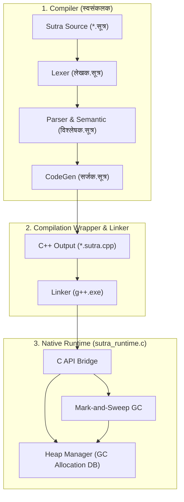

# Sutra Software Architecture & Components Layout

This document describes the high-level architecture layout, components interaction mapping, and core execution boundaries.

---

## 1. System Component Layout

Sutra execution divides compiler translation phases from runtime native boundaries:

---

## 2. Component Boundaries & Responsibilities

### 2.1 Compiler Components (Sutra-First)
-   **Lexer (`लेखक.सूत्र`)**: Converts source code stream to token streams. Implements UTF-8 Devanagari Unicode identifier checks.
-   **Parser & Semantic Analyzer (`विश्लेषक.सूत्र`)**: Performs grammatical parsing according to EBNF rules. Builds AST nodes, scopes symbol tables, and validates loops jumps contexts.
-   **CodeGen (`सर्जक.सूत्र`)**: Translates AST statements to C++ equivalents. Injects GC root push/pop statements at scope limits.

### 2.2 Runtime Components (Natively Linked)
-   **C API Bridge (`sutra_runtime.c`)**: Exposes stdio wrappers (`लिखतु`, `दर्शयतु`, `पठतु`) and math helpers to the transpiled C++ output.
-   **Heap Manager**: Manages object layouts (`GC_TYPE_STRING`, `GC_TYPE_ARRAY`, `GC_TYPE_OBJECT`, `GC_TYPE_DICTIONARY`) prefixing allocations with capacity and length headers.
-   **Garbage Collector**: Implements mark-and-sweep reclamation. Reads active variable roots registered on the shadow stack (`gc_roots`) to mark live references.

---

## 3. Verification Sources

*   **Compiler Backend**: Code generation details mapped in [`स्वसंकलक/सर्जक.सूत्र`](../../स्वसंकलक/सर्जक.सूत्र).
*   **Runtime Components**: Mapped to allocations in [`संकलक/src/compiler/sutra_runtime.c`](../../संकलक/src/compiler/sutra_runtime.c).
